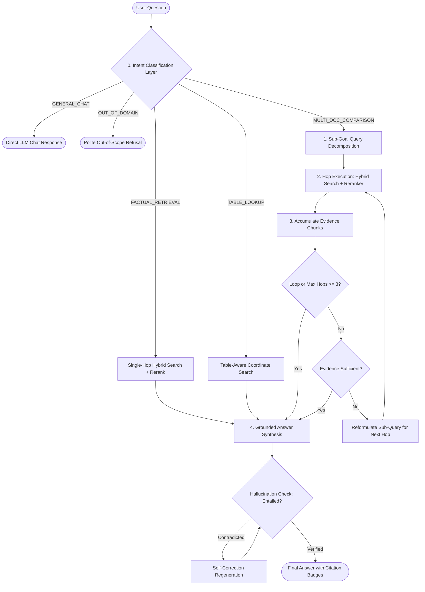

# Agentic Multi-Hop RAG & Verifiable Citations

This skill provides operational patterns for building and troubleshooting iterative multi-hop reasoning graphs powered by LangGraph, enforcing termination guardrails, formatting line-level citations, and executing the abstention protocol.

---

## 1. Multi-Hop Reasoning DAG Architecture & Intent Routing Gate

Before any vector search or multi-hop reasoning is triggered, the system runs through the **Intent Classification Layer** to determine whether RAG is necessary and choose the appropriate execution pipeline:



### Intent Routing Decision Matrix:
| Intent | Description | Vietnamese Example | Requires RAG? | Retrieval Strategy |
| :--- | :--- | :--- | :--- | :--- |
| `FACTUAL_RETRIEVAL` | Specific single-fact policy inquiry | *"Chính sách nghỉ phép là gì?"* | **Yes** | Single-hop Hybrid Search (Dense + Sparse) + Reranking |
| `MULTI_DOC_COMPARISON`| Multi-entity / comparative reasoning | *"So sánh HR và Sales"* | **Yes** | Multi-hop Iterative LangGraph DAG (Max 3 hops) |
| `TABLE_LOOKUP` | Matrix / spreadsheet / numerical data | *"Lương của Engineering là bao nhiêu?"* | **Yes** | Table-aware coordinate search (`sheet_name`, `row_range`) |
| `GENERAL_CHAT` | Conversational greetings / pleasantries | *"Xin chào"* | **No** | Direct LLM response (bypass retrieval) |
| `OUT_OF_DOMAIN` | Questions beyond corporate knowledge | *"Thời tiết hôm nay thế nào?"* | **No** | Deterministic polite refusal / out-of-scope guidance |

---

## 2. Guardrails & Loop Prevention Mechanisms

1. **Hard Hop Cap**:
   - Limit execution to a strict maximum of $\text{MaxHops} = 3$ iterations.
   - Any execution attempting a 4th hop must be forced to terminate and synthesize an answer from accumulated evidence or invoke abstention.

2. **Query Cycle / Loop Detection**:
   - Compare new sub-query embeddings against all previous sub-queries in the current session.
   - If cosine similarity $> 0.95$, terminate the retrieval loop immediately to avoid cyclic queries.

3. **Evidence Sufficiency Evaluator**:
   - Evaluate whether accumulated evidence answers all components of the original prompt.
   - If sufficient, bypass remaining hops to reduce latency and commercial token expenses.

---

## 3. Inline Citation Standards & Mapping Schema

Answers must never make assertions without verifiable evidence. Every factual statement must end with discrete citation markers:

### Markdown Output Template:
```markdown
According to corporate policy, standard employees in the Engineering department receive an on-call allowance of 3,000,000 VND/month [1]. Conversely, Sales department staff do not receive on-call allowances but are entitled to travel allowances of 2,500,000 VND/month alongside sales commission targets [2].

---
### References:
- [1] **HR_Engineering_Manual_2026.pdf** · Page 18 · Section 4.1 (On-call Allowance) · Chunk #14
- [2] **Sales_Comp_Plan_2026.docx** · Section 2 (Compensation & Allowances) · Table 1 · Chunk #09
```

### JSON Citation Contract (`message_citations` table):
```json
{
  "marker": 1,
  "document_id": "doc_9b1deb4d-3b7d-4bad-9bdd-2b0d7b3dcb6d",
  "chunk_id": "chk_c01a88b2-54a2-4a7b-a1e4-3983e2001a11",
  "page_number": 18,
  "section_heading": "4.1 On-call Allowance",
  "sheet_name": null,
  "row_range": null,
  "relevance_score": 0.942,
  "cited_text": "Section 4.1: Software engineers on on-call rotation receive an allowance of 3,000,000 VND per month."
}
```

---

## 4. Deterministic Abstention Protocol

When retrieved context is insufficient or conflicting under the user's role:
- **Refuse Speculation**: The model must never invent policies, numbers, or rules.
- **Formal Abstention Text**:
  > *"Based on the internal documents available under your permissions, there is no official policy regarding [Query Subject]. Please contact [Department Lead] for further clarification."*
- Set `is_abstained = true` on the `chat_messages` record and log an entry to `audit_logs`.

---

## 5. Hallucination Detection & NLI Self-Correction

Before presenting the answer to the user:
1. Decompose the draft answer into individual factual assertions.
2. Run NLI cross-encoder evaluation against cited chunks (`ENTAILMENT`, `NEUTRAL`, `CONTRADICTION`).
3. If any claim is classified as `CONTRADICTION`:
   - Prompt the LLM with explicit negative feedback to purge the unsupported claim.
   - Max retry limit: 2 attempts. If still ungrounded, fall back to abstention.
