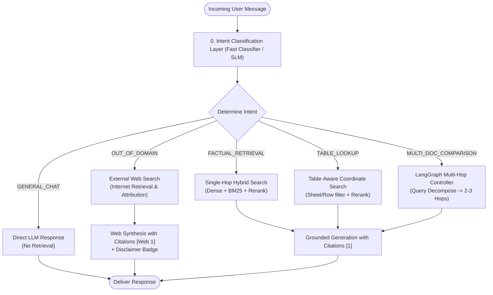

# Query Intent Classification & Routing Layer

This skill defines the operational standards, prompts, schemas, and routing logic for the **Intent Classification Layer** ("Router Layer"). It acts as the very first gate in the Enterprise Knowledge Agent pipeline, inspecting incoming questions before any database lookup, vector search, or reasoning graph execution.

---

## 1. Core Intent Taxonomies & Routing Decisions

Every user inquiry is mapped into one of five discrete intents:

| Intent | Definition | Vietnamese Example | Requires RAG? | Retrieval Strategy | Target SLA |
| :--- | :--- | :--- | :--- | :--- | :--- |
| `FACTUAL_RETRIEVAL` | Looking up a specific factual policy, regulation, employee benefit, or procedure | *"Chính sách nghỉ phép là gì?"* | **YES** | Single-hop Hybrid Search (Dense + Sparse BM25 + Cross-Encoder Reranker) | $P_{95} \le 1.5\text{s}$ |
| `MULTI_DOC_COMPARISON` | Analyzing, comparing, or synthesizing differences across multiple documents or departments | *"So sánh HR và Sales"* | **YES** | Multi-hop Iterative LangGraph DAG (Sub-goal decomposition, max 3 hops) | $P_{95} \le 5.0\text{s}$ |
| `TABLE_LOOKUP` | Querying tabular, matrix, salary bracket, or spreadsheet structured data | *"Lương của Engineering là bao nhiêu?"* | **YES** | Table-aware coordinate retrieval (filtering on `sheet_name`, `row_range`, structured chunks) | $P_{95} \le 2.0\text{s}$ |
| `GENERAL_CHAT` | Conversational greetings, gratitude, small talk, or system capabilities inquiry | *"Xin chào"*, *"Cảm ơn"* | **NO** | Direct LLM streaming response (bypasses vector DB & Reranker entirely) | $P_{95} \le 800\text{ms}$ |
| `OUT_OF_DOMAIN` | Inquiries unrelated to internal company documents, policies, or workplace matters | *"Thời tiết hôm nay thế nào?"* | **NO (Internal Docs)**<br>**YES (External Web)** | External Internet Web Search (Tavily/Bing API) + Web Citations `[Web 1]` & Disclaimer | $P_{95} \le 2.5\text{s}$ |

---

## 2. Intent Classification Layer Pipeline Flow



---

## 3. Data Contracts & Pydantic V2 Schema

In Python backend services, intent classification results must adhere to strict Pydantic models:

```python
from enum import Enum
from typing import List, Optional
from pydantic import BaseModel, Field, ConfigDict

class QueryIntent(str, Enum):
    FACTUAL_RETRIEVAL = "FACTUAL_RETRIEVAL"
    MULTI_DOC_COMPARISON = "MULTI_DOC_COMPARISON"
    TABLE_LOOKUP = "TABLE_LOOKUP"
    GENERAL_CHAT = "GENERAL_CHAT"
    OUT_OF_DOMAIN = "OUT_OF_DOMAIN"

class IntentClassificationResult(BaseModel):
    model_config = ConfigDict(frozen=True)

    intent: QueryIntent = Field(
        ...,
        description="The primary identified user intent among the 5 supported classes."
    )
    confidence: float = Field(
        ...,
        ge=0.0,
        le=1.0,
        description="Confidence score of the classification decision."
    )
    requires_rag: bool = Field(
        ...,
        description="Flag indicating if vector DB search and document retrieval are needed."
    )
    needs_multi_hop: bool = Field(
        ...,
        description="True if query requires sub-goal decomposition and multiple search hops."
    )
    target_departments: List[str] = Field(
        default_factory=list,
        description="Extracted department filters (e.g., ['HR', 'Sales', 'Engineering'])."
    )
    reasoning: Optional[str] = Field(
        None,
        description="Brief justification for the classification decision."
    )
```

---

## 4. Classification Prompt & Few-Shot Templates

The intent classification prompt must be lightweight, fast, and output strict JSON:

```yaml
system_prompt: |
  Bạn là Router Layer chuyên phân loại ý định (Intent Classification) cho hệ thống Enterprise Knowledge Agent.
  Nhiệm vụ của bạn là phân loại câu hỏi của người dùng vào chính xác 1 trong 5 loại sau:
  
  1. FACTUAL_RETRIEVAL:
     - Tìm kiếm thông tin hoặc quy định cụ thể trong tài liệu nội bộ (chính sách, quy chế, hướng dẫn, quyền lợi).
     - requires_rag: true, needs_multi_hop: false
     - Ví dụ: "Chính sách nghỉ phép là gì?", "Quy trình xin cấp thẻ xe thế nào?"
  
  2. MULTI_DOC_COMPARISON:
     - So sánh, tổng hợp hoặc đối chiếu giữa nhiều tài liệu, phòng ban, chính sách hoặc đối tượng khác nhau.
     - requires_rag: true, needs_multi_hop: true
     - Ví dụ: "So sánh HR và Sales", "Chính sách thưởng của khối kỹ thuật khác gì khối kinh doanh?"
  
  3. TABLE_LOOKUP:
     - Tra cứu thông tin dạng bảng, ma trận số liệu, bậc lương, ngân sách, bảng biểu kỹ thuật.
     - requires_rag: true, needs_multi_hop: false
     - Ví dụ: "Lương của Engineering là bao nhiêu?", "Bảng phân bổ ngân sách Q3 phòng IT?"
  
  4. GENERAL_CHAT:
     - Chào hỏi xã giao, cảm ơn, hỏi thăm thông thường hoặc câu hỏi về khả năng của trợ lý.
     - requires_rag: false, needs_multi_hop: false
     - Ví dụ: "Xin chào", "Chào bạn", "Cảm ơn em nhé", "Bạn có thể làm được gì?"
  
  5. OUT_OF_DOMAIN:
     - Câu hỏi hoàn toàn ngoài phạm vi doanh nghiệp/công việc nội bộ (thời tiết, thể thao, địa lý, chính trị, kiến thức phổ thông không liên quan đến công ty).
     - requires_rag: false (internal docs), triggers_web_search: true
     - Ví dụ: "Thời tiết hôm nay thế nào?", "Thủ đô của Úc là gì?", "Ai vô địch Cúp C1 năm 2024?"

  Hãy trả về định dạng JSON thuần túy theo cấu trúc:
  {
    "intent": "FACTUAL_RETRIEVAL" | "MULTI_DOC_COMPARISON" | "TABLE_LOOKUP" | "GENERAL_CHAT" | "OUT_OF_DOMAIN",
    "confidence": float,
    "requires_rag": boolean,
    "needs_multi_hop": boolean,
    "target_departments": string[],
    "reasoning": string
  }
```

---

## 5. Execution Rules & Fail-Safe Fallback

1. **Pre-Retrieval Execution**:
   - The intent layer must run **before** query embedding generation, Qdrant payload queries, or PostgreSQL searches.
   - For `GENERAL_CHAT`, skip all retrieval calls and route directly to conversational LLM.
   - For `OUT_OF_DOMAIN`, bypass internal enterprise databases and invoke the **External Web Search Engine** (Tavily, Bing, Serper) with real-time web grounding and citation badges `[Web 1]`.

2. **Latency Budget**:
   - Intent classification should complete in $\le 200\text{ms}$.
   - Can be served via a lightweight SLM, fast LLM call (e.g. `gpt-4o-mini`, `gemini-1.5-flash`), or fine-tuned text classifier.

3. **Fallback on Ambiguity**:
   - If confidence $< 0.60$ or classification fails, default conservatively to `FACTUAL_RETRIEVAL` with `requires_rag = true` to prevent dropping legitimate enterprise questions.
