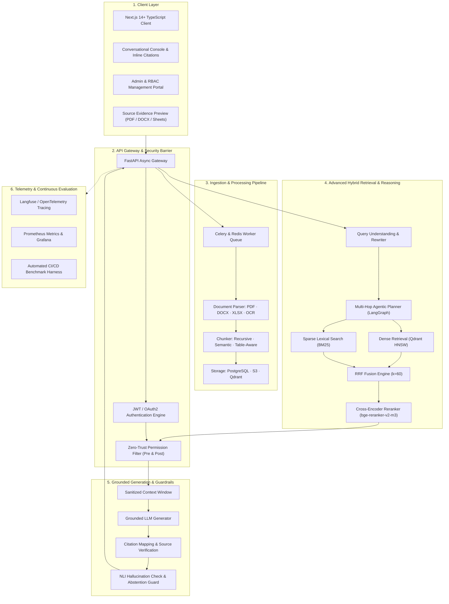

# Enterprise Knowledge Agent – Permission-Aware Advanced RAG Platform

[](#)
[](#)
[](#)
[](#)
[](#)
[](#)

An enterprise-grade, permission-aware conversational AI platform designed to securely manage, search, analyze, and query corporate knowledge from internal documents through a verifiable, natural-language interface.

---

## 🌟 Executive Summary

Traditional enterprise search and generic RAG prototypes fail in business environments due to three critical flaws: **hallucinations without verifiable sources**, **inability to answer multi-hop questions**, and **disregard for organizational permissions**, which risks catastrophic data leaks.

The **Enterprise Knowledge Agent** solves these challenges by combining:
1. **Multi-Format Ingestion with Absolute Lineage:** Parses PDF, DOCX, XLSX, and scanned files (OCR) down to page, heading, and cell coordinates.
2. **Hybrid Search & Cross-Encoder Reranking:** Merges dense vector embeddings (`bge-m3`, `Qdrant`) with sparse keyword matching (`BM25`) via Reciprocal Rank Fusion (RRF) and cross-attention reranking.
3. **Multi-Hop Agentic Reasoning:** Employs LangGraph-based iterative decomposition to solve complex multi-document queries without falling into infinite retrieval loops.
4. **Zero-Trust Permission-Aware Retrieval:** Role-Based Access Control (RBAC) and department-level filters are enforced *during* vector search and re-validated *prior* to context assembly.
5. **Grounded Generation & Verifiable Citation:** Produces inline citations `[1]` with direct preview links and enforces strict abstention when evidence is missing.
6. **Scientific Benchmark & Self-Evaluation:** Includes a 300-sample quantitative evaluation suite measuring Faithfulness, Recall@K, nDCG@10, and an 8-experiment Ablation Study (E1–E8).

---

## 🏛️ System Architecture



---

## 📦 The 10 Core Technical Modules

| Module | Core Responsibility | Key Technologies & Specifications |
| :--- | :--- | :--- |
| **1. Document Ingestion & Processing** | Parse, chunk, deduplicate, and preserve line-level provenance. | `pdfplumber`, `python-docx`, `openpyxl`, Tesseract OCR, MinHash LSH, SHA-256 deduplication. |
| **2. Embedding & Vector Database** | Multilingual semantic embedding & high-throughput vector store. | `Qdrant`, HNSW (`m=16, ef_construct=128`), `bge-m3`, `multilingual-e5-large`, Redis vector cache. |
| **3. Hybrid Search & Fusion** | Eliminate keyword and semantic blindspots. | Parallel Dense + BM25, Reciprocal Rank Fusion ($k=60$), configurable weight tuning. |
| **4. Query Understanding & Rewriting** | Decompose, expand, and classify queries before retrieval. | Query normalization, intent classification, coreference resolution, domain synonym expansion. |
| **5. Cross-Encoder Reranking** | Deep cross-attention passage relevance scoring. | `BAAI/bge-reranker-v2-m3`, `jina-reranker-v2-base`, MRR/nDCG tracking, graceful fallback. |
| **6. Multi-Hop Retrieval & Agentic RAG**| Iterative multi-document reasoning. | LangGraph DAG controller, evidence accumulation, query loop detection, max 3-hop termination. |
| **7. Grounded Generation & Citation** | Zero hallucination, inline citation badges, strict abstention. | Formatted citation schema `[1]`, document/page/section mapping, deterministic refusal when ungrounded. |
| **8. Permission-Aware Security** | Enforce enterprise RBAC at query time. | Qdrant payload pre-filtering, PostgreSQL post-validation, document/department/user ACLs, audit logs. |
| **9. Hallucination Detection & Self-Eval**| Automated post-generation verification barrier. | Claim decomposition, cross-encoder NLI entailment verification, automatic regeneration loop. |
| **10. Backend & Observability** | Enterprise async infrastructure and telemetry. | Python FastAPI, Next.js, PostgreSQL, Celery/Redis, Prometheus, Grafana, Langfuse tracing. |

---

## 📊 Evaluation & Benchmark Highlights

Unlike typical CRUD RAG implementations, this platform is calibrated against a formal **300-sample enterprise benchmark**:

### 1. Benchmark Composition
- **Simple Factual Retrieval (25%):** Exact keyword and handbook lookups.
- **Semantic Retrieval (15%):** Conceptual questions with high lexical divergence.
- **Multi-Document Reasoning (20%):** Comparing policies across separate departments.
- **Multi-Hop Questions (15%):** Dependent iterative search trajectories.
- **Numerical / Table QA (10%):** Complex tabular calculations from Excel/Word.
- **Unanswerable Questions (10%):** Tests strict abstention without guessing.
- **Permission-Sensitive Questions (5%):** Tests unauthorized access blockage.

### 2. Target Production SLAs
- **Retrieval:** Recall@5 $\ge 80\%$, Recall@10 $\ge 90\%$, MRR@10 $\ge 0.75$, nDCG@10 $\ge 0.80$.
- **Generation:** Faithfulness $\ge 0.90$, Answer Correctness $\ge 0.80$, Citation Accuracy $\ge 0.95$, Abstention Accuracy $\ge 0.90$.
- **Latency:** Single-hop retrieval $P_{95} \le 1.5\text{s}$, Total answer $P_{95} \le 10\text{s}$.

### 3. Scientific Ablation Study Matrix (E1 to E8)
The project validates performance across 8 distinct architectural configurations:
- **E1:** Dense Retrieval Only (`bge-m3`)
- **E2:** Sparse Retrieval Only (BM25)
- **E3:** Hybrid Retrieval (Dense + BM25 via RRF)
- **E4:** Hybrid + Cross-Encoder Reranking
- **E5:** Hybrid + Query Rewriting
- **E6:** Hybrid + Reranking + Query Rewriting
- **E7:** Multi-Hop Agentic RAG
- **E8:** Full Pipeline + Permission-Aware Filtering (Production Baseline)

---

## 🗺️ Implementation Priorities & Roadmap

Development is organized into three sequential phases to ensure a stable MVP before layering complex agentic reasoning:

```
[Phase 1: Core RAG MVP]
  └── Document Ingestion (PDF, DOCX, XLSX)
  └── Qdrant Vector DB & Embedding Pipeline
  └── Hybrid Search (Dense + BM25 via RRF)
  └── Cross-Encoder Reranking
  └── Answer Generation with Verifiable Citations

[Phase 2: Advanced RAG]
  └── Query Rewriting & Decomposition
  └── Multi-Hop Agentic Reasoning (LangGraph)
  └── Pre-Retrieval & Post-Validation RBAC
  └── Hallucination Detection & NLI Self-Correction

[Phase 3: Production & Evaluation]
  └── Next.js 14 Admin Portal & Usage Analytics
  └── 300-Sample Benchmark Suite & Ablation Experiments
  └── Observability (Langfuse + Prometheus + Grafana)
  └── Multi-Tenant Hardening & Compliance Audits
```

---

## 📖 Comprehensive Documentation

For complete, granular specifications, explore the dedicated documentation suite:

- 📘 [**Technical Requirements Document (TRD)**](file:///home/mercury/AgentGraph/docs/specifications/technical_requirements.md): Deep-dive specs for all 10 modules, API schemas, and data models.
- 📗 [**Non-Technical & Business Requirements (NFR)**](file:///home/mercury/AgentGraph/docs/specifications/non_technical_requirements.md): Business goals, 30 NFRs (Usability, Performance, Security, Scalability, Operations), and UX standards.
- 🔬 [**Evaluation & Benchmark Specifications**](file:///home/mercury/AgentGraph/docs/specifications/evaluation_and_benchmark.md): Dataset schema, mathematical formulas for metrics, and experimental protocols.
- 📑 [**Docs Overview Hub**](file:///home/mercury/AgentGraph/docs/README.md): System index, architecture guides, and navigation hub.

---

## 🛠️ Technology Stack Summary

- **Frontend:** Next.js 14+ (App Router), TypeScript, Tailwind CSS, Monaco Editor, PDF.js
- **Backend:** Python 3.11+, FastAPI, Pydantic v2
- **Vector Database:** Qdrant v1.8+ (HNSW index, payload filters)
- **Relational Storage:** PostgreSQL 16+
- **Task Queue & Cache:** Celery, Redis
- **Models:** `BAAI/bge-m3` (Embedding), `BAAI/bge-reranker-v2-m3` (Reranking), Local / API LLM
- **Observability:** Langfuse, Prometheus, Grafana, OpenTelemetry
