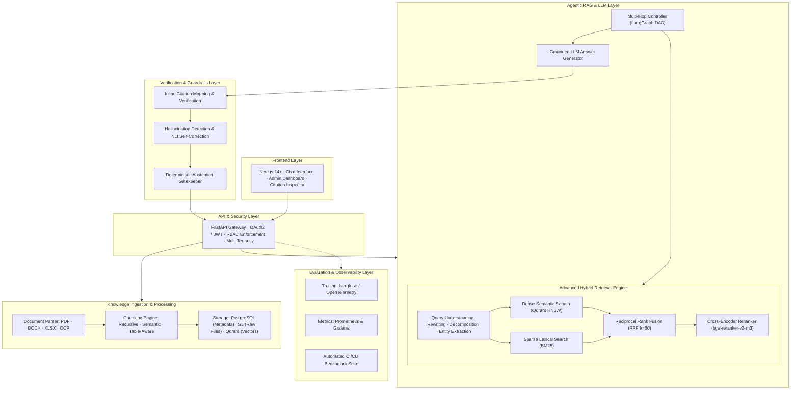
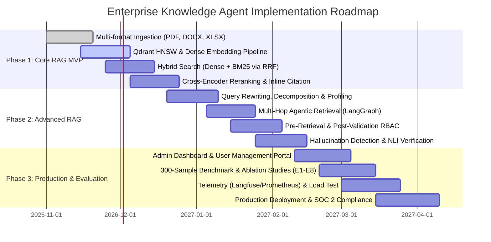

# Enterprise Knowledge Agent – Permission-Aware Advanced RAG Platform
## Documentation Hub

Welcome to the centralized documentation repository for the **Enterprise Knowledge Agent**. This platform is an enterprise-grade, permission-aware conversational AI ecosystem designed to securely ingest, index, retrieve, reason over, and synthesize organizational knowledge from heterogeneous enterprise documents with line-level source verification.

---

## 📚 Documentation Directory

The documentation suite is structured into three specialized architectural specifications:

| Document | Primary Scope | Target Audience |
| :--- | :--- | :--- |
| 📘 [**Technical Requirements Document (TRD)**](file:///home/mercury/AgentGraph/docs/technical_requirements.md) | In-depth specifications for all **10 technical modules**: Document Ingestion, Embedding & Vector DB (Qdrant), Hybrid Search (BM25 + Dense + RRF), Query Processing, Cross-Encoder Reranking, Multi-Hop Agentic RAG, Verifiable Citations, RBAC Security, Hallucination Detection, and FastAPI/Next.js/Telemetry Infrastructure. | Solution Architects, Backend Engineers, AI/ML Engineers, DevOps |
| 📗 [**Non-Technical & Business Requirements (NFR)**](file:///home/mercury/AgentGraph/docs/non_technical_requirements.md) | Business context, enterprise user personas (HR, Finance, Engineering, Legal), comprehensive catalog of **30 Non-Functional Requirements (NFR-01 to NFR-30)**, 3-panel UI/UX standards, and data privacy governance. | Product Managers, Business Analysts, UX Designers, Security Auditors |
| 🔬 [**Evaluation & Benchmark Specification**](file:///home/mercury/AgentGraph/docs/evaluation_and_benchmark.md) | Quantitative evaluation framework: 300-sample benchmark dataset distribution, Retrieval metrics (Recall@K, MRR, nDCG), Generation metrics (Faithfulness, Citation Accuracy), **Ablation Studies (E1 to E8)**, and automated CI/CD evaluation harness. | AI Researchers, QA Leads, Evaluation Engineers |
| 🛠️ [**End-to-End Implementation Workflow**](file:///home/mercury/AgentGraph/docs/end_to_end_workflow.md) | Full phased execution roadmap spanning **Phase 1 (ERD / Relational Schema & Vector Payloads)** through **Phase 8 (Production Web Service, 3-Panel UI, and E2E Benchmarks)** with quality gates and deliverables. | Full-Stack Engineers, ML Engineers, Project Managers |
| 🗄️ [**Database Setup & Operations Guide**](file:///home/mercury/AgentGraph/docs/database_setup.md) | PostgreSQL 16+ pgvector configuration, Conda `ml-env` native server, Docker Compose stack, and Prisma ORM migration operations. | Backend Engineers, Database Administrators, DevOps |
| 📝 [**Task 01: Database Infrastructure Report**](file:///home/mercury/AgentGraph/docs/task_01_database_infrastructure.md) | Implementation report for Task 01: PostgreSQL 16+ initialization, Prisma setup, `npm install` hang root cause analysis & fix, and verification results. | Solution Architects, Evaluators, Engineering Leads |
| 👥 [**Task 02: Multi-Tenant IAM Core Report**](file:///home/mercury/AgentGraph/docs/task_02_multi_tenant_iam_core.md) | Implementation report for Task 02: Multi-tenant relational persistence, User, Tenant, Role, Department hierarchy, and cascade rules. | Backend Engineers, Security Architects |
| 🛡️ [**Task 03: RBAC & Permission Management Report**](file:///home/mercury/AgentGraph/docs/task_03_rbac_permission_management.md) | Implementation report for Task 03: Granular RBAC, Permission catalog, RolePermission, UserRole audit tracking, and PostgreSQL tenant isolation triggers. | Security Engineers, Backend Architects |
| 🔑 [**Task 04: Authentication & Session Management Report**](file:///home/mercury/AgentGraph/docs/task_04_authentication_session_management.md) | Implementation report for Task 04: Secure Session model, token hashing, INET IP tracking, multi-device sessions, explicit revocation, and zero-trust cross-tenant triggers. | Security Engineers, Full-Stack Architects, Backend Leads |
| 📜 [**Task 05: Enterprise Audit Logging Report**](file:///home/mercury/AgentGraph/docs/task_05_enterprise_audit_logging.md) | Implementation report for Task 05: Immutable AuditLog model, structured JSON metadata, user & system actors, historical retention (onDelete: SetNull), and zero-trust isolation triggers. | Security Engineers, Compliance Officers, Backend Architects |
| 📄 [**Task 06: Document Metadata & Classification Report**](file:///home/mercury/AgentGraph/docs/task_06_document_metadata_classification.md) | Implementation report for Task 06: Core Document model, DocumentClassification & DocumentIngestionStatus enums, tenant-aware SHA-256 deduplication, soft-deletion sensitivity, and zero-trust triggers. | Backend Engineers, Security Architects, ML Engineers |
| 🗃️ [**Task 07: Document Versioning & Historical Lineage Report**](file:///home/mercury/AgentGraph/docs/task_07_document_versioning_historical_lineage.md) | Implementation report for Task 07: DocumentVersion model, unique version sequencing, dual current-version identification, historical metadata immutability, zero-trust triggers, and lineage chunk isolation. | Backend Engineers, Security Architects, ML Engineers |

---

## 🏛️ System Architecture Synthesis

---

## 🗺️ Phased Implementation Roadmap

To ensure agile delivery and mitigate deployment risk, development is segmented into three distinct phases:

### Milestone Deliverables:
- **Phase 1 (Core RAG MVP):** Ingest documents $\to$ Chunking $\to$ Qdrant Embeddings $\to$ Hybrid Retrieval $\to$ Reranker $\to$ Answer Generation with verifiable inline citation badges.
- **Phase 2 (Advanced RAG):** Query rewriting $\to$ Iterative multi-hop reasoning $\to$ Strict three-tier RBAC pre/post filtering $\to$ Self-evaluation and hallucination mitigation.
- **Phase 3 (Production & Evaluation):** Complete Next.js Admin portal $\to$ 300-sample quantitative benchmark suite $\to$ Full observability stack (Langfuse + Grafana) $\to$ Production hardening.

---

## 🔗 Quick Navigation Links

- [Detailed Technical Specifications (Modules 1–10)](file:///home/mercury/AgentGraph/docs/technical_requirements.md)
- [Non-Technical & Business Requirements (NFR-01 to NFR-30)](file:///home/mercury/AgentGraph/docs/non_technical_requirements.md)
- [Benchmark Dataset, Metrics & Ablation Studies](file:///home/mercury/AgentGraph/docs/evaluation_and_benchmark.md)
- [Database Setup & Operations Guide](file:///home/mercury/AgentGraph/docs/database_setup.md)
- [Task 01: Database Infrastructure Implementation Report](file:///home/mercury/AgentGraph/docs/task_01_database_infrastructure.md)
- [Task 02: Multi-Tenant IAM Core Implementation Report](file:///home/mercury/AgentGraph/docs/task_02_multi_tenant_iam_core.md)
- [Task 03: RBAC & Permission Management Implementation Report](file:///home/mercury/AgentGraph/docs/task_03_rbac_permission_management.md)
- [Task 04: Authentication & Session Management Implementation Report](file:///home/mercury/AgentGraph/docs/task_04_authentication_session_management.md)
- [Task 05: Enterprise Audit Logging Implementation Report](file:///home/mercury/AgentGraph/docs/task_05_enterprise_audit_logging.md)
- [Database Schema (Prisma)](file:///home/mercury/AgentGraph/backend/schema.prisma)
