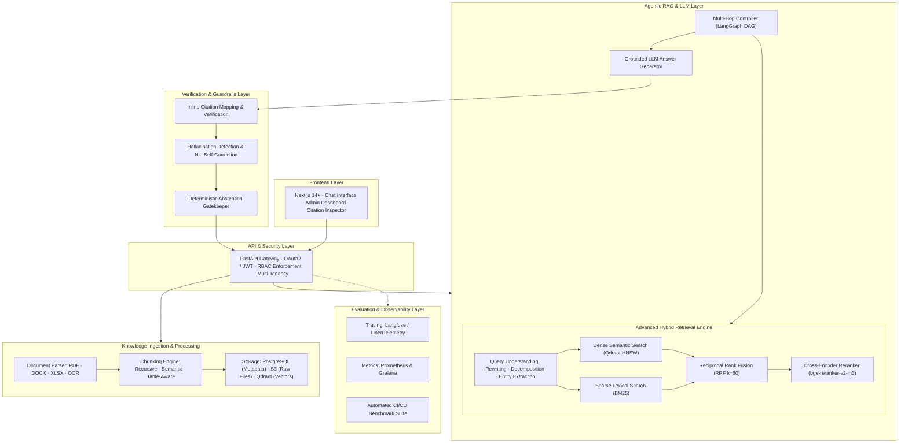
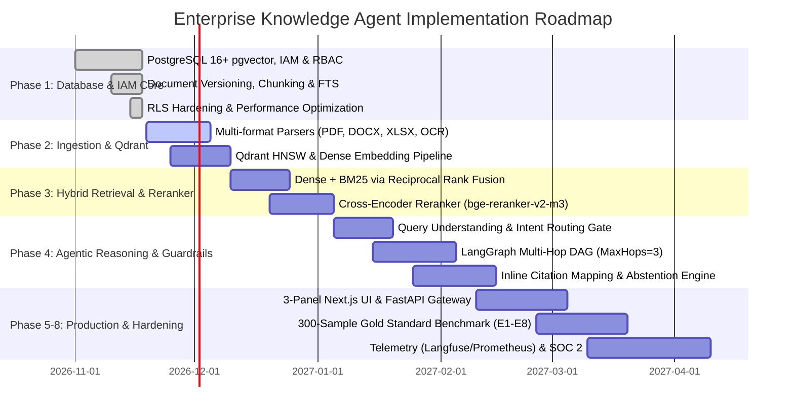

# Enterprise Knowledge Agent – Documentation Hub

Welcome to the centralized documentation repository for the **Enterprise Knowledge Agent**. This platform is an enterprise-grade, permission-aware conversational AI ecosystem designed to securely ingest, index, retrieve, reason over, and synthesize organizational knowledge from heterogeneous enterprise documents with line-level source verification.

---

## 📁 Documentation Architecture & Directory Layout

To ensure clarity and maintainability, all documentation is organized into 4 distinct, modular categories:

```
docs/
├── README.md                      # Central Documentation Index & Navigation Hub (this file)
│
├── specifications/                # Product, Technical & Benchmark Specifications
│   ├── technical_requirements.md  # TRD: 10 Core Architectural Modules
│   ├── non_technical_requirements.md # NFR: 30 Non-Functional Requirements, Personas, UX
│   ├── evaluation_and_benchmark.md # 300-sample benchmark, metrics, ablation studies (E1-E8)
│   └── end_to_end_workflow.md     # 8-Phase implementation roadmap
│
├── architecture/                  # Deep-Dive System & Database Architecture
│   ├── database_relationships.md  # Relational ERD, foreign keys, cascade rules & lineage
│   ├── tenant_isolation.md        # Three-tier zero-trust multi-tenancy & RLS architecture
│   └── technical_limitations.md   # Architectural trade-offs, boundaries & mitigations
│
├── database/                      # Database Operations & Performance Runbooks
│   ├── database_setup.md          # Setup guide (PostgreSQL 16+, pgvector, Conda, Docker, Prisma)
│   ├── migration_execution_report.md # Chronological migration inventory & validation runbook
│   └── indexing_and_optimization_report.md # Query plans, partial indexes & GIN deduplication
│
└── phases/                        # Phased Implementation & Verification Deliverables
    └── phase_1/                   # Phase 1: Database Infrastructure & Foundations (Tasks 01–10)
        ├── task_01_database_infrastructure.md
        ├── task_02_multi_tenant_iam_core.md
        ├── task_03_rbac_permission_management.md
        ├── task_04_authentication_session_management.md
        ├── task_05_enterprise_audit_logging.md
        ├── task_06_document_metadata_classification.md
        ├── task_07_document_versioning_historical_lineage.md
        ├── task_09_postgresql_full_text_search_infrastructure.md
        └── task_10_database_security_performance_optimization.md
```

---

## 📚 Document Catalog

### 1. Specifications (`docs/specifications/`)
Core functional and non-functional specifications defining the requirements, metrics, and workflows of the platform.

| Document | Primary Scope | Target Audience |
| :--- | :--- | :--- |
| 📘 [**Technical Requirements Document (TRD)**](file:///home/mercury/AgentGraph/docs/specifications/technical_requirements.md) | In-depth specifications for all **10 technical modules**: Document Ingestion, Embedding & Vector DB (Qdrant), Hybrid Search (BM25 + Dense + RRF), Query Processing, Cross-Encoder Reranking, Multi-Hop Agentic RAG, Verifiable Citations, RBAC Security, Hallucination Detection, and FastAPI/Next.js/Telemetry Infrastructure. | Solution Architects, Backend Engineers, AI/ML Engineers, DevOps |
| 📗 [**Non-Technical & Business Requirements (NFR)**](file:///home/mercury/AgentGraph/docs/specifications/non_technical_requirements.md) | Business context, enterprise user personas (HR, Finance, Engineering, Legal), comprehensive catalog of **30 Non-Functional Requirements (NFR-01 to NFR-30)**, 3-panel UI/UX standards, and data privacy governance. | Product Managers, Business Analysts, UX Designers, Security Auditors |
| 🔬 [**Evaluation & Benchmark Specification**](file:///home/mercury/AgentGraph/docs/specifications/evaluation_and_benchmark.md) | Quantitative evaluation framework: 300-sample benchmark dataset distribution, Retrieval metrics (Recall@K, MRR, nDCG), Generation metrics (Faithfulness, Citation Accuracy), **Ablation Studies (E1 to E8)**, and automated CI/CD evaluation harness. | AI Researchers, QA Leads, Evaluation Engineers |
| 🛠️ [**End-to-End Implementation Workflow**](file:///home/mercury/AgentGraph/docs/specifications/end_to_end_workflow.md) | Full phased execution roadmap spanning **Phase 1 (ERD / Relational Schema & Vector Payloads)** through **Phase 8 (Production Web Service, 3-Panel UI, and E2E Benchmarks)** with quality gates and deliverables. | Full-Stack Engineers, ML Engineers, Project Managers |

---

### 2. Architecture Deep Dives (`docs/architecture/`)
Architectural design documents detailing relational schemas, multi-tenant security barriers, and known constraints.

| Document | Primary Scope | Target Audience |
| :--- | :--- | :--- |
| 🗄️ [**Database Relationships & Lineage**](file:///home/mercury/AgentGraph/docs/architecture/database_relationships.md) | Detailed relational schema, foreign key hierarchies, referential cascade actions, document versioning, and chunk lineage tracking. | Backend Engineers, Database Architects |
| 🛡️ [**Tenant Isolation & Zero-Trust Security**](file:///home/mercury/AgentGraph/docs/architecture/tenant_isolation.md) | Three-tier isolation architecture: Relational scoping, cross-tenant integrity triggers, and PostgreSQL Row-Level Security (RLS) policies. | Security Engineers, Compliance Officers, Backend Architects |
| ⚠️ [**Technical Limitations & Trade-offs**](file:///home/mercury/AgentGraph/docs/architecture/technical_limitations.md) | Operational boundaries, ORM limitations, vector DB scaling constraints, and downstream mitigation strategies. | Solution Architects, Engineering Leads |

---

### 3. Database Operations & Optimization (`docs/database/`)
Practical guides and reports for provisioning, maintaining, and optimizing the persistence layer.

| Document | Primary Scope | Target Audience |
| :--- | :--- | :--- |
| ⚙️ [**Database Setup & Operations Guide**](file:///home/mercury/AgentGraph/docs/database/database_setup.md) | PostgreSQL 16+ pgvector configuration, Conda `ml-env` native server, Docker Compose stack, and Prisma ORM migration operations. | Backend Engineers, Database Administrators, DevOps |
| 📜 [**Migration Execution & Validation Report**](file:///home/mercury/AgentGraph/docs/database/migration_execution_report.md) | Chronological migration inventory (Tasks 01–10), zero-error execution proof, rollback validations, and clean database benchmark replication. | DevOps, Database Administrators, Lead Engineers |
| ⚡ [**Indexing & Query Performance Optimization Report**](file:///home/mercury/AgentGraph/docs/database/indexing_and_optimization_report.md) | Complete index inventory by model, redundant GIN index elimination, partial index architecture, and query plan benchmarks. | Database Administrators, Backend Engineers |

---

### 4. Phase 1 Implementation Reports (`docs/phases/phase_1/`)
Detailed task completion reports tracking implementation progress across Phase 1: Database Infrastructure & Foundations.

| Task Report | Focus Area | Key Deliverables |
| :--- | :--- | :--- |
| 📝 [**Task 01: Database Infrastructure**](file:///home/mercury/AgentGraph/docs/phases/phase_1/task_01_database_infrastructure.md) | Infrastructure Setup | PostgreSQL 16+ pgvector initialization, Prisma setup, network hang fixes |
| 👥 [**Task 02: Multi-Tenant IAM Core**](file:///home/mercury/AgentGraph/docs/phases/phase_1/task_02_multi_tenant_iam_core.md) | Multi-Tenancy & IAM | User, Tenant, Role, Department hierarchy, cascade rules |
| 🛡️ [**Task 03: RBAC & Permission Management**](file:///home/mercury/AgentGraph/docs/phases/phase_1/task_03_rbac_permission_management.md) | Access Control | Granular RBAC, Permission catalog, RolePermission, cross-tenant triggers |
| 🔑 [**Task 04: Authentication & Session Management**](file:///home/mercury/AgentGraph/docs/phases/phase_1/task_04_authentication_session_management.md) | Session Security | Secure Session model, token hashing, INET IP tracking, multi-device revocation |
| 📜 [**Task 05: Enterprise Audit Logging**](file:///home/mercury/AgentGraph/docs/phases/phase_1/task_05_enterprise_audit_logging.md) | Compliance & Audit | Immutable AuditLog model, structured JSON metadata, retention policies |
| 📄 [**Task 06: Document Metadata & Classification**](file:///home/mercury/AgentGraph/docs/phases/phase_1/task_06_document_metadata_classification.md) | Document Management | Core Document model, classification enums, tenant-aware SHA-256 deduplication |
| 🗃️ [**Task 07: Document Versioning & Lineage**](file:///home/mercury/AgentGraph/docs/phases/phase_1/task_07_document_versioning_historical_lineage.md) | Version Control | DocumentVersion model, version sequencing, dual current-version identification |
| 🔍 [**Task 09: Full-Text Search Infrastructure**](file:///home/mercury/AgentGraph/docs/phases/phase_1/task_09_postgresql_full_text_search_infrastructure.md) | Lexical Search | GIN index on `to_tsvector('simple', content)`, websearch query parsing, RBAC filtering |
| 🚀 [**Task 10: Security & Performance Optimization**](file:///home/mercury/AgentGraph/docs/phases/phase_1/task_10_database_security_performance_optimization.md) | Hardening & Benchmarking | RLS multi-tenant policies, partial indexing, duplicate GIN removal, clean DB validation |

---

## 🏛️ System Architecture Synthesis



---

## 🗺️ Phased Implementation Roadmap

Development is segmented into eight distinct phases:



---

## 🔗 Quick Links

- [Database Schema (`backend/schema.prisma`)](file:///home/mercury/AgentGraph/backend/schema.prisma)
- [Root Workspace Overview (`README.md`)](file:///home/mercury/AgentGraph/README.md)
