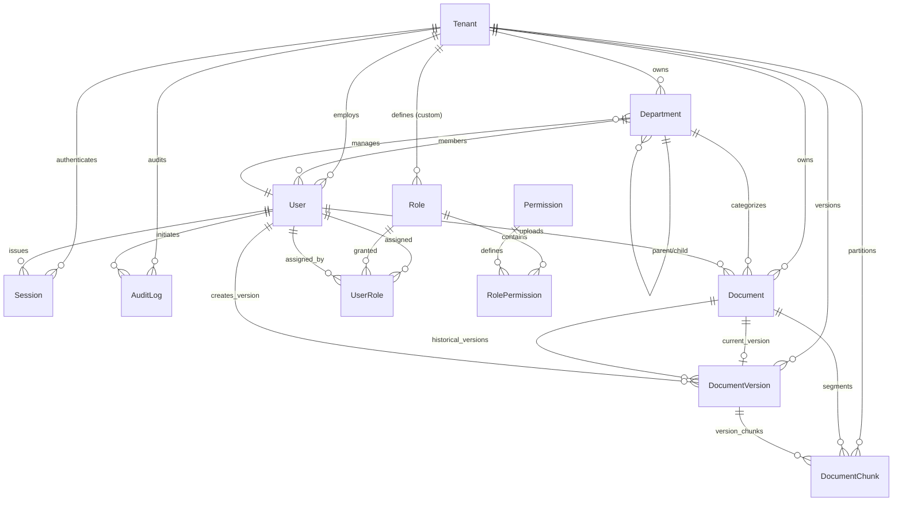

# Enterprise Knowledge Agent – Database Relationship & Lineage Architecture

**Phase**: 1 – Database Infrastructure & Foundations  
**Task**: 10 – Database Security, Performance Optimization & Final Validation  
**Database**: PostgreSQL 16+ with `pgvector` & GIN Full-Text Search Extensions  
**ORM**: Prisma 5.22.0 (`@prisma/client`)

---

## 1. Executive Summary

This document provides a comprehensive specification of the relational schema, foreign key hierarchies, referential actions, and historical lineage tracking within the **Enterprise Knowledge Agent** database architecture.

The database is designed around a **Zero-Trust Multi-Tenant Core**, where every entity (except global canonical permissions and infrastructure health metrics) is strictly partitioned by `tenant_id`. Referential integrity is enforced at both the relational foreign key layer and via PostgreSQL database triggers, guaranteeing that cross-tenant foreign key relationships are strictly impossible.

---

## 2. Entity-Relationship Overview

---

## 3. Relational Entities & Relationship Specifications

### 3.1. Infrastructure & Health

#### `DatabaseHealth` (`database_health`)
- **Purpose**: Low-overhead database liveness and connectivity probes for Kubernetes / load balancers.
- **Tenancy**: Global unowned infrastructure entity.
- **Relationships**: None.

---

### 3.2. Multi-Tenant Identity & Access Management (IAM)

#### `Tenant` (`tenants`)
- **Primary Key**: `id` (`UUID`, default `gen_random_uuid()`)
- **Unique Constraints**: `slug` (`VARCHAR(100) UNIQUE`)
- **Check Constraints**: `slug ~ '^[a-z0-9-]+$'` (lowercase alphanumeric and hyphens)
- **Relationships (1:N)**:
  - `departments`: All organizational units within the tenant (`ON DELETE CASCADE`).
  - `users`: All user accounts within the tenant (`ON DELETE CASCADE`).
  - `roles`: Tenant-scoped custom authorization roles (`ON DELETE CASCADE`).
  - `sessions`: Active and historical user authentication sessions (`ON DELETE CASCADE`).
  - `auditLogs`: Tamper-evident governance audit trail (`ON DELETE CASCADE`).
  - `documents`: Ingested documents and knowledge assets (`ON DELETE CASCADE`).
  - `documentVersions`: Version snapshots of documents (`ON DELETE CASCADE`).
  - `documentChunks`: Extracted textual and citation chunks (`ON DELETE CASCADE`).

#### `Department` (`departments`)
- **Primary Key**: `id` (`UUID`)
- **Foreign Keys**:
  - `tenant_id` -> `tenants(id)` (`ON DELETE CASCADE`, `ON UPDATE CASCADE`)
  - `parent_id` -> `departments(id)` (`ON DELETE SET NULL`, `ON UPDATE CASCADE`)
  - `manager_id` -> `users(id)` (`ON DELETE SET NULL`, `ON UPDATE CASCADE`)
- **Composite Unique**: `(tenant_id, name)`
- **Check Constraints**: `parent_id IS NULL OR parent_id != id` (Prevents direct self-loop)
- **Cross-Tenant Validation**: Trigger `enforce_department_tenant_isolation` verifies:
  1. `parent.tenant_id == NEW.tenant_id`
  2. `manager.tenant_id == NEW.tenant_id`

#### `User` (`users`)
- **Primary Key**: `id` (`UUID`)
- **Foreign Keys**:
  - `tenant_id` -> `tenants(id)` (`ON DELETE CASCADE`, `ON UPDATE CASCADE`)
  - `department_id` -> `departments(id)` (`ON DELETE SET NULL`, `ON UPDATE CASCADE`)
- **Composite Unique**: `(tenant_id, email)`
- **Check Constraints**: `length(trim(email)) >= 3 AND email LIKE '%@%'`
- **Cross-Tenant Validation**: Trigger `enforce_user_department_tenant_isolation` verifies `department.tenant_id == NEW.tenant_id`.

#### `Role` (`roles`)
- **Primary Key**: `id` (`UUID`)
- **Foreign Keys**:
  - `tenant_id` -> `tenants(id)` (`ON DELETE CASCADE`, `ON UPDATE CASCADE`, Nullable for `SYSTEM` scope)
- **Composite Unique**: `(tenant_id, name)`
- **Partial Unique**: `system_roles_name_key` on `(name)` WHERE `tenant_id IS NULL` (Ensures global uniqueness for system roles).
- **Scope**: `SYSTEM` (global predefined) or `TENANT` (custom role).

---

### 3.3. Granular RBAC & Permissions

#### `Permission` (`permissions`)
- **Primary Key**: `id` (`UUID`)
- **Unique Constraints**: `key` (`VARCHAR(100) UNIQUE`, e.g., `document:read`, `audit:read`)
- **Scope**: System-level immutable capabilities.

#### `RolePermission` (`role_permissions`)
- **Primary Key**: `id` (`UUID`)
- **Foreign Keys**:
  - `role_id` -> `roles(id)` (`ON DELETE CASCADE`, `ON UPDATE CASCADE`)
  - `permission_id` -> `permissions(id)` (`ON DELETE CASCADE`, `ON UPDATE CASCADE`)
- **Composite Unique**: `(role_id, permission_id)`

#### `UserRole` (`user_roles`)
- **Primary Key**: `id` (`UUID`)
- **Foreign Keys**:
  - `user_id` -> `users(id)` (`ON DELETE CASCADE`, `ON UPDATE CASCADE`)
  - `role_id` -> `roles(id)` (`ON DELETE CASCADE`, `ON UPDATE CASCADE`)
  - `assigned_by_id` -> `users(id)` (`ON DELETE SET NULL`, `ON UPDATE CASCADE`)
- **Composite Unique**: `(userId, roleId)`
- **Cross-Tenant Validation**: Trigger `enforce_user_role_tenant_isolation` verifies:
  1. If role is `TENANT`-scoped, `role.tenant_id == user.tenant_id`.
  2. If `assigned_by_id` is set, `assigner.tenant_id == user.tenant_id`.

---

### 3.4. Authentication & Audit Trail

#### `Session` (`sessions`)
- **Primary Key**: `id` (`UUID`)
- **Foreign Keys**:
  - `tenant_id` -> `tenants(id)` (`ON DELETE CASCADE`)
  - `user_id` -> `users(id)` (`ON DELETE CASCADE`)
- **Unique Constraints**: `token_hash` (`VARCHAR(255) UNIQUE`)
- **Check Constraints**: `expires_at > created_at`
- **Cross-Tenant Validation**: Trigger `enforce_session_tenant_isolation` ensures `session.tenant_id == user.tenant_id`.

#### `AuditLog` (`audit_logs`)
- **Primary Key**: `id` (`UUID`)
- **Foreign Keys**:
  - `tenant_id` -> `tenants(id)` (`ON DELETE CASCADE`)
  - `user_id` -> `users(id)` (`ON DELETE SET NULL`) — Preserves immutable audit history if user is deleted!
- **Immutability Protection**: Trigger `protect_audit_log_immutability` strictly blocks `UPDATE` and `DELETE` operations.
- **Cross-Tenant Validation**: Trigger `enforce_audit_log_tenant_isolation` verifies `user.tenant_id == audit_log.tenant_id`.

---

### 3.5. Document Metadata, Versioning & Lineage

#### `Document` (`documents`)
- **Primary Key**: `id` (`UUID`)
- **Foreign Keys**:
  - `tenant_id` -> `tenants(id)` (`ON DELETE CASCADE`)
  - `department_id` -> `departments(id)` (`ON DELETE SET NULL`)
  - `uploaded_by_id` -> `users(id)` (`ON DELETE SET NULL`) — Preserves document metadata if uploader is deleted.
  - `current_version_id` -> `document_versions(id)` (`ON DELETE SET NULL`, `UNIQUE`)
- **Check Constraints**: `file_size_bytes >= 0`
- **Deduplication Constraints**: Partial unique index `(tenant_id, content_hash) WHERE deleted_at IS NULL`.
- **Soft Deletion**: `deleted_at` timestamp. Active records are filtered using `WHERE deleted_at IS NULL`.

#### `DocumentVersion` (`document_versions`)
- **Primary Key**: `id` (`UUID`)
- **Foreign Keys**:
  - `document_id` -> `documents(id)` (`ON DELETE CASCADE`) — Cascades on document purge.
  - `tenant_id` -> `tenants(id)` (`ON DELETE CASCADE`)
  - `created_by_id` -> `users(id)` (`ON DELETE SET NULL`)
- **Composite Unique**: `(document_id, version_number)`
- **Partial Unique**: `(document_id) WHERE is_current = true AND deleted_at IS NULL` (Ensures exactly one active current version per document).
- **Check Constraints**: `file_size_bytes >= 0`, `version_number > 0`
- **Current Version Synchronization**: Triggers `sync_document_version_current_status_before`, `sync_document_version_current_status_after`, and `sync_document_current_version_pointer` automatically synchronize `is_current` and `documents.current_version_id`.

#### `DocumentChunk` (`document_chunks`)
- **Primary Key**: `id` (`UUID`)
- **Foreign Keys**:
  - `tenant_id` -> `tenants(id)` (`ON DELETE CASCADE`)
  - `document_id` -> `documents(id)` (`ON DELETE CASCADE`)
  - `document_version_id` -> `document_versions(id)` (`ON DELETE CASCADE`)
- **Deterministic Ordering Unique Constraints**:
  - For versioned chunks: `(document_version_id, chunk_index) WHERE document_version_id IS NOT NULL`
  - For standalone chunks: `(document_id, chunk_index) WHERE document_version_id IS NULL`
- **Source Coordinates & Check Constraints**:
  - `char_start >= 0`, `char_end >= 0`, `char_start <= char_end`
  - `page_number > 0`
  - `chunk_index >= 0`, `token_count >= 0`
- **Cross-Tenant Validation**: Trigger `enforce_document_chunk_tenant_isolation` verifies that chunk, document, and version all share the identical `tenant_id`.

---

## 4. Referential Integrity Actions Matrix

| Child Entity | Parent Entity | Foreign Key Column | Action on Parent Delete | Action on Parent Update | Justification |
| :--- | :--- | :--- | :--- | :--- | :--- |
| `Department` | `Tenant` | `tenant_id` | **CASCADE** | **CASCADE** | Tenant deprovisioning purges all organizational departments. |
| `Department` | `Department` | `parent_id` | **SET NULL** | **CASCADE** | Deleting a parent department promotes children to root without deleting them. |
| `Department` | `User` | `manager_id` | **SET NULL** | **CASCADE** | Offboarding a manager leaves the department intact awaiting reassignment. |
| `User` | `Tenant` | `tenant_id` | **CASCADE** | **CASCADE** | Tenant deprovisioning removes all user accounts. |
| `User` | `Department` | `department_id` | **SET NULL** | **CASCADE** | Dissolving a department leaves users active as unassigned members. |
| `Role` | `Tenant` | `tenant_id` | **CASCADE** | **CASCADE** | Tenant deprovisioning removes custom tenant roles. |
| `UserRole` | `User` | `user_id` | **CASCADE** | **CASCADE** | User deletion clears role assignments. |
| `UserRole` | `Role` | `role_id` | **CASCADE** | **CASCADE** | Role deletion revokes all user assignments. |
| `UserRole` | `User` | `assigned_by_id` | **SET NULL** | **CASCADE** | Offboarding an admin preserves role assignments made by them. |
| `Session` | `User` | `user_id` | **CASCADE** | **CASCADE** | User deletion immediately revokes all authentication tokens. |
| `AuditLog` | `User` | `user_id` | **SET NULL** | **CASCADE** | **Compliance requirement**: Audit records must remain intact for 365 days after user offboarding. |
| `Document` | `User` | `uploaded_by_id` | **SET NULL** | **CASCADE** | Offboarding an uploader preserves organizational knowledge assets. |
| `Document` | `Department` | `department_id` | **SET NULL** | **CASCADE** | Reorganizing departments preserves documents. |
| `DocumentVersion` | `Document` | `document_id` | **CASCADE** | **CASCADE** | Hard deletion of a document removes all its historical versions. |
| `DocumentChunk` | `DocumentVersion`| `document_version_id`| **CASCADE** | **CASCADE** | Version hard delete cascades to all its textual and vector chunks. |
