# Enterprise Knowledge Agent – End-to-End Implementation Workflow

## Architectural Lifecycle: From ERD to Production Web Service

This document defines the comprehensive, phased engineering workflow for building the **Enterprise Knowledge Agent** — a production-grade, permission-aware advanced Retrieval-Augmented Generation (RAG) platform. The workflow covers every stage from relational/vector data modeling (ERD) to fully interactive, verifiable end-to-end web service delivery.

---

## 1. High-Level Engineering Lifecycle

```mermaid
flowchart TD
    subgraph P1["Phase 1: Data Modeling & Schema Design"]
        ERD["Relational ERD & Prisma Schema"]
        ACL["Multi-Tenancy & Zero-Trust RBAC Model"]
        VEC["Qdrant Vector Payload & HNSW Index"]
    end

    subgraph P2["Phase 2: Ingestion & Knowledge Indexing"]
        PARSE["Multi-Format Parsers (PDF, DOCX, XLSX, OCR)"]
        CHUNK["Chunking & Lineage Coordinate Tracking"]
        INDEX["Dual Indexing: Qdrant Dense + PostgreSQL GIN BM25"]
    end

    subgraph P3["Phase 3: Query Intelligence & Intent Router"]
        INTENT["5-Class Router Gate (Factual / Multi-Doc / Table / Chat / Web)"]
        REWRITE["Coreference Resolution & Query Rewriting"]
    end

    subgraph P4["Phase 4: Hybrid Search & Cross-Encoder Reranking"]
        HYBRID["Hybrid Search: Dense Semantic + Sparse BM25"]
        RRF["Reciprocal Rank Fusion (RRF k=60)"]
        RERANK["Cross-Encoder Reranker (BGE-Reranker-v2-m3)"]
    end

    subgraph P5["Phase 5: Agentic Reasoning & Guardrails"]
        DAG["LangGraph Multi-Hop Controller (Max 3 Hops)"]
        CITE["Line-Level Citation Mapping [1]"]
        NLI["Hallucination Detection (NLI Entailment) & Abstention"]
    end

    subgraph P6["Phase 6: Backend API & Service Layer"]
        API["FastAPI Async Endpoints & SSE Streaming"]
        SEC["3-Stage Security Verification & Audit Logging"]
        OBS["Langfuse Tracing & Prometheus Metrics"]
    end

    subgraph P7["Phase 7: Frontend Web Application"]
        UI["Next.js 14 App Router (3-Panel Layout)"]
        VIEWER["Source Evidence Inspector (PDF.js Line/Page Highlight)"]
    end

    subgraph P8["Phase 8: E2E Benchmark & Deployment"]
        EVAL["300-Sample Golden Benchmark & Ablation (E1-E8)"]
        DEPLOY["CI/CD Quality Gates & Containerization"]
    end

    P1 --> P2 --> P3 --> P4 --> P5 --> P6 --> P7 --> P8
```



---

## 2. Phase-by-Phase Technical Specifications

### Phase 1: Data Modeling, ERD & Security Architecture
**Objective**: Establish the relational schema, vector database payloads, and zero-trust multi-tenant security foundations.

1. **Relational Database Modeling (PostgreSQL 16+ via Prisma)**:
   - Primary schema location: [`backend/schema.prisma`](file:///home/mercury/AgentGraph/backend/schema.prisma).
   - **Identity & Access Management (IAM)**: Models for `Tenant`, `User`, `Role`, `Department`, `Session`, and `AuditLog`.
   - **Document Lineage & Chunking**:
     - `Document`: Metadata including SHA-256 hash for deduplication, document classification (`CONFIDENTIAL`, `RESTRICTED`, `INTERNAL`, `PUBLIC`), MIME types, and ingestion status.
     - `DocumentChunk`: Lineage locator coordinates (`page_number`, `section_heading`, `sheet_name`, `row_range`, `char_start`, `char_end`) to guarantee verifiable provenance.
   - **Full-Text Lexical Search Indexing**: PostgreSQL GIN Index on document chunks for BM25 sparse retrieval:
     ```sql
     CREATE INDEX idx_chunks_fts ON document_chunks USING gin(to_tsvector('simple', content));
     ```
2. **Vector Database Configuration (Qdrant)**:
   - Dense Embedding: 1024-dimensional representation via `BAAI/bge-m3` with Cosine distance metric.
   - HNSW Hyperparameters: `m = 16`, `ef_construct = 128`, and runtime `ef = 64`.
   - Payload Indexes: Filterable fields for `tenant_id`, `document_id`, `chunk_id`, `allowed_roles`, `allowed_departments`, `page_number`, and `section_heading`.
3. **Quality Gates & Acceptance Criteria**:
   - Zero schema validation errors (`npx prisma validate`).
   - Clean execution of relational migrations and GIN index creation.
   - Zero hardcoded tenant IDs or local filesystem paths.

---

### Phase 2: Heterogeneous Document Ingestion & Indexing Pipeline
**Objective**: Build an asynchronous, atomic ingestion engine capable of extracting unstructured/structured data with line-level locator coordinates.

1. **Multi-Format Extraction & Deduplication**:
   - Support native PDF (`pdfplumber` / `PyMuPDF`), scanned OCR documents (`RapidOCR` / `Tesseract`), Microsoft Word (`python-docx`), and spreadsheets (`openpyxl` / `pandas`).
   - Calculate SHA-256 file hashes before parsing to reject exact duplicates immediately.
   - Apply MinHash LSH chunk indexing to detect near-duplicate sections across document versions.
2. **Structure-Aware Chunking Engine**:
   - Implement three distinct strategies:
     - `FIXED_SLIDING_WINDOW`: Token-based chunking with 10% overlap.
     - `RECURSIVE_STRUCTURAL`: Semantic boundary chunking based on Markdown headings (H1/H2/H3) and paragraphs.
     - `SEMANTIC_TABLE_AWARE`: Parses XLSX/CSV tables into Markdown tables, embedding sheet names, column headers, and row indices directly into chunk metadata.
   - Every chunk must preserve locator coordinates: `page_number`, `section_heading`, `sheet_name`, `row_range`, `char_start`, and `char_end`.
3. **Atomic Dual-Storage & Queue Workers (Celery + Redis)**:
   - Coordinate chunk ingestion asynchronously using Celery background workers.
   - Execute atomic transactions: Any failure during embedding generation or vector indexing triggers a rollback and soft-deletes records in PostgreSQL, leaving zero orphan vectors in Qdrant.
4. **Quality Gates & Acceptance Criteria**:
   - 100% of extracted chunks retain verifiable locator coordinates.
   - Ingestion throughput $\ge 50$ pages/minute for standard text PDFs.

---

### Phase 3: Query Intelligence & Intent Router Gate
**Objective**: Provide a first-stage routing gateway to classify incoming queries, resolve multi-turn context, and direct requests to the appropriate retrieval or generation pipeline.

1. **5-Class Intent Classification**:
   - `FACTUAL_RETRIEVAL`: Single-hop factual internal inquiries (e.g., *"What is the parental leave policy?"*) $\rightarrow$ Routes to single-hop hybrid retrieval.
   - `MULTI_DOC_COMPARISON`: Cross-departmental or multi-policy comparative queries (e.g., *"Compare HR remote policy with Engineering guidelines"*) $\rightarrow$ Routes to multi-hop LangGraph DAG.
   - `TABLE_LOOKUP`: Quantitative or tabular inquiries (e.g., *"What is the budget allocation for Q3?"*) $\rightarrow$ Routes to table-aware retrieval with row/column coordinate filtering.
   - `GENERAL_CHAT`: Polite greetings and conversational pleasantries (e.g., *"Hello"*, *"Thank you"*) $\rightarrow$ Bypasses retrieval entirely; routed directly to conversational LLM to save latency and token costs.
   - `OUT_OF_DOMAIN`: Queries outside corporate scope (e.g., *"What was the score of yesterday's match?"*) $\rightarrow$ Bypasses internal enterprise data; routes to external web search engine with clear external source attribution and internet disclaimer. Zero enterprise data is exposed.
2. **Contextual Query Rewriting & Coreference Resolution**:
   - In multi-turn chat sessions, resolve ambiguous pronouns (*"it"*, *"that policy"*, *"their budget"*) against prior conversation history into a standalone, self-contained search query.
3. **Quality Gates & Acceptance Criteria**:
   - Intent classification accuracy $\ge 95\%$ on the intent dev benchmark.
   - First-stage routing latency $P_{95} \le 120\text{ms}$.

---

### Phase 4: Permission-Aware Hybrid Search & Cross-Encoder Reranking
**Objective**: Execute high-recall candidate retrieval combining dense semantic and sparse lexical signals, followed by high-precision cross-encoder scoring.

1. **Stage 1 & Stage 2 Security Pre-Filtering (Zero-Trust RBAC)**:
   - Dense vector queries in Qdrant must inject payload filters matching the user's authenticated `tenant_id`, active roles (`acl.roles`), and assigned departments (`acl.departments`).
   - Sparse lexical queries in PostgreSQL must enforce identical tenant and role constraints.
2. **Reciprocal Rank Fusion (RRF)**:
   - Retrieve top $K_1 = 40$ candidates from Qdrant Dense Search (BGE-M3).
   - Retrieve top $K_1 = 40$ candidates from PostgreSQL Sparse BM25 Search.
   - Merge and rank candidates via RRF:
     $$RRF\_Score(d) = \sum_{m \in \{Dense, Sparse\}} \frac{w_m}{k + rank_m(d)}$$
     *(Parameters: $k = 60$, $w_{Dense} = 0.7$, $w_{Sparse} = 0.3$)*.
3. **Cross-Encoder Reranking & Fallback**:
   - Rerank the fused candidate list ($K_1 = 40$) using `BAAI/bge-reranker-v2-m3`.
   - Select the top $K_2 = 5\text{ to }8$ passages with normalized relevance scores $\in [0.0, 1.0]$.
   - **Graceful Fallback**: If the reranker service encounters a timeout or OOM condition, the pipeline automatically falls back to RRF ordering and logs a warning trace to Langfuse.
4. **Quality Gates & Acceptance Criteria**:
   - Recall@10 $\ge 85\%$, MRR@10 $\ge 0.75$.
   - End-to-end hybrid retrieval & rerank latency $P_{95} \le 600\text{ms}$.

---

### Phase 5: Multi-Hop Agentic Reasoning & Guardrails
**Objective**: Orchestrate complex multi-step reasoning using a LangGraph directed acyclic graph (DAG), guaranteeing verifiable citations and zero speculation.

1. **LangGraph Multi-Hop DAG**:
   - Nodes: `QueryDecomposer`, `EvidenceRetriever`, `SufficiencyEvaluator`, `AnswerSynthesizer`.
   - **Termination Guardrails**:
     - Maximum hop limit: $\text{MaxHops} = 3$.
     - Cycle/loop detection: Terminate trajectory if the cosine similarity between the current hop query and any previous hop query exceeds $0.95$.
     - Sufficiency Gate: Terminate iterations as soon as accumulated evidence completely satisfies all sub-questions.
2. **Line-Level Inline Citations**:
   - The LLM must formulate responses using inline numerical citation markers `[1]`, `[2]`.
   - Every citation marker maps strictly to a specific `document_id`, `chunk_id`, page number, and paragraph/row coordinate.
3. **Deterministic Abstention & Hallucination Guardrails**:
   - If retrieved evidence is missing, conflicting, or blocked by RBAC permissions, the model must **deterministically abstain** by explaining which specific document or policy is unavailable, rather than hallucinating.
   - Natural Language Inference (NLI) Cross-Encoder evaluates answer claims against source chunks (`ENTAILMENT`, `NEUTRAL`, `CONTRADICTION`).
4. **Quality Gates & Acceptance Criteria**:
   - Faithfulness $\ge 0.90$.
   - Citation Accuracy $\ge 0.95$.
   - Zero infinite loop occurrences.

---

### Phase 6: Backend API, Security Middleware & Telemetry
**Objective**: Encapsulate reasoning workflows within high-throughput FastAPI services, enforcing end-to-end security and full observability.

1. **FastAPI Application & Pydantic v2 Contracts**:
   - Execute within the dedicated Python environment (`conda activate ml-env`).
   - Pure dynamic configuration via `pydantic-settings` reading from `.env`.
   - Server-Sent Events (SSE) streaming endpoint `/api/v1/chat/stream` delivering tokens, intent classification tags, and citation metadata in real time.
2. **Three-Tier Zero-Trust Enforcement**:
   - *Stage 1*: Qdrant vector payload pre-filter.
   - *Stage 2*: PostgreSQL relational permissions query filter.
   - *Stage 3*: Post-retrieval verification before chunks are injected into LLM context window.
   - **Immutable Audit Logging**: Every query, retrieved chunk ID, and authorization decision (`GRANTED`, `DENIED`, `PARTIALLY_GRANTED`) is recorded in the `audit_logs` table with a 365-day retention policy.
3. **Observability & Instrumentation**:
   - Full LangGraph execution tracing via **Langfuse** (step latencies, token consumption, prompt versions).
   - Prometheus metrics endpoint `/metrics` publishing `rag_query_latency_seconds`, `rag_token_usage_total`, and `rag_hallucination_refusal_total`.
4. **Quality Gates & Acceptance Criteria**:
   - Single-hop query response latency $P_{95} \le 1.5\text{s}$.
   - 100% of API endpoints covered by JWT authentication and RBAC validation tests.

---

### Phase 7: Frontend Web Application & Evidence Inspector
**Objective**: Build a responsive, accessible, 3-panel enterprise web application with deep source citation verification.

1. **Next.js 14 App Router & Design System**:
   - TypeScript strict mode enabled.
   - Design aesthetics: Dark/Light modes, clean typography (Inter / Outfit), fluid micro-animations, and unified design tokens.
2. **Three-Panel Layout Architecture**:
   - **Left Panel (Workspace & Department Catalog)**:
     - Document tree grouped by department (HR, Finance, Engineering, Legal).
     - Ingestion status indicators, file upload drag-and-drop, and classification badges (`INTERNAL`, `CONFIDENTIAL`).
   - **Center Panel (Verifiable Conversation Console)**:
     - Real-time SSE streaming message stream.
     - Intent indicator badges (`Factual`, `Comparison`, `Web Source`).
     - Interactive citation badges `[1]`, `[2]` embedded in assistant responses.
   - **Right Panel (Source Evidence Inspector)**:
     - Synchronized PDF.js document viewer and markdown table viewer.
     - Clicking any citation badge `[1]` instantly loads the source document, jumps to the exact `page_number`, and **highlights the target paragraph or table row**.
3. **Keyboard Accessibility**:
   - Global command palette (`⌘K` / `Ctrl+K`) for workspace-wide document search.
   - `Enter` to send, `Shift+Enter` for multiline input, `Esc` to close evidence inspector.
4. **Quality Gates & Acceptance Criteria**:
   - Lighthouse Performance & Accessibility score $\ge 90$.
   - Citation inspector jump latency $< 100\text{ms}$.

---

### Phase 8: E2E Benchmark, Validation & Production Deployment
**Objective**: Quantitatively validate system accuracy, latency, and security across the 300-sample gold benchmark before production release.

1. **300-Sample Golden Benchmark Evaluation**:
   - Validate across 7 core benchmark categories:
     1. Simple Factual (25%)
     2. Semantic Retrieval (15%)
     3. Multi-Document Reasoning (20%)
     4. Multi-Hop Questions (15%)
     5. Numerical / Table QA (10%)
     6. Unanswerable Questions (10%)
     7. Permission-Sensitive Questions (5%)
2. **Ablation Studies Execution (E1 to E8)**:
   - Quantify contribution of each architectural component:
     - Dense-only vs. Sparse-only vs. Hybrid RRF.
     - Effect of Cross-Encoder Reranking on MRR@10.
     - Single-hop vs. Multi-hop LangGraph on multi-document reasoning.
     - NLI Verification on hallucination suppression.
3. **CI/CD Quality Gates & Release Packaging**:
   - **PR Smoke Benchmark**: 30 dev samples executed on every pull request (runtime $\le 3\text{ minutes}$).
   - **Nightly Benchmark**: Full 300-sample evaluation run against staging environment.
   - Production containerization via Docker Compose / Kubernetes manifests.
4. **Quality Gates & Acceptance Criteria**:
   - Faithfulness $\ge 0.90$, Citation Accuracy $\ge 0.95$, Answer Relevancy $\ge 0.85$.
   - All CI benchmark quality gates pass with zero regressions.

---

## 3. Workflow Deliverables & Technology Stack Matrix

| Phase | Phase Focus | Key Deliverables | Core Technologies |
| :--- | :--- | :--- | :--- |
| **Phase 1** | Data Modeling & Security | [`schema.prisma`](file:///home/mercury/AgentGraph/backend/schema.prisma), Qdrant Collection, DB Migrations | PostgreSQL 16+, pgvector, Prisma, Qdrant |
| **Phase 2** | Ingestion & Lineage | Parsers, OCR Pipeline, Structure-Aware Chunker | Python 3.11, PyMuPDF, RapidOCR, Celery, Redis |
| **Phase 3** | Query Intelligence | 5-Class Intent Router, Query Rewriter | FastAPI, BGE Embeddings, LLM Prompt Router |
| **Phase 4** | Hybrid Search & Reranking | Dual Search Engine, RRF Algorithm, Cross-Encoder | Qdrant HNSW, PostgreSQL GIN, BGE-Reranker-v2-m3 |
| **Phase 5** | Agentic Reasoning | LangGraph Multi-Hop DAG, Citation & NLI Guard | LangGraph, Cross-Encoder NLI, Pydantic v2 |
| **Phase 6** | Backend API & Telemetry | FastAPI Async Gateway, SSE Streaming, Audit Logs | FastAPI, SSE-Starlette, Langfuse, Prometheus |
| **Phase 7** | Frontend Web Application | 3-Panel Console, PDF.js Evidence Viewer | Next.js 14 App Router, TypeScript, CSS Modules |
| **Phase 8** | Benchmark & Production | Automated Benchmark Harness, Docker Compose, Helm | Pytest, Golden Benchmark Suite, Docker, K8s |

---

## 4. Operational Best Practices & Strict Guidelines

1. **Environment Initialization**:
   - Always activate the dedicated machine learning environment:
     ```bash
     conda activate ml-env
     ```
2. **Zero Hardcoding**:
   - Never embed static API keys, local paths (`/home/...`, `/tmp/...`), or hardcoded tenant IDs (`tenant_enterprise_vn`).
   - Resolve all configurations via Pydantic Settings (`pydantic-settings`) in Python and `process.env` in TypeScript.
3. **Database Migrations**:
   - Format and validate the Prisma schema before any migration:
     ```bash
     cd backend && npx prisma format && npx prisma validate
     ```
4. **Evaluation Integrity**:
   - Never use the blind 50% Test split of the Golden Benchmark for prompt engineering or hyperparameter tuning. Reserve the Test split exclusively for final regression gates.
