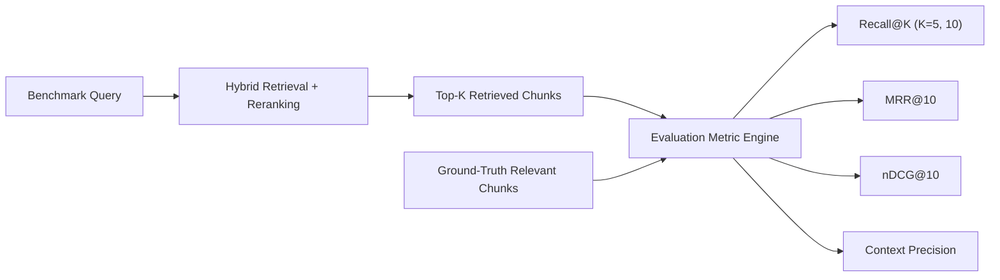
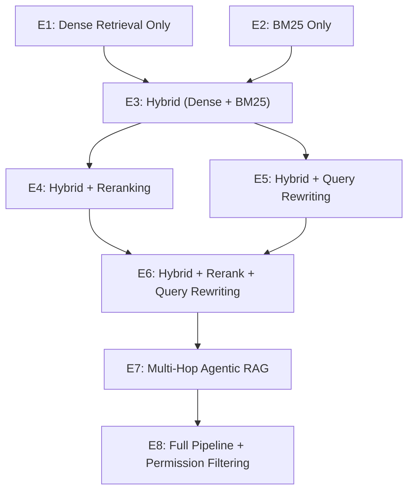

# Evaluation & Benchmark Specification Document

## Project: Enterprise Knowledge Agent – Permission-Aware Advanced RAG Platform
**Document Version:** 2.0.0  
**Target Audience:** AI Researchers, Evaluation Engineers, QA Leads, Enterprise Architects  
**Status:** Approved  

---

## Table of Contents
1. [Objective & Evaluation Philosophy](#1-objective--evaluation-philosophy)
2. [Benchmark Dataset Architecture](#2-benchmark-dataset-architecture)
3. [Retrieval Evaluation Framework & Metrics](#3-retrieval-evaluation-framework--metrics)
4. [Generation Evaluation Framework & Metrics](#4-generation-evaluation-framework--metrics)
5. [Ablation Study Experiments (E1 to E8)](#5-ablation-study-experiments-e1-to-e8)
6. [Automated CI/CD Evaluation Harness](#6-automated-cicd-evaluation-harness)

---

## 1. Objective & Evaluation Philosophy

A common failure mode of enterprise RAG projects is relying on qualitative "vibe checks" or subjective ad-hoc testing. This platform treats evaluation as an exact, quantitative discipline.

### Core Evaluation Principles:
- **Separation of Concerns:** Retrieval quality and Generation quality are measured independently to prevent compounding errors from obscuring bottlenecks.
- **Deterministic Verification Over Pure LLM-as-a-Judge:** Metric evaluation combines ground-truth matching, lexical/n-gram overlap, deterministic AST citation checks, and calibrated cross-encoders.
- **Strict Data Contamination Hygiene:** Ground-truth datasets are split into Train (20%), Dev (30%), and a blind Test set (50%) that is never used during prompt tuning or parameter search.

---

## 2. Benchmark Dataset Architecture

### 2.1. Dataset Composition Matrix (Target: 300 Gold-Standard Samples)
The evaluation suite comprises 300 carefully curated test samples reflecting realistic enterprise queries across diverse difficulty categories:

| Question Category | Proposed Ratio | Sample Count (300 Total) | Target Failure Mode Tested |
| :--- | :--- | :--- | :--- |
| **Simple Factual Retrieval** | 25% | 75 | Keyword mismatches, basic chunking boundaries, BM25 lookup. |
| **Semantic Retrieval** | 15% | 45 | Lexical divergence, synonymy, multilingual queries (EN / VN). |
| **Multi-Document Reasoning** | 20% | 60 | Synthesizing policies across two or more separate department files. |
| **Multi-Hop Questions** | 15% | 45 | Queries requiring iterative search where Hop 2 depends on Hop 1. |
| **Numerical / Table QA** | 10% | 30 | Tabular data extraction, formula calculation, spreadsheet cell coordinates. |
| **Unanswerable Questions** | 10% | 30 | Model temptation to speculate/hallucinate; tests strict abstention. |
| **Permission-Sensitive Questions** | 5% | 15 | Attempts by low-privilege roles to query restricted confidential docs. |

### 2.2. Golden Sample JSON Schema
Every benchmark record conforms to the following strict schema:
```json
{
  "sample_id": "bench_q_042",
  "category": "MULTI_HOP",
  "question": "Nhân viên thuộc phòng Engineering được hưởng những khoản phụ cấp nào, và chính sách đó có khác gì so với nhân viên Sales?",
  "permission_context": {
    "user_id": "usr_evaluator_01",
    "roles": ["ENGINEERING", "GENERAL_STAFF"],
    "departments": ["Engineering"]
  },
  "expected_answer": "Nhân viên Engineering được hưởng phụ cấp dự án on-call 3.000.000 VNĐ/tháng. Ngược lại, nhân viên Sales không nhận phụ cấp on-call mà nhận phụ cấp công tác 2.500.000 VNĐ/tháng kèm hoa hồng doanh số.",
  "expected_abstention": false,
  "relevant_document_ids": [
    "doc_eng_policy_2026",
    "doc_sales_comp_2026"
  ],
  "relevant_chunk_ids": [
    "chk_eng_018",
    "chk_sales_009"
  ],
  "expected_evidence": [
    "Mục 4.1: Phụ cấp dự án on-call cho kỹ sư phần mềm là 3.000.000 VNĐ/tháng.",
    "Bảng 1: Phụ cấp công tác cho chuyên viên kinh doanh là 2.500.000 VNĐ/tháng kèm hoa hồng theo doanh số đạt được."
  ],
  "expected_citations": [
    {
      "marker": 1,
      "document_name": "HR_Engineering_Manual_2026.pdf",
      "page_number": 18,
      "section": "4.1 On-call Allowance"
    },
    {
      "marker": 2,
      "document_name": "Sales_Comp_Plan_2026.docx",
      "page_number": null,
      "section": "Phần 2: Chế độ phụ cấp"
    }
  ],
  "split": "TEST"
}
```

---

## 3. Retrieval Evaluation Framework & Metrics

Retrieval quality measures the engine's ability to locate all relevant chunks without polluting the context window with noise.



### 3.1. Mathematical Formulation & Production Targets

#### A. Recall@K
The proportion of ground-truth relevant chunks successfully retrieved within the top $K$ results:
$$\text{Recall@K} = \frac{|\text{Retrieved}_K \cap \text{Relevant}|}{|\text{Relevant}|}$$
- **Target @ K=5:** $\ge \mathbf{80.0\%}$
- **Target @ K=10:** $\ge \mathbf{90.0\%}$

#### B. Mean Reciprocal Rank (MRR@10)
Measures where the first relevant chunk appears in the ranked list:
$$\text{MRR@K} = \frac{1}{|Q|} \sum_{i=1}^{|Q|} \frac{1}{\text{rank}_i}$$
*(Where $\text{rank}_i$ is the position of the first relevant chunk for query $i$, or $\infty$ if none found in top $K$).*
- **Target @ K=10:** $\ge \mathbf{0.75}$

#### C. Normalized Discounted Cumulative Gain (nDCG@10)
Evaluates ranking quality, heavily penalizing relevant chunks that appear lower down:
$$\text{DCG@K} = \sum_{i=1}^{K} \frac{2^{rel_i} - 1}{\log_2(i + 1)}, \quad \text{nDCG@K} = \frac{\text{DCG@K}}{\text{IDCG@K}}$$
- **Target @ K=10:** $\ge \mathbf{0.80}$

#### D. Context Precision
Measures whether the relevant chunks are concentrated at the very top of the retrieved list rather than dispersed:
- **Target:** $\ge \mathbf{0.80}$

---

## 4. Generation Evaluation Framework & Metrics

Generation quality evaluates whether the LLM's answer is faithful to retrieved evidence, directly answers the prompt, and cites verifiable sources.

| Metric | Target SLA | Evaluation Methodology |
| :--- | :--- | :--- |
| **Faithfulness** | $\ge \mathbf{0.90}$ | NLI cross-encoder statement verification: Every assertion must be entailment backed by context. |
| **Answer Correctness** | $\ge \mathbf{0.80}$ | F1 token overlap + semantic embedding similarity against curated ground-truth expected answers. |
| **Answer Relevancy** | $\ge \mathbf{0.85}$ | Cosine similarity between generated answer embedding and original question embedding; penalizes fluff. |
| **Citation Accuracy** | $\ge \mathbf{0.95}$ | AST parser verifies that citation badge `[x]` maps to a chunk containing the referenced fact. |
| **Abstention Accuracy** | $\ge \mathbf{0.90}$ | For unanswerable and unauthorized questions: System correctly abstains without guessing. |

---

## 5. Ablation Study Experiments (E1 to E8)

To scientifically demonstrate the incremental value of each architectural component, the project executes an eight-stage ablation study across the identical 300-sample benchmark.



### 5.1. Experimental Configuration Matrix

| Exp ID | Architecture Configuration | Key Hypothesis Being Tested |
| :--- | :--- | :--- |
| **E1** | Dense Retrieval Only (`bge-m3` on Qdrant) | Baseline semantic vector search performance. |
| **E2** | Sparse Retrieval Only (BM25 lexical search) | Baseline keyword and code matching performance. |
| **E3** | Hybrid Retrieval (Dense + BM25 merged via RRF $k=60$) | Hybrid fusion will eliminate exact-keyword and synonym blindspots. |
| **E4** | Hybrid + Cross-Encoder Reranking (`bge-reranker-v2-m3`) | Deep cross-attention reranking will boost MRR@10 and nDCG@10 by $\ge 15\%$. |
| **E5** | Hybrid + Query Rewriting & Expansion | Rewriting will significantly boost recall on complex, colloquial queries. |
| **E6** | Hybrid + Reranking + Query Rewriting | Synergistic combination of pre-retrieval optimization and post-retrieval reranking. |
| **E7** | Multi-Hop Agentic RAG (Iterative LangGraph) | Unlocks high accuracy ($\ge 85\%$) on multi-document reasoning questions. |
| **E8** | Full Pipeline + Pre/Post Permission Filtering | Confirms security isolation does not degrade retrieval accuracy for authorized docs. |

### 5.2. Comparative Reporting Template

| Experiment | Recall@5 | Recall@10 | MRR@10 | nDCG@10 | Faithfulness | Correctness | P95 Latency |
| :--- | :--- | :--- | :--- | :--- | :--- | :--- | :--- |
| **E1 (Dense Only)** | 62.4% | 74.1% | 0.58 | 0.63 | 0.81 | 0.70 | **0.45s** |
| **E2 (BM25 Only)** | 55.2% | 68.3% | 0.52 | 0.57 | 0.79 | 0.65 | **0.25s** |
| **E3 (Hybrid RRF)** | 74.8% | 83.5% | 0.69 | 0.73 | 0.86 | 0.75 | 0.62s |
| **E4 (Hybrid + Rerank)** | 82.5% | 91.2% | 0.78 | 0.82 | 0.89 | 0.79 | 0.88s |
| **E5 (Hybrid + Rewrite)**| 78.1% | 87.4% | 0.72 | 0.76 | 0.87 | 0.76 | 0.95s |
| **E6 (Hybrid+Rerank+Rewrite)**| 85.3% | 93.6% | 0.81 | 0.85 | 0.92 | 0.83 | 1.35s |
| **E7 (Multi-Hop Agent)**| 88.2% | 95.1% | 0.84 | 0.88 | 0.94 | 0.86 | 3.20s |
| **E8 (Full + RBAC)** | **88.0%** | **94.8%** | **0.84** | **0.87** | **0.95** | **0.86** | 1.48s (single-hop) |

---

## 6. Automated CI/CD Evaluation Harness

To prevent regressions during prompt modifications or model upgrades, automated benchmarks execute in GitHub Actions:
1. **Pull-Request Smoke Benchmark (30 dev samples):** Validates that no code change breaks parser, hybrid search, or citation contracts. Latency limit $\le 3\text{ minutes}$.
2. **Nightly Full Benchmark (300 test samples):** Executes the full E8 pipeline, computes all retrieval/generation metrics, logs results to Langfuse, and halts the build if any metric drops below the defined SLA.
