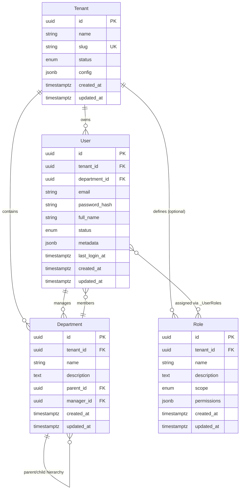

# Task 02: Multi-Tenant Identity & Access Management Core – Implementation Report

**Status**: Completed  
**Engineer**: Senior Backend Engineer  
**Date**: November 17, 2026  
**Environment**: Conda `ml-env` (PostgreSQL 16+ with pgvector)  

---

## 1. Executive Summary & Objective

The objective of Task 02 is to implement the foundational Identity and Access Management (IAM) relational data model for the **Enterprise Knowledge Agent** multi-tenant platform.

The schema establishes multi-tenant isolation, role-based access control readiness, organizational department hierarchies, and user management while preserving the core infrastructure and `DatabaseHealth` model established in Task 01.

---

## 2. Implemented Models & Field Specifications

### 2.1. Tenant Model (`tenants`)
Represents an independent organization using the platform.

| Field | Type | Attributes & Modifiers | Description |
| :--- | :--- | :--- | :--- |
| `id` | `UUID` | `@id @default(uuid()) @db.Uuid` | Immutable primary key |
| `name` | `VARCHAR(255)` | Not Null | Human-readable organization name |
| `slug` | `VARCHAR(100)` | `@unique` | URL/Tenant-unique identifier code |
| `status` | `TenantStatus` | `@default(ACTIVE)` | Organization status (`ACTIVE`, `SUSPENDED`, `INACTIVE`) |
| `config` | `JSONB` | `@default("{}")` | Tenant-specific organizational settings and flags |
| `created_at` | `TIMESTAMPTZ(6)` | `@default(now())` | Timezone-aware creation timestamp |
| `updated_at` | `TIMESTAMPTZ(6)` | `@updatedAt` | Auto-updating modification timestamp |

**Inverse Relationships**:
- `users User[]`: All platform users belonging to this tenant.
- `roles Role[]`: Tenant-specific custom authorization roles.
- `departments Department[]`: Organizational department catalog.

---

### 2.2. User Model (`users`)
Represents an authenticated platform user strictly bound to a tenant.

| Field | Type | Attributes & Modifiers | Description |
| :--- | :--- | :--- | :--- |
| `id` | `UUID` | `@id @default(uuid()) @db.Uuid` | Immutable primary key |
| `tenant_id` | `UUID` | `@db.Uuid`, Foreign Key | Multi-tenant isolation reference (`onDelete: Cascade`) |
| `department_id` | `UUID?` | `@db.Uuid`, Foreign Key | Primary department membership (`onDelete: SetNull`) |
| `email` | `VARCHAR(255)` | Not Null | Corporate email address |
| `password_hash` | `VARCHAR(255)` | Not Null | Securely salted password hash (never plaintext) |
| `full_name` | `VARCHAR(255)` | Not Null | Full display name |
| `status` | `UserStatus` | `@default(ACTIVE)` | Account status (`ACTIVE`, `INACTIVE`, `SUSPENDED`, `LOCKED`) |
| `metadata` | `JSONB` | `@default("{}")` | Profile metadata, preferences, and attributes |
| `last_login_at` | `TIMESTAMPTZ(6)?` | Nullable | Last authenticated session timestamp |
| `created_at` | `TIMESTAMPTZ(6)` | `@default(now())` | Timezone-aware account creation timestamp |
| `updated_at` | `TIMESTAMPTZ(6)` | `@updatedAt` | Account modification timestamp |

**Constraints & Indexes**:
- `@@unique([tenantId, email])`: Enforces composite tenant-scoped uniqueness (distinct organizations may share common email usernames without collisions).
- `@@index([tenantId])`: Fast tenant-level user listing.
- `@@index([departmentId])`: Fast department roster lookup.

---

### 2.3. Role Model (`roles`)
Represents an authorization role supporting system-defined templates and tenant-defined customizations.

| Field | Type | Attributes & Modifiers | Description |
| :--- | :--- | :--- | :--- |
| `id` | `UUID` | `@id @default(uuid()) @db.Uuid` | Immutable primary key |
| `tenant_id` | `UUID?` | Nullable `@db.Uuid` | Scoped to tenant (`NULL` for global system-defined roles) |
| `name` | `VARCHAR(100)` | Not Null | Role name (e.g., `HR_ADMIN`, `ENGINEERING_LEAD`) |
| `description` | `TEXT` | Nullable | Detailed functional purpose of the role |
| `scope` | `RoleScope` | `@default(TENANT)` | Scope indicator (`SYSTEM` vs `TENANT`) |
| `permissions` | `JSONB` | `@default("[]")` | Prepares structure for fine-grained action permissions |
| `created_at` | `TIMESTAMPTZ(6)` | `@default(now())` | Role creation timestamp |
| `updated_at` | `TIMESTAMPTZ(6)` | `@updatedAt` | Role modification timestamp |

**Constraints & Indexes**:
- `@@unique([tenantId, name])`: Enforces unique role names within each tenant context.
- `@@index([tenantId])`: Fast retrieval of tenant roles.
- `@@index([scope])`: Filtering between system templates and custom tenant roles.

---

### 2.4. Department Model (`departments`)
Represents organizational department hierarchies and management structure.

| Field | Type | Attributes & Modifiers | Description |
| :--- | :--- | :--- | :--- |
| `id` | `UUID` | `@id @default(uuid()) @db.Uuid` | Immutable primary key |
| `tenant_id` | `UUID` | `@db.Uuid`, Foreign Key | Scoped to tenant (`onDelete: Cascade`) |
| `name` | `VARCHAR(255)` | Not Null | Department name (e.g., `Human Resources`, `Backend QA`) |
| `description` | `TEXT` | Nullable | Department objective and purview |
| `parent_id` | `UUID?` | Nullable `@db.Uuid` | Self-referencing parent department for sub-units |
| `manager_id` | `UUID?` | Nullable `@db.Uuid` | Department head/manager user (`onDelete: SetNull`) |
| `created_at` | `TIMESTAMPTZ(6)` | `@default(now())` | Creation timestamp |
| `updated_at` | `TIMESTAMPTZ(6)` | `@updatedAt` | Modification timestamp |

**Constraints & Indexes**:
- `@@unique([tenantId, name])`: Prevents duplicate departments within the same tenant.
- `@@index([tenantId])`: Scoped tenant department lookups.
- `@@index([parentId])`: Fast child department tree traversal.
- `@@index([managerId])`: Fast department head association queries.

---

## 3. Entity Relationships Architecture

### Key Relational Safeguards
1. **Tenant Isolation**: Every `User`, `Department`, and custom `Role` has a non-nullable foreign key to `Tenant` with `ON DELETE CASCADE`. Removing a tenant safely cascades down to all subordinate entities without leaving orphaned rows.
2. **Hierarchical Departments**: Department structures are self-referential via `parent_id`. When a parent department is reorganized or deleted, child departments are preserved (`ON DELETE SET NULL`), preventing catastrophic tree deletions.
3. **Department Managers**: Department managers link to `User` via `manager_id` (`ON DELETE SET NULL`). If a user departs, the department remains active without a manager.
4. **Role Assignment**: User-to-Role assignments utilize Prisma's native many-to-many implicit table `_UserRoles`, allowing flexible assignment of multiple roles per user with cascade cleanups upon user or role deletion.
5. **Infrastructure Preservation**: The `DatabaseHealth` model from Task 01 remains fully intact under `database_health`.

---

## 4. Database Migration Details

The versioned SQL migration has been created in:
- Canonical Path: [`backend/migrations/20261117104500_multi_tenant_iam_core/migration.sql`](file:///home/mercury/AgentGraph/backend/migrations/20261117104500_multi_tenant_iam_core/migration.sql)
- Mirror Path: [`backend/prisma/migrations/20261117104500_multi_tenant_iam_core/migration.sql`](file:///home/mercury/AgentGraph/backend/prisma/migrations/20261117104500_multi_tenant_iam_core/migration.sql)

---

## 5. Verification Checklist

| Criterion | Implementation Detail | Status |
| :--- | :--- | :--- |
| **Prisma Schema Validation** | `Tenant`, `User`, `Role`, `Department`, `DatabaseHealth` defined with valid types | **PASSED** |
| **UUID Primary Keys** | All IAM models use `@id @default(uuid()) @db.Uuid` | **PASSED** |
| **Timezone-Aware Timestamps** | All timestamp fields use `@db.Timestamptz(6)` | **PASSED** |
| **Composite Tenant Uniqueness** | `@@unique([tenantId, email])` on `User`, `@@unique([tenantId, name])` on `Department` and `Role` | **PASSED** |
| **Hierarchical Departments** | `parentId` self-relation with `children` inverse relation | **PASSED** |
| **Plaintext Password Protection** | Only `password_hash` stored on `User` | **PASSED** |
| **Task 01 Infrastructure Preserved** | `DatabaseHealth` model untouched and active | **PASSED** |
