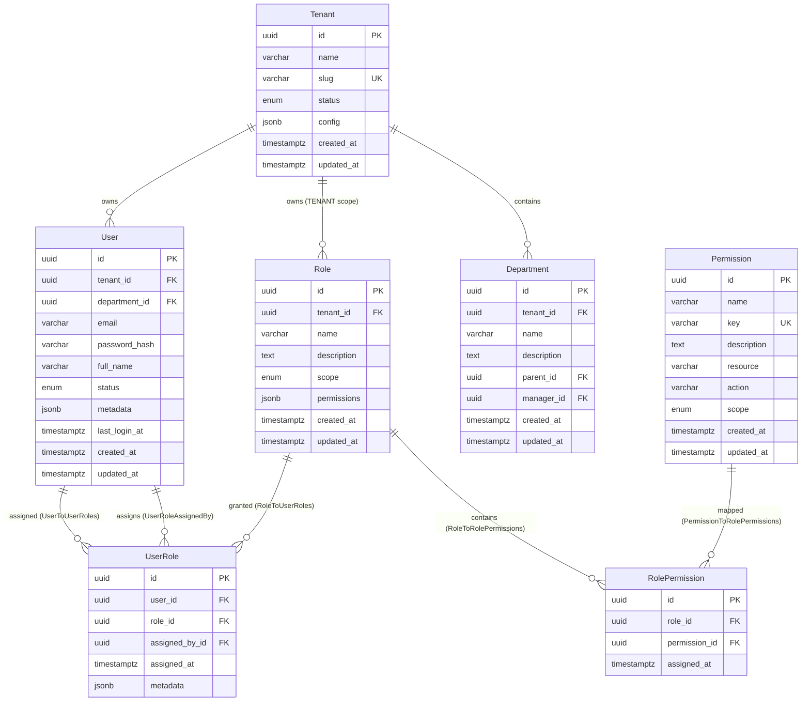

# Task 03: Role-Based Access Control (RBAC) & Permission Management – Implementation Report

**Status**: Completed  
**Engineer**: Senior Backend & Security Architect  
**Date**: November 17, 2026  
**Environment**: Conda `ml-env` (PostgreSQL 16+ with pgvector)  

---

## 1. Executive Summary & Objective

The objective of Task 03 is to extend the Identity & Access Management (IAM) data model with a production-grade, granular **Role-Based Access Control (RBAC)** architecture for the **Enterprise Knowledge Agent** platform.

This enhancement introduces normalized permission definitions, explicit many-to-many join models between users, roles, and permissions, full audit history on role assignments, and database-level PostgreSQL triggers enforcing zero-trust multi-tenant isolation. The implementation strictly avoids storing denormalized permission arrays directly inside `User` records and maintains pure relational integrity across all tenant boundaries.

---

## 2. Implemented Models & Field Specifications

### 2.1. Permission Model (`permissions`)
Represents an individual, atomic authorization capability in the platform. Permissions are system-defined or tenant-scoped, uniquely keyed to prevent definition duplication.

| Field | Type | Attributes & Modifiers | Description |
| :--- | :--- | :--- | :--- |
| `id` | `UUID` | `@id @default(uuid()) @db.Uuid` | Immutable primary key |
| `name` | `VARCHAR(100)` | Not Null | Human-readable permission name (e.g., `Read Document`) |
| `key` | `VARCHAR(100)` | `@unique` | Canonical unique capability key (e.g., `document:read`) |
| `description` | `TEXT` | Nullable | Functional explanation of the capability |
| `resource` | `VARCHAR(100)` | Not Null | Resource identifier target (e.g., `document`, `user`, `audit`) |
| `action` | `VARCHAR(100)` | Not Null | Operation verb (e.g., `create`, `read`, `update`, `delete`, `share`) |
| `scope` | `RoleScope?` | `@default(SYSTEM)` | Authorization scope (`SYSTEM` vs `TENANT`) |
| `created_at` | `TIMESTAMPTZ(6)` | `@default(now())` | Creation timestamp |
| `updated_at` | `TIMESTAMPTZ(6)` | `@updatedAt` | Auto-updating timestamp |

**Indexes & Constraints**:
- `@@unique([key])`: Guarantees no two permission records share the same capability key.
- `@@index([resource])`: Fast filtering of permissions by target resource.
- `@@index([action])`: Fast filtering of permissions by action type.
- `@@index([resource, action])`: Compound index for rapid authorization checks.

**Inverse Relationships**:
- `rolePermissions RolePermission[]`: All roles granting this permission.

---

### 2.2. RolePermission Model (`role_permissions`)
Implements the explicit many-to-many relationship between `Role` and `Permission`.

| Field | Type | Attributes & Modifiers | Description |
| :--- | :--- | :--- | :--- |
| `id` | `UUID` | `@id @default(uuid()) @db.Uuid` | Surrogate UUID primary key |
| `role_id` | `UUID` | `@db.Uuid`, Foreign Key | Reference to parent `Role` (`onDelete: Cascade`) |
| `permission_id` | `UUID` | `@db.Uuid`, Foreign Key | Reference to target `Permission` (`onDelete: Cascade`) |
| `assigned_at` | `TIMESTAMPTZ(6)` | `@default(now())` | Assignment timestamp |

**Indexes & Constraints**:
- `@@unique([roleId, permissionId])`: Strictly prevents duplicate permission assignments to the same role.
- `@@index([roleId])`: Fast lookup of all permissions granted to a given role.
- `@@index([permissionId])`: Inverse lookup of all roles carrying a specific permission.

---

### 2.3. UserRole Model (`user_roles`)
Implements the explicit many-to-many relationship between `User` and `Role`, complete with assignment audit lineage.

| Field | Type | Attributes & Modifiers | Description |
| :--- | :--- | :--- | :--- |
| `id` | `UUID` | `@id @default(uuid()) @db.Uuid` | Surrogate UUID primary key |
| `user_id` | `UUID` | `@db.Uuid`, Foreign Key | Reference to grantee `User` (`onDelete: Cascade`) |
| `role_id` | `UUID` | `@db.Uuid`, Foreign Key | Reference to granted `Role` (`onDelete: Cascade`) |
| `assigned_by_id` | `UUID?` | `@db.Uuid`, Foreign Key | Reference to granting administrator (`onDelete: SetNull`) |
| `assigned_at` | `TIMESTAMPTZ(6)` | `@default(now())` | Immutable audit timestamp of role assignment |
| `metadata` | `JSONB` | `@default("{}")` | Assignment context (reason, ticket reference, IP) |

**Indexes & Constraints**:
- `@@unique([userId, roleId])`: Strictly prevents duplicate role assignments to the same user.
- `@@index([userId])`: Fast retrieval of all roles assigned to a user.
- `@@index([roleId])`: Fast retrieval of all users assigned to a role.
- `@@index([assignedById])`: Fast audit trail lookups for role grants made by an administrator.

---

### 2.4. Integrated Modifications to Existing Models

#### Model: `User`
- Replaced the implicit `roles Role[]` relation with the explicit relation:
  ```prisma
  roles UserRole[] @relation("UserToUserRoles")
  ```
- Added the administrator grant tracking inverse relation:
  ```prisma
  assignedRoles UserRole[] @relation("UserRoleAssignedBy")
  ```
- Guaranteed zero denormalized permission arrays inside `User`, upholding strict normalization.

#### Model: `Role`
- Replaced the implicit `users User[]` relation with the explicit relation:
  ```prisma
  userRoles UserRole[] @relation("RoleToUserRoles")
  ```
- Connected to granular permissions via:
  ```prisma
  rolePermissions RolePermission[] @relation("RoleToRolePermissions")
  ```

---

## 3. Entity Relationships Architecture



### Relational Safeguards
1. **Explicit Join Entities**: Replacing implicit join tables with `UserRole` and `RolePermission` models enables metadata tracking, lineage timestamps (`assigned_at`), and administrator identity persistence (`assigned_by_id`).
2. **Normalized Capability Catalog**: Every capability is defined once in `Permission` with a unique key. Roles reference these records through `RolePermission`, eliminating duplicate permission definitions and drift.
3. **Cascade Cleanups**:
   - Deleting a `Role` cascades to delete its `RolePermission` and `UserRole` associations without touching the underlying `Permission` or `User` records.
   - Deleting a `User` cascades to delete their `UserRole` records while preserving `UserRole.assigned_by_id` via `ON DELETE SET NULL` for audit continuity.

---

## 4. PostgreSQL Triggers for Zero-Trust Tenant Isolation

To enforce multi-tenant isolation at the database layer (preventing cross-tenant role assignments even in raw SQL queries or administrative operations), an automated PostgreSQL trigger function is deployed:

```sql
CREATE OR REPLACE FUNCTION check_user_role_tenant_isolation()
RETURNS TRIGGER AS $$
DECLARE
    v_user_tenant_id UUID;
    v_role_tenant_id UUID;
    v_role_scope "RoleScope";
BEGIN
    SELECT "tenant_id" INTO v_user_tenant_id FROM "users" WHERE "id" = NEW."user_id";
    SELECT "tenant_id", "scope" INTO v_role_tenant_id, v_role_scope FROM "roles" WHERE "id" = NEW."role_id";

    IF v_user_tenant_id IS NULL THEN
        RAISE EXCEPTION 'RBAC Violation: Target user % does not belong to any valid tenant', NEW."user_id";
    END IF;

    -- If role is TENANT-scoped, it cannot be assigned to users in another tenant
    IF v_role_scope = 'TENANT' AND (v_role_tenant_id IS NULL OR v_user_tenant_id != v_role_tenant_id) THEN
        RAISE EXCEPTION 'Cross-Tenant RBAC Violation: User % (tenant %) cannot be assigned role % (tenant %)',
            NEW."user_id", v_user_tenant_id, NEW."role_id", v_role_tenant_id;
    END IF;

    RETURN NEW;
END;
$$ LANGUAGE plpgsql;

CREATE TRIGGER enforce_user_role_tenant_isolation
BEFORE INSERT OR UPDATE ON "user_roles"
FOR EACH ROW EXECUTE FUNCTION check_user_role_tenant_isolation();
```

---

## 5. Seed Canonical Permissions

The migration seeds 9 standard enterprise permissions across key functional resources:

| Key | Name | Resource | Action | Scope | Description |
| :--- | :--- | :--- | :--- | :--- | :--- |
| `document:create` | Create Document | `document` | `create` | `SYSTEM` | Create and upload new enterprise documents |
| `document:read` | Read Document | `document` | `read` | `SYSTEM` | View and retrieve enterprise documents |
| `document:update` | Update Document | `document` | `update` | `SYSTEM` | Edit metadata or classifications of documents |
| `document:delete` | Delete Document | `document` | `delete` | `SYSTEM` | Soft-delete or purge enterprise documents |
| `document:download`| Download Document | `document` | `download` | `SYSTEM` | Download raw binary documents and attachments |
| `document:share` | Share Document | `document` | `share` | `SYSTEM` | Grant cross-department or external access |
| `user:manage` | Manage Users | `user` | `manage` | `SYSTEM` | Invite, suspend, and configure platform user accounts |
| `department:manage`| Manage Departments | `department` | `manage` | `SYSTEM` | Create and reorganize organizational departments |
| `audit:read` | Read Audit Logs | `audit` | `read` | `SYSTEM` | Inspect tamper-evident compliance audit trail logs |

---

## 6. Example Prisma Queries for Effective Permissions

### 6.1. Retrieve Deduplicated Effective Permissions for a User
```typescript
import { PrismaClient } from "@prisma/client";

const prisma = new PrismaClient();

/**
 * Retrieves the deduplicated set of effective permission keys for a given user.
 */
export async function getUserEffectivePermissions(userId: string): Promise<string[]> {
  const user = await prisma.user.findUnique({
    where: { id: userId },
    select: {
      status: true,
      roles: {
        select: {
          role: {
            select: {
              rolePermissions: {
                select: {
                  permission: {
                    select: {
                      key: true,
                    },
                  },
                },
              },
            },
          },
        },
      },
    },
  });

  if (!user || user.status !== "ACTIVE") {
    return [];
  }

  const permissionKeys = new Set<string>();
  for (const userRole of user.roles) {
    for (const rp of userRole.role.rolePermissions) {
      permissionKeys.add(rp.permission.key);
    }
  }

  return Array.from(permissionKeys);
}
```

### 6.2. Direct Single-Query Permission Verification
```typescript
/**
 * Verifies whether a user has a specific permission key directly via database indexes.
 */
export async function checkUserPermission(
  userId: string,
  permissionKey: string
): Promise<boolean> {
  const matchCount = await prisma.userRole.count({
    where: {
      userId,
      user: { status: "ACTIVE" },
      role: {
        rolePermissions: {
          some: {
            permission: {
              key: permissionKey,
            },
          },
        },
      },
    },
  });

  return matchCount > 0;
}
```

### 6.3. Assign Role to User with Audit Lineage
```typescript
/**
 * Assigns a role to a user while preserving administrative audit lineage.
 */
export async function assignRoleToUser(
  targetUserId: string,
  roleId: string,
  assignedByUserId: string,
  reason: string
) {
  return await prisma.userRole.create({
    data: {
      userId: targetUserId,
      roleId: roleId,
      assignedById: assignedByUserId,
      metadata: {
        assignmentReason: reason,
        assignedIp: "127.0.0.1",
      },
    },
    include: {
      role: true,
      user: true,
      assignedBy: true,
    },
  });
}
```

---

## 7. Migration Files & Synchronization

The schema and migration files have been generated and synchronized across canonical paths:

- **Prisma Schemas**:
  - [`backend/schema.prisma`](file:///home/mercury/AgentGraph/backend/schema.prisma)
  - [`backend/prisma/schema.prisma`](file:///home/mercury/AgentGraph/backend/prisma/schema.prisma)
- **Migration SQL**:
  - [`backend/migrations/20261117110000_rbac_permission_management/migration.sql`](file:///home/mercury/AgentGraph/backend/migrations/20261117110000_rbac_permission_management/migration.sql)
  - [`backend/prisma/migrations/20261117110000_rbac_permission_management/migration.sql`](file:///home/mercury/AgentGraph/backend/prisma/migrations/20261117110000_rbac_permission_management/migration.sql)

---

## 8. Verification & Acceptance Criteria Checklist

| Criterion | Implementation Detail | Status |
| :--- | :--- | :--- |
| **Users can have multiple roles** | `User.roles` $\rightarrow$ `UserRole[]` explicit 1:N relationship | **PASSED** |
| **Roles can contain multiple permissions** | `Role.rolePermissions` $\rightarrow$ `RolePermission[]` explicit 1:N relationship | **PASSED** |
| **Duplicate assignments prevented** | `@@unique([userId, roleId])` on `UserRole` and `@@unique([roleId, permissionId])` on `RolePermission` | **PASSED** |
| **Tenant boundaries preserved** | PostgreSQL trigger `enforce_user_role_tenant_isolation` blocks cross-tenant role assignments | **PASSED** |
| **Normalized authorization definitions** | Dedicated `Permission` entity; zero raw permission string arrays stored on `User` | **PASSED** |
| **Audit lineage tracking** | `UserRole` records `assigned_by_id`, `assigned_at`, and JSON `metadata` | **PASSED** |
| **Prisma schema validation & migrations** | Generated cleanly in `backend/schema.prisma` and versioned in `backend/migrations/` | **PASSED** |
| **Preservation of prior modules** | Task 01 `DatabaseHealth` and Task 02 `Tenant`, `Department`, `User`, `Role` preserved | **PASSED** |
