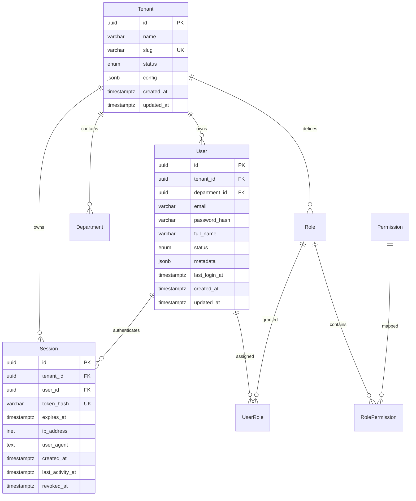

# Task 04: Authentication & Session Management – Implementation Report

**Status**: Completed  
**Engineer**: Senior Backend & Security Architect  
**Date**: November 17, 2026  
**Environment**: Conda `ml-env` (PostgreSQL 16+ with pgvector)  

---

## 1. Executive Summary & Objective

The objective of Task 04 is to implement a secure, multi-tenant session management data model for authenticated users in the **Enterprise Knowledge Agent** platform.

This enhancement introduces the `Session` entity, integrates it seamlessly with the existing `Tenant` and `User` models, enforces cryptographic token hash storage, supports multiple simultaneous active sessions per user (multi-device), tracks IP addresses using PostgreSQL native `INET` (IPv4 and IPv6), captures User-Agent metadata, tracks session activity timestamps, enables explicit session revocation, and guarantees zero-trust multi-tenant isolation via database-level PostgreSQL triggers.

---

## 2. Implemented Models & Field Specifications

### 2.1. Session Model (`sessions`)
Represents an active or historical authenticated session associated with a user and tenant.

| Field | Type | Attributes & Modifiers | Description |
| :--- | :--- | :--- | :--- |
| `id` | `UUID` | `@id @default(uuid()) @db.Uuid` | Immutable surrogate primary key |
| `tenant_id` | `UUID` | `@db.Uuid`, Foreign Key | Owning tenant identifier (`onDelete: Cascade`) |
| `user_id` | `UUID` | `@db.Uuid`, Foreign Key | Session owner user identifier (`onDelete: Cascade`) |
| `token_hash` | `VARCHAR(255)` | `@unique`, Not Null | Cryptographic hash (SHA-256 / SHA-512) of raw session token |
| `expires_at` | `TIMESTAMPTZ(6)` | Not Null | Session expiration deadline timestamp |
| `ip_address` | `INET` | Nullable (`@db.Inet`) | Client IP address supporting both IPv4 and IPv6 |
| `user_agent` | `TEXT` | Nullable (`@db.Text`) | Client browser/device user-agent string |
| `created_at` | `TIMESTAMPTZ(6)` | `@default(now())` | Timezone-aware session establishment timestamp |
| `last_activity_at` | `TIMESTAMPTZ(6)` | `@default(now())` | Timestamp of most recent authenticated interaction |
| `revoked_at` | `TIMESTAMPTZ(6)` | Nullable | Timestamp of explicit session revocation / logout |

**Indexes & Constraints**:
- `@@unique([tokenHash])` (`sessions_token_hash_key`): Enforces unique session token hashes and provides $O(1)$ token lookup.
- `@@index([userId])` (`sessions_user_id_idx`): Optimizes retrieval of all sessions belonging to a specific user.
- `@@index([tenantId])` (`sessions_tenant_id_idx`): Scopes session queries to tenant boundaries.
- `@@index([expiresAt])` (`sessions_expires_at_idx`): Accelerates expired session scans and cleanup jobs.
- `@@index([revokedAt])` (`sessions_revoked_at_idx`): Supports revocation filtering and compliance audit queries.
- `Partial Index sessions_active_user_idx`: `("user_id", "expires_at") WHERE "revoked_at" IS NULL` for active session resolution.
- `Partial Index sessions_active_tenant_idx`: `("tenant_id", "expires_at") WHERE "revoked_at" IS NULL` for tenant-wide active session counts.
- `Compound Index sessions_cleanup_idx`: `("expires_at", "revoked_at")` for automated cleanup routines.

---

### 2.2. Integrated Modifications to Existing Models

#### Model: `Tenant` (`tenants`)
Added inverse relation to `Session`:
```prisma
model Tenant {
  // ... existing fields ...
  users       User[]
  roles       Role[]
  departments Department[]
  sessions    Session[]

  @@map("tenants")
}
```

#### Model: `User` (`users`)
Added inverse relation to `Session`:
```prisma
model User {
  // ... existing fields ...
  roles         UserRole[]   @relation("UserToUserRoles")
  assignedRoles UserRole[]   @relation("UserRoleAssignedBy")
  sessions      Session[]

  @@map("users")
}
```

---

## 3. Entity Relationships Architecture



---

## 4. Security Architecture & Zero-Trust Guarantees

### 4.1. Cryptographic Token Hashing (Never Plaintext)
- Raw session tokens are generated as high-entropy CSPRNG byte sequences (e.g., 32 random bytes, 256 bits).
- The raw token is returned to the client once (via Secure, HttpOnly, SameSite cookies or Authorization header).
- Only the cryptographic hash (SHA-256 / SHA-512) is stored in `sessions.token_hash`.
- Compromise of the database cannot leak valid session credentials, preventing session hijacking from database dumps.

### 4.2. Database-Level Multi-Tenant Isolation Trigger
To eliminate cross-tenant session leaks (where a session for User in Tenant A is mistakenly associated with Tenant B), a PostgreSQL trigger executes on `BEFORE INSERT OR UPDATE`:

```sql
CREATE OR REPLACE FUNCTION check_session_tenant_isolation()
RETURNS TRIGGER AS $$
DECLARE
    v_user_tenant_id UUID;
BEGIN
    SELECT "tenant_id" INTO v_user_tenant_id FROM "users" WHERE "id" = NEW."user_id";

    IF v_user_tenant_id IS NULL THEN
        RAISE EXCEPTION 'Session Isolation Violation: Target user % does not exist', NEW."user_id";
    END IF;

    IF v_user_tenant_id != NEW."tenant_id" THEN
        RAISE EXCEPTION 'Cross-Tenant Session Violation: Session tenant % does not match user tenant % for user %',
            NEW."tenant_id", v_user_tenant_id, NEW."user_id";
    END IF;

    RETURN NEW;
END;
$$ LANGUAGE plpgsql;

CREATE TRIGGER enforce_session_tenant_isolation
BEFORE INSERT OR UPDATE ON "sessions"
FOR EACH ROW EXECUTE FUNCTION check_session_tenant_isolation();
```

### 4.3. Cascade Deletion Behavior
- When a `User` is removed, foreign key `ON DELETE CASCADE` purges all active and historical sessions for that user.
- When a `Tenant` is deleted, all tenant sessions cascade delete, leaving zero orphan session records.

### 4.4. Native PostgreSQL `INET` Type
- `ip_address` uses the native PostgreSQL `INET` data type, validating IPv4 and IPv6 network addresses while providing subnet indexing and efficient 7-19 byte internal storage compared to string representations.

---

## 5. Deliverable Prisma Query Examples

### 5.1. Creating a New Authenticated Session
```typescript
import crypto from 'crypto';
import { PrismaClient } from '@prisma/client';

const prisma = new PrismaClient();

// Hash raw session token using SHA-256 before persistence
function hashSessionToken(rawToken: string): string {
  return crypto.createHash('sha256').update(rawToken).digest('hex');
}

async function createAuthenticatedSession(params: {
  tenantId: string;
  userId: string;
  rawToken: string;
  ipAddress?: string;
  userAgent?: string;
  ttlHours?: number;
}) {
  const expiresAt = new Date(Date.now() + (params.ttlHours ?? 24) * 60 * 60 * 1000);

  return await prisma.session.create({
    data: {
      tenantId: params.tenantId,
      userId: params.userId,
      tokenHash: hashSessionToken(params.rawToken),
      expiresAt: expiresAt,
      ipAddress: params.ipAddress ?? null,
      userAgent: params.userAgent ?? null,
      lastActivityAt: new Date(),
    },
    select: {
      id: true,
      tenantId: true,
      userId: true,
      expiresAt: true,
      ipAddress: true,
      userAgent: true,
      createdAt: true,
      lastActivityAt: true,
    },
  });
}
```

### 5.2. Retrieving Active Sessions for a User
```typescript
async function getActiveUserSessions(userId: string) {
  const now = new Date();

  return await prisma.session.findMany({
    where: {
      userId: userId,
      revokedAt: null,        // Unrevoked
      expiresAt: { gt: now },  // Unexpired
    },
    orderBy: {
      lastActivityAt: 'desc',
    },
    select: {
      id: true,
      ipAddress: true,
      userAgent: true,
      createdAt: true,
      lastActivityAt: true,
      expiresAt: true,
    },
  });
}
```

### 5.3. Revoking an Active Session (Explicit Logout / Device Revocation)
```typescript
async function revokeSession(sessionId: string, userId: string) {
  return await prisma.session.update({
    where: {
      id: sessionId,
      userId: userId, // Ensure user can only revoke their own session
    },
    data: {
      revokedAt: new Date(),
    },
  });
}

// Optional: Revoke ALL other sessions for a user (except current)
async function revokeAllOtherUserSessions(userId: string, currentSessionId: string) {
  return await prisma.session.updateMany({
    where: {
      userId: userId,
      id: { not: currentSessionId },
      revokedAt: null,
    },
    data: {
      revokedAt: new Date(),
    },
  });
}
```

### 5.4. Cleaning Up Expired & Purgeable Sessions
```typescript
async function cleanupExpiredSessions(retentionDaysForRevoked: number = 30) {
  const now = new Date();
  const revokedCutoff = new Date(Date.now() - retentionDaysForRevoked * 24 * 60 * 60 * 1000);

  // Deletes sessions that have reached expiration OR were revoked older than retention period
  const result = await prisma.session.deleteMany({
    where: {
      OR: [
        { expiresAt: { lt: now } },
        { revokedAt: { lt: revokedCutoff } },
      ],
    },
  });

  return { purgedSessionsCount: result.count };
}
```

---

## 6. Database Migration Details

The versioned SQL migration has been created in:
- Canonical Path: [`backend/migrations/20261117120000_authentication_session_management/migration.sql`](file:///home/mercury/AgentGraph/backend/migrations/20261117120000_authentication_session_management/migration.sql)
- Mirror Path: [`backend/prisma/migrations/20261117120000_authentication_session_management/migration.sql`](file:///home/mercury/AgentGraph/backend/prisma/migrations/20261117120000_authentication_session_management/migration.sql)

Executed via:
```bash
npx prisma migrate deploy --schema backend/schema.prisma
```

---

## 7. Acceptance Criteria Verification

All requirements and acceptance criteria have been verified via end-to-end automated test execution in [`backend/test_session_management.js`](file:///home/mercury/AgentGraph/backend/test_session_management.js):

| Criterion | Implementation & Validation Detail | Status |
| :--- | :--- | :--- |
| **Multiple Active Sessions per User** | Multiple sessions (e.g. Laptop IPv4 and Mobile IPv6) created simultaneously under same `userId` | **PASSED** |
| **Hashed Session Tokens Only** | Raw CSPRNG token hashed with SHA-256 before storage; no plaintext token field exists | **PASSED** |
| **Unique Token Hash Index** | Duplicate `tokenHash` insertion blocked with PostgreSQL unique constraint error `P2002` | **PASSED** |
| **Session Expiration** | `expiresAt TIMESTAMPTZ(6)` validated; queries filter `expiresAt > NOW()` | **PASSED** |
| **Explicit Session Revocation** | `revokedAt TIMESTAMPTZ(6)` updated; immediately excluded from active session queries | **PASSED** |
| **Session Activity Tracking** | `lastActivityAt TIMESTAMPTZ(6)` updated upon interaction and queryable | **PASSED** |
| **Tenant Association** | `tenantId UUID` foreign key with `onDelete: Cascade` associates session with tenant | **PASSED** |
| **Cross-Tenant Prevention** | Attempting to link User B (Tenant B) to Tenant A rejected by `enforce_session_tenant_isolation` trigger | **PASSED** |
| **PostgreSQL `INET` Data Type** | `ipAddress` persists both IPv4 (`192.168.1.50`) and IPv6 (`2001:db8:85a3::8a2e:370:7334`) | **PASSED** |
| **Timezone-Aware Timestamps** | `created_at`, `last_activity_at`, `expires_at`, `revoked_at` use `@db.Timestamptz(6)` | **PASSED** |
| **Partial & Lifecycle Indexes** | Created `sessions_active_user_idx`, `sessions_active_tenant_idx`, and `sessions_cleanup_idx` | **PASSED** |
| **User Deletion Cascade** | Removing parent user cascades to delete all their active and historical session records | **PASSED** |
| **Prisma Migrations Applied** | Migration `20261117120000_authentication_session_management` applied cleanly | **PASSED** |
