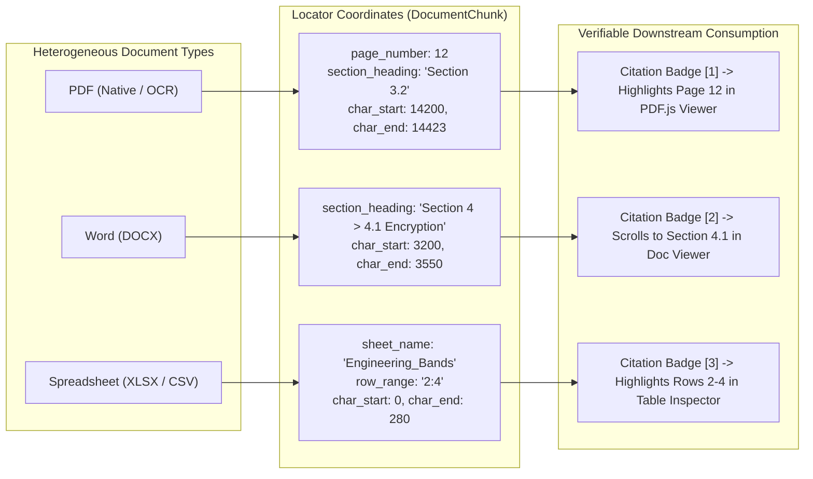

# Task 08: Document Chunking & Source Provenance – Implementation Report

**Status**: Completed  
**Engineer**: Senior Backend & Security Architect  
**Date**: November 18, 2026  
**Environment**: Conda `ml-env` (PostgreSQL 16+ with pgvector & GIN Indexing)  

---

## 1. Executive Summary & Objective

The objective of Task 08 is to design, implement, and verify the persistent relational data model for **Document Chunking & Source Provenance** (`DocumentChunk`) in the **Enterprise Knowledge Agent** platform.

In an enterprise Retrieval-Augmented Generation (RAG) system, whole documents cannot be directly embedded or passed to Large Language Models due to embedding model context windows, semantic dilution, and strict citation requirements. Documents must be partitioned into granular chunks. However, naive chunking without strict physical source coordinate tracking produces ungrounded citations and prevents line-level audit verification.

This implementation establishes the database schema, data integrity constraints, multi-format source lineage tracking, deterministic sequential reconstruction, zero-trust cross-tenant isolation triggers, and dual dense/sparse search indexing hooks required to ground every generated AI response with verifiable source attribution badges (`[1]`, `[2]`).

### Key Architectural Highlights:
1. **Core `DocumentChunk` Model**:
   - Represents an extracted text segment with UUID PK (`id`), owning `tenant_id` FK, parent `document_id` FK, and optional `document_version_id` FK.
   - Preserves deterministic sequential order (`chunk_index`), text payload (`content`), SHA-256 integrity hash (`content_hash`), and precomputed token metrics (`token_count`).
   - Links seamlessly to external vector stores via `embedding_id` and `vector_storage_id` (e.g., Qdrant point identifiers).
2. **Multi-Format Source Lineage Coordinates**:
   - **PDF Native & Scanned (OCR)**: `page_number`, `section_heading`, `char_start`, `char_end`.
   - **Microsoft Word (DOCX)**: `section_heading` (hierarchical outline paths such as `"Section 4 > 4.1 Device Security"`), `char_start`, `char_end`.
   - **Spreadsheets (XLSX, CSV)**: `sheet_name`, `row_range` (e.g., `"2:4"`), `char_start`, `char_end`.
   - Standardized on **0-indexed half-open intervals `[char_start, char_end)`** representing exact character offsets within the source text stream.
3. **Data Integrity & Check Constraints**:
   - Check constraints enforce `chunk_index >= 0`, `token_count >= 0`, `page_number > 0`, `char_start >= 0`, `char_end >= 0`, and `char_start <= char_end`.
   - Version-level unique index `UNIQUE (document_version_id, chunk_index)` prevents sequence collisions within a document version snapshot.
4. **Zero-Trust Cross-Tenant Boundary Validation Trigger**:
   - PostgreSQL trigger `enforce_document_chunk_tenant_isolation` executes on every `INSERT` or `UPDATE`, validating that `DocumentChunk.tenant_id` strictly matches `Document.tenant_id` and `DocumentVersion.tenant_id`.
   - Rejects any foreign key attempt to associate a chunk with a version belonging to a different document.
5. **Version-Specific Provenance & Lifecycle Hygiene**:
   - Chunks are linked to specific immutable `DocumentVersion` records. When a document is updated from $V_1$ to $V_2$, historical $V_1$ chunks remain preserved for retrospective auditability and historical citation verification.
   - Deleting a document version cascades cleanly to delete its corresponding chunks (`onDelete: Cascade`), leaving other versions intact. Deprovisioning a tenant cascades completely across all documents, versions, and chunks.
6. **Dual Indexing & Retrieval Optimization**:
   - GIN expression index on `to_tsvector('simple', content)` for PostgreSQL sparse lexical search (BM25).
   - B-Tree indexes on `(document_id, chunk_index)`, `(document_version_id, chunk_index)`, `(tenant_id, document_id)`, `(document_id, page_number)`, `(document_id, section_heading)`, and `(document_id, sheet_name)`.

---

## 2. Implemented Data Model & Relations

### 2.1. Prisma Model Definition (`backend/schema.prisma`)

```prisma
// ==========================================
// DOCUMENT CHUNKING & SOURCE PROVENANCE
// ==========================================

/// Represents an extracted textual segment of an enterprise document or document version,
/// maintaining deterministic chunk ordering, line-level source provenance coordinates
/// (PDF page, DOCX section, XLSX worksheet & rows, character offsets), content hashing,
/// token metrics, vector store point references, and zero-trust multi-tenant isolation.
/// Character offset convention: 0-indexed, half-open interval [charStart, charEnd)
/// representing the exact character slice within the source text stream where charStart <= charEnd.
model DocumentChunk {
  id                String  @id @default(uuid()) @db.Uuid
  tenantId          String  @map("tenant_id") @db.Uuid
  documentId        String  @map("document_id") @db.Uuid
  documentVersionId String? @map("document_version_id") @db.Uuid
  chunkIndex        Int     @map("chunk_index")
  content           String  @db.Text
  contentHash       String  @map("content_hash") @db.VarChar(64)
  tokenCount        Int     @map("token_count")
  embeddingId       String? @map("embedding_id") @db.VarChar(255)
  vectorStorageId   String? @map("vector_storage_id") @db.VarChar(255)
  metadata          Json?   @default("{}")

  // Source Lineage Coordinates (Nullable for format-specific provenance)
  pageNumber     Int?    @map("page_number")
  sectionHeading String? @map("section_heading") @db.Text
  sheetName      String? @map("sheet_name") @db.VarChar(255)
  rowRange       String? @map("row_range") @db.VarChar(100)
  charStart      Int?    @map("char_start")
  charEnd        Int?    @map("char_end")

  createdAt DateTime @default(now()) @map("created_at") @db.Timestamptz(6)
  updatedAt DateTime @updatedAt @map("updated_at") @db.Timestamptz(6)

  // Relationships
  tenant          Tenant           @relation(fields: [tenantId], references: [id], onDelete: Cascade)
  document        Document         @relation("DocumentToChunks", fields: [documentId], references: [id], onDelete: Cascade)
  documentVersion DocumentVersion? @relation("DocumentVersionToChunks", fields: [documentVersionId], references: [id], onDelete: Cascade)

  // Optimization, Lineage & Retrieval Indexes
  @@index([documentId, chunkIndex])
  @@index([documentVersionId, chunkIndex])
  @@index([tenantId])
  @@index([tenantId, documentId])
  @@index([tenantId, documentVersionId])
  @@index([documentId, pageNumber])
  @@index([documentId, sectionHeading])
  @@index([documentId, sheetName])
  @@index([contentHash])
  @@index([embeddingId])
  @@index([vectorStorageId])
  @@index([createdAt(sort: Desc)])
  @@map("document_chunks")
}
```

### 2.2. Field Specifications Table

| Field Name | Relational Column | PostgreSQL Type | Nullable | Modifiers & Constraints | Description |
| :--- | :--- | :--- | :--- | :--- | :--- |
| `id` | `id` | `UUID` | No | `@id @default(uuid())` | Surrogate primary key |
| `tenantId` | `tenant_id` | `UUID` | No | FK $\rightarrow$ `tenants(id)` (`ON DELETE CASCADE`) | Owning enterprise tenant identifier |
| `documentId` | `document_id` | `UUID` | No | FK $\rightarrow$ `documents(id)` (`ON DELETE CASCADE`) | Parent enterprise document reference |
| `documentVersionId` | `document_version_id`| `UUID` | Yes | FK $\rightarrow$ `document_versions(id)` (`ON DELETE CASCADE`) | Specific version snapshot reference (null for standalone) |
| `chunkIndex` | `chunk_index` | `INTEGER` | No | `CHECK (chunk_index >= 0)` | Deterministic 0-indexed sequence counter within document |
| `content` | `content` | `TEXT` | No | None | Extracted textual chunk payload |
| `contentHash` | `content_hash` | `VARCHAR(64)` | No | None | SHA-256 cryptographic digest of `content` |
| `tokenCount` | `token_count` | `INTEGER` | No | `CHECK (token_count >= 0)` | Precomputed token length (e.g., via `cl100k_base` / BGE tokenizer) |
| `embeddingId` | `embedding_id` | `VARCHAR(255)`| Yes | None | Logical embedding model identifier or vector job reference |
| `vectorStorageId` | `vector_storage_id` | `VARCHAR(255)`| Yes | None | External vector database record ID (e.g. Qdrant point UUID) |
| `metadata` | `metadata` | `JSONB` | Yes | `DEFAULT '{}'` | Extensible parsing metadata (tables, OCR confidence scores, etc.) |
| `pageNumber` | `page_number` | `INTEGER` | Yes | `CHECK (page_number > 0)` | 1-indexed PDF/Document page locator coordinate |
| `sectionHeading` | `section_heading` | `TEXT` | Yes | None | Heading hierarchy path (H1 > H2 > H3) |
| `sheetName` | `sheet_name` | `VARCHAR(255)`| Yes | None | Spreadsheet worksheet tab name (XLSX, CSV) |
| `rowRange` | `row_range` | `VARCHAR(100)`| Yes | None | Spreadsheet row index or range (e.g., `"2:4"`, `"10"`) |
| `charStart` | `char_start` | `INTEGER` | Yes | `CHECK (char_start >= 0)` | 0-indexed start character offset in source text stream |
| `charEnd` | `char_end` | `INTEGER` | Yes | `CHECK (char_end >= 0)` | 0-indexed end character offset (half-open `[char_start, char_end)`) |
| `createdAt` | `created_at` | `TIMESTAMPTZ(6)`| No | `DEFAULT CURRENT_TIMESTAMP` | Chunk ingestion timestamp |
| `updatedAt` | `updated_at` | `TIMESTAMPTZ(6)`| No | Auto-updating timestamp | Last modification timestamp |

---

## 3. Database Migration & Security Constraints

### 3.1. Migration Artifacts
- **Prisma Migration**: `backend/prisma/migrations/20261118110000_document_chunking_source_provenance/migration.sql`
- **Synchronized Canonical Copy**: `backend/migrations/20261118110000_document_chunking_source_provenance/migration.sql`

### 3.2. Check Constraints
PostgreSQL database-level check constraints ensure syntactic validity before chunk rows can be committed:
```sql
CONSTRAINT "document_chunks_chunk_index_check" CHECK ("chunk_index" >= 0),
CONSTRAINT "document_chunks_token_count_check" CHECK ("token_count" >= 0),
CONSTRAINT "document_chunks_page_number_check" CHECK ("page_number" IS NULL OR "page_number" > 0),
CONSTRAINT "document_chunks_char_start_check" CHECK ("char_start" IS NULL OR "char_start" >= 0),
CONSTRAINT "document_chunks_char_end_check" CHECK ("char_end" IS NULL OR "char_end" >= 0),
CONSTRAINT "document_chunks_char_offset_check" CHECK ("char_start" IS NULL OR "char_end" IS NULL OR "char_start" <= "char_end")
```

### 3.3. Index Architecture
To support low-latency citation lookup, sequential reading, and sparse BM25 search, the following indexes are provisioned:

```sql
-- Version-scoped chunk index uniqueness
CREATE UNIQUE INDEX IF NOT EXISTS "document_chunks_version_chunk_index_unique"
ON "document_chunks" ("document_version_id", "chunk_index")
WHERE "document_version_id" IS NOT NULL;

-- Ordered sequential reading
CREATE INDEX IF NOT EXISTS "document_chunks_document_id_chunk_index_idx"
ON "document_chunks" ("document_id", "chunk_index");

CREATE INDEX IF NOT EXISTS "document_chunks_document_version_id_chunk_index_idx"
ON "document_chunks" ("document_version_id", "chunk_index");

-- Multi-tenant isolation filters
CREATE INDEX IF NOT EXISTS "document_chunks_tenant_id_idx"
ON "document_chunks" ("tenant_id");

CREATE INDEX IF NOT EXISTS "document_chunks_tenant_id_document_id_idx"
ON "document_chunks" ("tenant_id", "document_id");

CREATE INDEX IF NOT EXISTS "document_chunks_tenant_id_document_version_id_idx"
ON "document_chunks" ("tenant_id", "document_version_id");

-- Lineage locator coordinates for citation badge & evidence inspector
CREATE INDEX IF NOT EXISTS "document_chunks_document_id_page_number_idx"
ON "document_chunks" ("document_id", "page_number");

CREATE INDEX IF NOT EXISTS "document_chunks_document_id_section_heading_idx"
ON "document_chunks" ("document_id", "section_heading");

CREATE INDEX IF NOT EXISTS "document_chunks_document_id_sheet_name_idx"
ON "document_chunks" ("document_id", "sheet_name");

-- Vector DB synchronization
CREATE INDEX IF NOT EXISTS "document_chunks_embedding_id_idx"
ON "document_chunks" ("embedding_id");

CREATE INDEX IF NOT EXISTS "document_chunks_vector_storage_id_idx"
ON "document_chunks" ("vector_storage_id");

-- Full-Text Lexical Search (Sparse BM25 retrieval)
CREATE INDEX IF NOT EXISTS "document_chunks_content_fts_idx"
ON "document_chunks" USING gin (to_tsvector('simple', "content"));
```

### 3.4. Zero-Trust Cross-Tenant Boundary Trigger
To prevent accidental or malicious cross-tenant foreign key assignments, a PL/pgSQL trigger validates tenant alignment across all related parent entities before write:

```sql
CREATE OR REPLACE FUNCTION check_document_chunk_tenant_isolation()
RETURNS TRIGGER AS $$
DECLARE
    v_doc_tenant_id UUID;
    v_version_tenant_id UUID;
    v_version_doc_id UUID;
BEGIN
    -- 1. Verify parent document belongs to the same tenant
    SELECT "tenant_id" INTO v_doc_tenant_id FROM "documents" WHERE "id" = NEW."document_id";
    IF v_doc_tenant_id IS NOT NULL AND v_doc_tenant_id != NEW."tenant_id" THEN
        RAISE EXCEPTION 'Cross-Tenant Document Chunk Violation: DocumentChunk tenant % does not match document tenant %',
            NEW."tenant_id", v_doc_tenant_id;
    END IF;

    -- 2. If document_version_id is specified, verify tenant and document alignment
    IF NEW."document_version_id" IS NOT NULL THEN
        SELECT "tenant_id", "document_id" INTO v_version_tenant_id, v_version_doc_id
        FROM "document_versions" WHERE "id" = NEW."document_version_id";
        
        IF v_version_tenant_id IS NOT NULL AND v_version_tenant_id != NEW."tenant_id" THEN
            RAISE EXCEPTION 'Cross-Tenant Document Chunk Violation: DocumentChunk tenant % does not match document version tenant %',
                NEW."tenant_id", v_version_tenant_id;
        END IF;

        IF v_version_doc_id IS NOT NULL AND v_version_doc_id != NEW."document_id" THEN
            RAISE EXCEPTION 'Document Version Chunk Mismatch: document_version_id % does not belong to document %',
                NEW."document_version_id", NEW."document_id";
        END IF;
    END IF;

    RETURN NEW;
END;
$$ LANGUAGE plpgsql;

DROP TRIGGER IF EXISTS enforce_document_chunk_tenant_isolation ON "document_chunks";
CREATE TRIGGER enforce_document_chunk_tenant_isolation
BEFORE INSERT OR UPDATE ON "document_chunks"
FOR EACH ROW EXECUTE FUNCTION check_document_chunk_tenant_isolation();
```

---

## 4. Multi-Format Source Lineage Coordinates

The `DocumentChunk` schema accommodates heterogeneous document structures while maintaining exact locator coordinates for downstream citation attribution:



### Locator Representation by Document Type:

1. **PDF Documents (Native & Scanned OCR)**:
   - `pageNumber`: Physical 1-indexed page where the text block appears.
   - `sectionHeading`: Nearest structural heading above the chunk.
   - `charStart`, `charEnd`: Absolute character offset in the extracted page/document stream.
2. **Word Documents (DOCX)**:
   - `pageNumber`: `NULL` (Word documents have reflowable pagination).
   - `sectionHeading`: Hierarchical heading chain (e.g., `"Chapter 2 > Policy 2.1 > Exceptions"`).
   - `charStart`, `charEnd`: Character offsets within the paragraph/section.
3. **Spreadsheets (XLSX, CSV)**:
   - `sheetName`: Tab name (e.g., `"Q3_Financials"`).
   - `rowRange`: Exact row or row interval (e.g., `"12:15"`).
   - `sectionHeading`: Table title or table caption if present.

---

## 5. Operational Usage Patterns & Query Examples

### 5.1. Deterministic Sequential Document Reconstruction

```typescript
// Reconstruct document content in exact chronological reading sequence
const chunks = await prisma.documentChunk.findMany({
  where: {
    tenantId: authenticatedTenantId,
    documentVersionId: activeVersionId,
  },
  orderBy: {
    chunkIndex: 'asc',
  },
  select: {
    chunkIndex: true,
    content: true,
    pageNumber: true,
    sectionHeading: true,
    charStart: true,
    charEnd: true,
  },
});
```

### 5.2. Active Version Filtering (Stale Version Isolation)

```typescript
// Downstream retrieval query filtering strictly by current version
const chunks = await prisma.documentChunk.findMany({
  where: {
    tenantId: authenticatedTenantId,
    document: {
      id: documentId,
      currentVersion: {
        isCurrent: true,
        deletedAt: null,
      },
    },
    // Enforce that chunk is attached to the current active version
    documentVersion: {
      isCurrent: true,
      deletedAt: null,
    },
  },
});
```

### 5.3. Line-Level Citation Verification & Evidence Inspection

```typescript
// Retrieve exact chunk details for a citation badge click in the UI Inspector
const citationChunk = await prisma.documentChunk.findUnique({
  where: { id: citationChunkId },
  include: {
    document: {
      select: {
        id: true,
        originalFilename: true,
        storageUri: true,
        classification: true,
      },
    },
    documentVersion: {
      select: {
        versionNumber: true,
        storageUri: true,
        isCurrent: true,
      },
    },
  },
});
```

---

## 6. Test Suite & Verification Results

Verification test suite: `backend/test_document_chunking.js`  
Execution command: `node backend/test_document_chunking.js` (within `conda activate ml-env`)

### Execution Output:
```text
🚀 Starting Task 08: Document Chunking & Source Provenance Verification...

Step 1: Setting up multi-tenant test fixtures...
  PASSED: Multi-tenant test fixtures initialized.

Step 2: Creating PDF DocumentChunk records with page-based coordinates...
  PASSED: PDF chunks created with verifiable page coordinates (Page: 12, charStart: 14200, charEnd: 14423).

Step 3: Creating DOCX DocumentChunk records with section heading hierarchy...
  PASSED: DOCX chunks created with section-based citations (Heading: "Section 4: Remote Work & Security Protocols > 4.1 Device Encryption & Storage").

Step 4: Creating XLSX DocumentChunk records with worksheet and row range coordinates...
  PASSED: XLSX chunks created with table coordinates (Sheet: "Engineering_Bands", Rows: "2:4").

Step 5: Testing character offset constraint validation (charStart <= charEnd)...
  PASSED: Database check constraint enforces charStart <= charEnd.

Step 6: Testing deterministic chunk ordering...
  Retrieved 3 chunks in deterministic order:
    - Chunk #0 [Page 1]: "Chapter 1: Code of Conduct and Workplace Ethics. A..."
    - Chunk #1 [Page 12]: "Section 3.2 Annual Paid Leave Allowances: Employee..."
    - Chunk #2 [Page 14]: "Section 3.3 Maternity and Parental Benefits: Femal..."
  PASSED: Chunks maintain deterministic sequential ordering.

Step 7: Testing unique chunkIndex per document version...
  PASSED: Duplicate chunkIndex within the same document version is strictly prevented.

Step 8: Testing version-specific lineage & non-destructive version replacement...
  PASSED: Version-specific provenance preserved. V1 historical chunks (15 days) and V2 chunks (18 days) co-exist without cross-version pollution.

Step 9: Testing Zero-Trust cross-tenant boundary validation triggers...
  PASSED: Cross-tenant document assignment blocked by database trigger.
  PASSED: Mismatched document_version_id blocked by validation trigger.

Step 10: Testing BM25 Full-Text Search (GIN index)...
  PASSED: GIN Full-Text Search query matched chunk #1 ("Section 4: Remote Work & Security Protocols > 4.1 Device Encryption & Storage").

Step 11: Executing Deliverable Example Query...
  Retrieved Document Chunk with Source Provenance:
    - Chunk ID:          b78bac81-2837-48d7-b879-a8d2fabd6838
    - Chunk Index:       1
    - Tenant:            Enterprise Corp Alpha (test-chunk-tenant-a-1795076281341)
    - Document File:     HR_Policy_Handbook_2026_Revised.pdf [INTERNAL]
    - Source Version:    v1 (Current: false)
    - PDF Page Number:   12
    - Section Heading:   Section 3.2 Annual Paid Leave Allowances
    - Char Coordinates:  [14200:14423) (Length: 223 chars)
    - Content Hash:      6b0f74ef7936961b45086b23b65046542453052748ceaacbc55f78aa8cbc1041
    - Vector Storage ID: qdrant_point_pdf_001
    - Text Extract:      "Section 3.2 Annual Paid Leave Allowances: Employees are entitled to 15 days of paid annual leave during their first three years of service. Leave requests must be submitted at least 5 business days in advance via the HR portal."
  PASSED: Example query executed successfully.

Step 12: Testing cascade deletion and retention policies...
  PASSED: Deleting document version cascades to its specific chunks while leaving other versions intact.
  PASSED: Tenant cascade deprovisioning completed.

======================================================
🎉 ALL TASK 08 ACCEPTANCE CRITERIA VERIFIED SUCCESSFULLY!
======================================================
```

---

## 7. Downstream RAG Architecture & Quality Gates Alignment

The completed `DocumentChunk` architecture establishes the structural foundation for downstream phases across the RAG lifecycle:

1. **Phase 2 (Heterogeneous Ingestion Pipeline)**:
   - Chunking strategies (`FIXED_SLIDING_WINDOW`, `RECURSIVE_STRUCTURAL`, `SEMANTIC_TABLE_AWARE`) directly populate `DocumentChunk` records with precise coordinate metadata.
2. **Phase 4 (Hybrid Search & Reciprocal Rank Fusion)**:
   - Sparse lexical retrieval utilizes PostgreSQL GIN indexing on `document_chunks.content`.
   - Dense semantic retrieval queries Qdrant vectors mapped directly to `DocumentChunk.vector_storage_id`.
3. **Phase 5 (Multi-Hop Agentic Reasoning & Grounded Citations)**:
   - LangGraph iterative nodes synthesize evidence referencing exact `chunk_id` locator coordinates.
   - Generated responses attach inline citation badges (`[1]`, `[2]`) carrying metadata: document filename, version number, page number, section heading, and character range.
4. **Phase 7 (Next.js 3-Panel Evidence Inspector)**:
   - Clicking citation badge `[1]` opens the right-hand Source Evidence Inspector, zooming to the highlighted PDF bounding box / text paragraph using `(pageNumber, charStart, charEnd)`.
