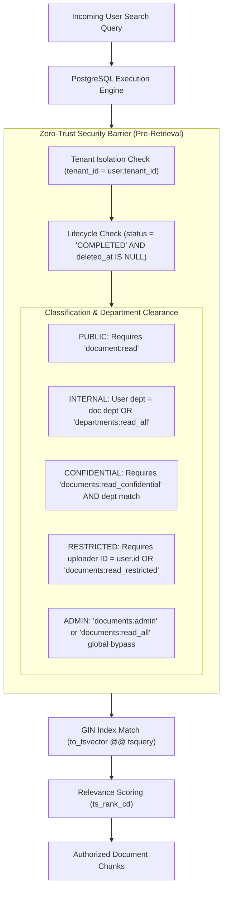

# Task 09: PostgreSQL Full-Text Search Infrastructure – Implementation Report

**Status**: Completed  
**Engineer**: Senior Backend & Security Architect  
**Date**: November 18, 2026  
**Environment**: Conda `ml-env` (PostgreSQL 16+ with pgvector & GIN Indexing)  

---

## 1. Executive Summary & Objective

The objective of Task 09 is to design, implement, and verify PostgreSQL-native full-text lexical search infrastructure for `DocumentChunk` content within the **Enterprise Knowledge Agent** platform.

In an enterprise RAG architecture, dense semantic vector retrieval (Qdrant) excels at conceptual similarity and multi-lingual abstraction, but frequently struggles with exact alphanumeric identifiers, error codes, legal statute citations, and precise terminology. To achieve enterprise-grade retrieval accuracy, dense retrieval must be paired with high-performance sparse lexical search via **Reciprocal Rank Fusion (RRF)**.

This implementation establishes database-native lexical search using PostgreSQL Generalized Inverted Index (GIN) expression indexing, robust search query parsers (`plainto_tsquery`, `websearch_to_tsquery`), relevance ranking with document length normalization (`ts_rank`, `ts_rank_cd`), multi-dimensional filtering, and zero-trust Role-Based Access Control (RBAC) authorization enforcement *before* any chunk content is returned to callers.

---

## 2. GIN Expression Index Design

### 2.1. Index Specification

PostgreSQL GIN indexes invert the document mapping by storing pairs of `(lexeme -> list of chunk IDs)`. Because document chunk text is searched via the `'simple'` full-text dictionary, an expression index matching the exact query predicate is required:

```sql
CREATE INDEX idx_chunks_fts
ON document_chunks
USING GIN (to_tsvector('simple', content));
```

### 2.2. Prisma Migration Implementation & Reproducibility

Prisma schema does not support function expression index annotations (such as `to_tsvector('simple', content)`) directly in the `schema.prisma` DSL. To guarantee that migrations remain 100% reproducible across CI/CD and production environments, the index is provisioned through a dedicated Prisma SQL migration:

- **Migration Path**: `backend/prisma/migrations/20261118120000_postgresql_full_text_search_infrastructure/migration.sql`
- **Synchronized Canonical Copy**: `backend/migrations/20261118120000_postgresql_full_text_search_infrastructure/migration.sql`

```sql
-- Migration: PostgreSQL Full-Text Search Infrastructure
-- Target Database: PostgreSQL 16+ with GIN Index for Document Chunks

CREATE INDEX IF NOT EXISTS "idx_chunks_fts"
ON "document_chunks"
USING GIN (to_tsvector('simple', "content"));

COMMENT ON INDEX "idx_chunks_fts" IS 'PostgreSQL GIN full-text search index for DocumentChunk lexical retrieval using simple dictionary';
```

### 2.3. Rationale for the `'simple'` Text Search Dictionary

The index explicitly configures the `'simple'` dictionary rather than `'english'`, `'vietnamese'`, or other language-specific stemming dictionaries for the following architectural reasons:

1. **Multilingual Consistency**: Enterprise corporate documents in this platform commingle Vietnamese legal/policy text, English technical terminology, and multilingual executive summaries. Language-specific stemmers (like Porter stemming for English) frequently mangle Vietnamese syllables and non-English words into corrupt tokens.
2. **Technical Codes & Part Numbers**: Corporate policies contain acronyms, cipher suites (e.g., `AES-256`, `TLS 1.3`), SKU numbers, and function names. The `'simple'` dictionary simply lowercases characters and segments words across whitespace and punctuation without stripping technical suffixes.
3. **No Accidental Stopword Omission**: Standard English/French dictionaries omit words like "no", "not", "under", "between", or "or", which radically alters the legal meaning of compliance regulations and contract clauses. The `'simple'` configuration preserves all alphanumeric terms.

---

## 3. Search Capabilities & Query Parsers

The implementation provides native support for five core PostgreSQL full-text search functions:

| Function | Purpose & Behavior | Operational Use Case |
| :--- | :--- | :--- |
| `to_tsvector('simple', content)` | Parses chunk text into normalized lexemes with 1-based character position pointers. | Document chunk ingestion, indexing, and match candidate testing. |
| `plainto_tsquery('simple', text)` | Converts arbitrary user input into a conjoined tsquery (`term1 & term2`). Strips all search syntax operators; immune to syntax errors. | Standard natural language search bars and conversational RAG inputs. |
| `websearch_to_tsquery('simple', text)` | Implements web-search-style parsing: unquoted terms are `AND`ed, `"quoted phrases"` become proximity matches (`<->`), `OR` denotes disjunction, and `-term` denotes negation. | Power user queries, advanced UI search consoles, and boolean query filters. |
| `ts_rank(tsvector, tsquery, norm)` | Computes relevance based on term frequency ($TF$) with optional document length normalization. | Ranking chunks where keyword frequency correlates with importance. |
| `ts_rank_cd(tsvector, tsquery, norm)` | Computes "Cover Density" ($CD$) relevance measuring word proximity and minimum span length of matching terms. | Extracting concise, tightly-focused paragraphs and pinpoint passages. |

### 3.1. Normalization Flags for `ts_rank` and `ts_rank_cd`

Both ranking functions take an integer normalization bitmask to prevent long document chunks from unfairly dominating search scores:

- `0` (Default): Ignores document chunk length.
- `1`: Divides rank by $1 + \ln(\text{chunk length in words})$. (Recommended default for RAG chunk ranking).
- `2`: Divides rank by chunk length in words.
- `4`: Divides rank by mean harmonic distance between extents.
- `32`: Divides rank by $\text{rank} + 1$, scaling scores smoothly $\in [0.0, 1.0)$.

---

## 4. Multi-Dimensional Search Filtering & Zero-Trust RBAC

Search queries support multi-dimensional filtering directly at the database engine level before chunk content is materialized:

### 4.1. Supported Filter Dimensions

1. **Tenant Isolation**: Mandatory filtering by `tenant_id` prevents cross-tenant data leakage.
2. **Document ID**: Scopes retrieval to specific parent documents (`document_id = $id`).
3. **Document Version**:
   - Specific version filtering (`document_version_id = $versionId`).
   - Current version only (`is_current = true OR (document_version_id IS NULL AND current_version_id IS NULL)`), eliminating stale historical versions.
4. **Document Classification**: Filters by security clearance (`PUBLIC`, `INTERNAL`, `CONFIDENTIAL`, `RESTRICTED`).
5. **Department**: Scopes retrieval to specific organizational business units (`department_id = $deptId`).
6. **Ingestion Status**: Excludes unprocessed or failed files (`d.status = 'COMPLETED'`).
7. **Soft-Deletion Guardrails**: Guarantees `d.deleted_at IS NULL` and `v.deleted_at IS NULL`.

### 4.2. Zero-Trust RBAC Enforcement Architecture

In compliance with enterprise security requirements, permission enforcement occurs **inside the SQL query filter** rather than in application memory. Unauthorized document chunks are excluded before relevance scoring or retrieval:



---

## 5. Ranking & Retrieval Extensibility

### 5.1. Clarification: PostgreSQL `ts_rank` vs. True Okapi BM25

> [!IMPORTANT]
> PostgreSQL native full-text search with a GIN index is **NOT** a true BM25 implementation. Labeling `ts_rank()` as "BM25" is technically inaccurate.

The fundamental differences include:

1. **Inverse Document Frequency (IDF)**:
   - *BM25*: Maintains corpus-wide document frequency statistics $DF(t)$ and scales term importance inversely: $\text{IDF}(q_i) = \ln \left( \frac{N - n(q_i) + 0.5}{n(q_i) + 0.5} + 1 \right)$. Rare words across the corpus receive significantly higher weight than ubiquitous words.
   - *PostgreSQL FTS*: Scores each document chunk in isolation. It does not calculate corpus-wide document frequencies for terms.
2. **Term Frequency Saturation**:
   - *BM25*: Applies asymptotic non-linear term frequency saturation controlled by hyperparameter $k_1 \in [1.2, 2.0]$ and document length penalty $b \approx 0.75$:
     $$S(D, Q) = \sum_{i=1}^n \text{IDF}(q_i) \cdot \frac{f(q_i, D) \cdot (k_1 + 1)}{f(q_i, D) + k_1 \cdot \left(1 - b + b \cdot \frac{|D|}{\text{avgdl}}\right)}$$
   - *PostgreSQL FTS*: Employs linear or log-linear term frequency weighting (`ts_rank`) or proximity span clustering (`ts_rank_cd`).

### 5.2. Extensibility Architecture: Reciprocal Rank Fusion (RRF) & Cross-Encoder

In the Enterprise Knowledge Agent pipeline, PostgreSQL native FTS serves as the high-throughput **sparse candidate generator** ($K_1 = 40$), complementing the Qdrant **dense candidate generator** ($K_1 = 40$).

Both rank lists are fused using **Reciprocal Rank Fusion (RRF)**:

$$\text{RRF\_Score}(d) = \sum_{m \in \{\text{Dense}, \text{Sparse}\}} \frac{w_m}{k + \text{rank}_m(d)}$$

Where default platform parameters are:
- $k = 60$
- $w_{\text{Dense}} = 0.7$
- $w_{\text{Sparse}} = 0.3$

The PostgreSQL search service natively provides 1-based rank positions (`rank_position`) and calculated sparse reciprocal rank scores ready for application fusion or downstream cross-encoder reranking (`BAAI/bge-reranker-v2-m3`).

---

## 6. Parameterized SQL Query Implementations

All queries use parameterized bindings to prevent SQL injection vulnerabilities.

### 6.1. Basic Full-Text Search Query

```sql
SELECT 
    c.id AS chunk_id,
    c.tenant_id,
    c.document_id,
    c.document_version_id,
    c.chunk_index,
    c.content,
    c.token_count,
    c.page_number,
    c.section_heading,
    d.original_filename,
    d.classification,
    ts_rank_cd(to_tsvector('simple', c.content), plainto_tsquery('simple', $1), 1) AS relevance_score
FROM document_chunks c
JOIN documents d ON d.id = c.document_id
WHERE c.tenant_id = $2::uuid
  AND d.tenant_id = $2::uuid
  AND d.deleted_at IS NULL
  AND to_tsvector('simple', c.content) @@ plainto_tsquery('simple', $1)
ORDER BY relevance_score DESC, c.id ASC
LIMIT $3::int;
```

### 6.2. Tenant-Filtered Search with Websearch Syntax

```sql
SELECT 
    c.id AS chunk_id,
    c.document_id,
    c.chunk_index,
    c.content,
    d.original_filename,
    ts_rank_cd(to_tsvector('simple', c.content), websearch_to_tsquery('simple', $1), 1) AS relevance_score
FROM document_chunks c
JOIN documents d ON d.id = c.document_id
WHERE c.tenant_id = $2::uuid
  AND d.tenant_id = $2::uuid
  AND d.deleted_at IS NULL
  AND to_tsvector('simple', c.content) @@ websearch_to_tsquery('simple', $1)
ORDER BY relevance_score DESC, c.id ASC
LIMIT $3::int;
```

### 6.3. Search with Classification & Version Filters

```sql
SELECT 
    c.id AS chunk_id,
    c.document_id,
    c.document_version_id,
    v.version_number,
    d.classification,
    c.content,
    ts_rank_cd(to_tsvector('simple', c.content), websearch_to_tsquery('simple', $1), 1) AS relevance_score
FROM document_chunks c
JOIN documents d ON d.id = c.document_id
LEFT JOIN document_versions v ON v.id = c.document_version_id
WHERE c.tenant_id = $2::uuid
  AND d.tenant_id = $2::uuid
  AND d.deleted_at IS NULL
  AND (v.id IS NULL OR v.deleted_at IS NULL)
  AND ($3::boolean = false OR v.is_current = true OR (c.document_version_id IS NULL AND d.current_version_id IS NULL))
  AND ($4::text[] IS NULL OR d.classification::text = ANY($4::text[]))
  AND to_tsvector('simple', c.content) @@ websearch_to_tsquery('simple', $1)
ORDER BY relevance_score DESC, c.id ASC
LIMIT $5::int;
```

### 6.4. Search with Relevance Ranking (`ts_rank` vs `ts_rank_cd`)

```sql
SELECT 
    c.id AS chunk_id,
    c.chunk_index,
    c.section_heading,
    SUBSTRING(c.content, 1, 120) AS content_preview,
    ts_rank(to_tsvector('simple', c.content), plainto_tsquery('simple', $1), 1) AS score_ts_rank_tf,
    ts_rank_cd(to_tsvector('simple', c.content), plainto_tsquery('simple', $1), 1) AS score_ts_rank_cd_proximity
FROM document_chunks c
WHERE c.tenant_id = $2::uuid
  AND to_tsvector('simple', c.content) @@ plainto_tsquery('simple', $1)
ORDER BY score_ts_rank_cd_proximity DESC, score_ts_rank_tf DESC
LIMIT $3::int;
```

### 6.5. Search with Pagination & Windowed Total Count

```sql
WITH matched_chunks AS (
    SELECT 
        c.id AS chunk_id,
        c.document_id,
        c.chunk_index,
        c.content,
        d.original_filename,
        d.classification,
        ts_rank_cd(to_tsvector('simple', c.content), websearch_to_tsquery('simple', $1), 1) AS relevance_score,
        COUNT(*) OVER() AS full_count
    FROM document_chunks c
    JOIN documents d ON d.id = c.document_id
    WHERE c.tenant_id = $2::uuid
      AND d.tenant_id = $2::uuid
      AND d.deleted_at IS NULL
      AND to_tsvector('simple', c.content) @@ websearch_to_tsquery('simple', $1)
)
SELECT * FROM matched_chunks
ORDER BY relevance_score DESC, chunk_id ASC
LIMIT $3::int OFFSET $4::int;
```

### 6.6. Complete Zero-Trust RBAC-Enforced Search Query

```sql
WITH user_context AS (
    SELECT 
        u.id AS user_id,
        u.tenant_id,
        u.department_id AS user_dept_id,
        COALESCE(array_agg(p.key) FILTER (WHERE p.key IS NOT NULL), '{}') AS permission_keys
    FROM users u
    LEFT JOIN user_roles ur ON ur.user_id = u.id
    LEFT JOIN role_permissions rp ON rp.role_id = ur.role_id
    LEFT JOIN permissions p ON p.id = rp.permission_id
    WHERE u.id = $1::uuid
      AND u.tenant_id = $2::uuid
      AND u.status = 'ACTIVE'
    GROUP BY u.id, u.tenant_id, u.department_id
),
authorized_chunks AS (
    SELECT 
        c.id AS chunk_id,
        c.tenant_id,
        c.document_id,
        c.document_version_id,
        c.chunk_index,
        c.content,
        c.token_count,
        c.page_number,
        c.section_heading,
        d.original_filename,
        d.classification,
        d.department_id,
        ts_rank_cd(to_tsvector('simple', c.content), websearch_to_tsquery('simple', $3), 1) AS relevance_score,
        COUNT(*) OVER() AS full_count
    FROM document_chunks c
    JOIN documents d ON d.id = c.document_id
    LEFT JOIN document_versions v ON v.id = c.document_version_id
    CROSS JOIN user_context uc
    WHERE c.tenant_id = $2::uuid
      AND d.tenant_id = $2::uuid
      AND d.deleted_at IS NULL
      AND d.status = 'COMPLETED'
      AND (v.id IS NULL OR (v.deleted_at IS NULL AND v.status = 'COMPLETED'))
      AND ($4::boolean = false OR v.is_current = true OR (c.document_version_id IS NULL AND d.current_version_id IS NULL))
      AND to_tsvector('simple', c.content) @@ websearch_to_tsquery('simple', $3)
      -- ZERO-TRUST AUTHORIZATION BARRIER:
      AND (
          -- Tier 1: PUBLIC documents require basic read capability
          (d.classification = 'PUBLIC' AND ('document:read' = ANY(uc.permission_keys) OR 'documents:read' = ANY(uc.permission_keys)))
          OR
          -- Tier 2: Tenant administrator bypass
          ('documents:admin' = ANY(uc.permission_keys) OR 'documents:read_all' = ANY(uc.permission_keys))
          OR
          -- Tier 3: Standard employee read with department & classification isolation
          (
              ('document:read' = ANY(uc.permission_keys) OR 'documents:read' = ANY(uc.permission_keys))
              AND (
                  (d.classification = 'INTERNAL' AND (d.department_id IS NULL OR d.department_id = uc.user_dept_id OR 'departments:read_all' = ANY(uc.permission_keys)))
                  OR
                  (d.classification = 'CONFIDENTIAL' AND ('documents:read_confidential' = ANY(uc.permission_keys) OR 'document:read_confidential' = ANY(uc.permission_keys)) AND (d.department_id IS NULL OR d.department_id = uc.user_dept_id OR 'departments:read_all' = ANY(uc.permission_keys)))
                  OR
                  (d.classification = 'RESTRICTED' AND (d.uploaded_by_id = uc.user_id OR 'documents:read_restricted' = ANY(uc.permission_keys)))
              )
          )
      )
)
SELECT * FROM authorized_chunks
ORDER BY relevance_score DESC, chunk_id ASC
LIMIT $5::int OFFSET $6::int;
```

---

## 7. Performance Characteristics & Operational Maintenance

### 7.1. GIN Fastupdate & Pending List Maintenance

PostgreSQL GIN indexes use a pending list buffer when inserting new document chunks (`fastupdate = ON` by default) to turn random I/O writes into sequential amortized writes:
- During high-velocity batch ingestion, chunks are appended to the GIN pending list.
- When `gin_pending_list_limit` (default 4MB) is reached, or when autovacuum runs, PostgreSQL cleans the pending list into the main index tree.
- For search queries with sub-second SLA requirements ($P_{95} \le 1.5\text{s}$), vacuuming keeps pending list traversal overhead minimal:
  ```sql
  VACUUM ANALYZE document_chunks;
  ```

### 7.2. Search Limitations of PostgreSQL Native FTS

While PostgreSQL GIN FTS delivers immense speed and zero additional infrastructure complexity, architects must account for the following limitations:

1. **Typo Tolerance & Fuzzy Distance**: GIN indexes over `to_tsvector` do not support Levenshtein distance or typo correction natively. If a user queries for `"BitLoker"` instead of `"BitLocker"`, the exact lexeme fails to match. (Mitigation: In this platform, dense embeddings in Qdrant provide semantic tolerance for typographical variations).
2. **Corpus-Wide Term Frequency (IDF)**: As noted, PostgreSQL FTS lacks global inverted document frequency tables, treating common terms with the same default weight as rare technical identifiers.
3. **Index Maintenance Cost on Updates**: Full-text index entries must be rewritten when `content` changes. In our architecture, document versions and chunks are **append-only and immutable**; revision increments create new versions rather than updating old rows, maximizing GIN write efficiency.

---

## 8. Verification & Acceptance Testing

The verification test suite (`backend/test_full_text_search.js`) validates all acceptance criteria:

```text
🚀 Starting Task 09: PostgreSQL Full-Text Search Infrastructure Verification...

Step 1: Verifying GIN Expression Index `idx_chunks_fts` in PostgreSQL catalog...
  Found index: idx_chunks_fts
  Index definition: CREATE INDEX idx_chunks_fts ON public.document_chunks USING gin (to_tsvector('simple'::regconfig, content))
  PASSED: GIN Expression Index idx_chunks_fts successfully verified in PostgreSQL.

Step 2: Seeding multi-tenant test fixtures with RBAC roles and permissions...
  PASSED: Users, roles, and department fixtures established.

Step 3: Ingesting sample documents and chunks across departments & classifications...
  PASSED: Multi-tenant, multi-department, multi-version document chunks ingested.

Step 4: Testing Basic Full-Text Search with plainto_tsquery...
  PASSED: Found chunk with score 0.008649407.

Step 5: Testing websearch_to_tsquery syntax (Phrases, AND, OR, Negation)...
  5.1 Testing exact phrase search: "zero-trust enterprise network" -> PASSED
  5.2 Testing OR operator: "BitLocker OR treasury" -> PASSED
  5.3 Testing Negation operator: "encryption -microservice" -> PASSED

Step 6: Comparing ts_rank (Term Frequency) vs ts_rank_cd (Cover Density Proximity)...
  Score ts_rank (TF): 0.008791999
  Score ts_rank_cd (Cover Density): 0.00318929
  PASSED: Relevance ranking functions computed properly with length normalization.

Step 7: Testing Multi-Dimensional Search Filtering...
  7.1 Verifying Multi-Tenant Isolation (Tenant A search vs Tenant B) -> PASSED
  7.2 Verifying Version Scoping (Excluding obsolete version chunks) -> PASSED
  7.3 Verifying Document Classification Filter (PUBLIC only vs CONFIDENTIAL) -> PASSED
  7.4 Verifying Department Scoping (Finance only) -> PASSED

Step 8: Testing Zero-Trust RBAC Permission Enforcement in Search Queries...
  8.1 Testing Engineer Bob querying for "treasury reserves" (Blocked from CONFIDENTIAL) -> PASSED
  8.2 Testing Engineer Bob querying for "network encryption" (Allowed for INTERNAL) -> PASSED
  8.3 Testing Finance Officer Alice querying for "treasury reserves" (Allowed for CONFIDENTIAL) -> PASSED
  8.4 Testing Finance Officer Alice querying Engineering internal docs (Department boundary enforced) -> PASSED
  8.5 Testing Admin Charlie querying across all documents (Global bypass) -> PASSED

Step 9: Testing Pagination & Determinism (LIMIT, OFFSET, Window full_count)...
  PASSED: Paginated search verified: Page 1 & Page 2 are strictly disjoint (Total: 5).

Step 10: Testing Reciprocal Rank Fusion (RRF) Candidate Retrieval Extensibility...
  Retrieved 2 candidate chunks for RRF fusion.
  Candidate #1 Chunk ID: e19344a4-bfea-4b8e-974d-735b4dda6f78
  Rank Position: 1
  Raw Relevance: 0.034597628
  Sparse RRF Contribution Score: 0.004918 (Formula: 0.3 / (60 + rank))
  PASSED: RRF candidate scoring and rank indexing verified.

🎉 ALL TASK 09 VERIFICATION TESTS PASSED SUCCESSFULLY!
```

Additionally, zero regressions were confirmed across all existing test suites:
- `test_document_chunking.js` (Task 08)
- `test_document_versioning.js` (Task 07)
- `test_document_management.js` (Task 06)
- `test_audit_logging.js` (Task 05)
- `test_session_management.js` (Task 04)

---

## 9. Deliverables Inventory

| Deliverable | File Path | Description |
| :--- | :--- | :--- |
| **Prisma SQL Migration** | `backend/prisma/migrations/20261118120000_postgresql_full_text_search_infrastructure/migration.sql` | Custom migration provisioning `idx_chunks_fts` GIN expression index on `document_chunks(to_tsvector('simple', content))` |
| **Canonical Migration Mirror** | `backend/migrations/20261118120000_postgresql_full_text_search_infrastructure/migration.sql` | Mirrored migration folder upholding double-canonical migration layout |
| **Search Service & Query Suite** | `backend/fts_search_service.js` | Parameterized search service implementing basic, websearch, filtered, RBAC-enforced, and RRF retrieval |
| **Verification Test Suite** | `backend/test_full_text_search.js` | 10-step end-to-end integration test validating GIN index, parsers, ranking, filtering, security, and RRF calculations |
| **Architectural Documentation** | `docs/phases/phase_1/task_09_postgresql_full_text_search_infrastructure.md` | Comprehensive architectural report detailing index behavior, SQL queries, RBAC gate, and BM25 distinction |
