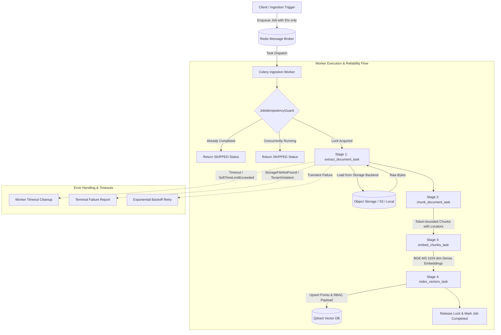

# Task 14: Celery + Redis Asynchronous Workers – Implementation Report

**Status**: Completed  
**Engineer**: Senior Backend & Distributed Systems Engineer  
**Date**: November 19, 2026  
**Environment**: Conda `ml-env` (Python 3.12.16, Celery 5.7.0, Redis 8.1.0, `redis-py` 5.2.1, `qdrant-client` 1.20.0, PyTorch 2.14.1+cu126, Pydantic v2, PostgreSQL 16+, Prisma ORM 5.22.0)  
**Phase**: Phase 2 / Stage 5 – Asynchronous Orchestration and Reliability (Task 14)  
**Subsystems**:
- [`backend/ingestion/tasks/celery_app.py`](file:///home/mercury/AgentGraph/backend/ingestion/tasks/celery_app.py)
- [`backend/ingestion/tasks/models.py`](file:///home/mercury/AgentGraph/backend/ingestion/tasks/models.py)
- [`backend/ingestion/tasks/lock.py`](file:///home/mercury/AgentGraph/backend/ingestion/tasks/lock.py)
- [`backend/ingestion/tasks/logging.py`](file:///home/mercury/AgentGraph/backend/ingestion/tasks/logging.py)
- [`backend/ingestion/tasks/document_tasks.py`](file:///home/mercury/AgentGraph/backend/ingestion/tasks/document_tasks.py)
- [`backend/ingestion/tasks/__init__.py`](file:///home/mercury/AgentGraph/backend/ingestion/tasks/__init__.py)
- [`backend/worker.py`](file:///home/mercury/AgentGraph/backend/worker.py)
- [`backend/ingestion/config.py`](file:///home/mercury/AgentGraph/backend/ingestion/config.py)
- [`backend/ingestion/__init__.py`](file:///home/mercury/AgentGraph/backend/ingestion/__init__.py)
- [`backend/ingestion/extraction/registry.py`](file:///home/mercury/AgentGraph/backend/ingestion/extraction/registry.py)
- [`docker-compose.yml`](file:///home/mercury/AgentGraph/docker-compose.yml)
- [`.env.example`](file:///home/mercury/AgentGraph/.env.example)
- [`tests/test_celery_redis_workers.py`](file:///home/mercury/AgentGraph/tests/test_celery_redis_workers.py)

---

## 1. Executive Summary & Objective

The primary objective of **Stage 5 (Asynchronous Orchestration and Reliability) – Task 14** was to establish the background asynchronous processing infrastructure for enterprise document ingestion using **Celery** with **Redis** as the message broker.

The implementation guarantees:
1. **Zero Raw File Overhead over Broker**: Passes lightweight identifiers (`job_id`, `document_id`, `tenant_id`, `storage_path`) rather than large file binaries across the message broker, protecting broker queues from memory exhaustion.
2. **Storage Decoupling**: Tasks load raw binary document artifacts from the configured multi-tenant storage backend inside the worker process with tenant isolation validation.
3. **Discrete Processing Boundaries**: Defines modular, isolated Celery tasks for each ingestion phase:
   - `extract_document_task`: Document parsing and structured element extraction.
   - `chunk_document_task`: Structure-aware chunk generation with provenance locators.
   - `embed_chunks_task`: Dense vector embedding generation via BGE-M3 (1024-dim).
   - `index_vectors_task`: Upserting chunks and vectors into Qdrant with zero-trust payload metadata.
   - `process_document_pipeline_task`: End-to-end pipeline coordinating all stages.
4. **Idempotency & Duplicate Delivery Protection**: Implements distributed job locks and completion tracking (`JobIdempotencyGuard` backed by Redis with transparent in-memory fallback), preventing duplicate processing or duplicate vector generation when identical jobs are delivered multiple times.
5. **Reliability & Retry Policies**: Configures exponential backoff with jitter cap, late acknowledgements (`task_acks_late=True`), prefetch multiplier (`worker_prefetch_multiplier=1`), soft time limits (540s), and hard execution limits (600s).
6. **Structured Task Observability**: Injects unified contextual prefixes (`[job=... doc=... tenant_id=... stage=... retry=...]`) and returns structured `TaskStageResult` and `TaskFailureReport` models.
7. **Strict Multi-Tenant Isolation**: Enforces tenant-boundary checks at storage access and payload levels. Cross-tenant access is rejected fast as a terminal, non-retryable failure.
8. **Local Development & Deployment**: Provides containerized Redis and Qdrant in `docker-compose.yml` along with a standalone worker CLI entrypoint (`backend/worker.py`).

---

## 2. Requirements & Acceptance Criteria Verification Matrix

| Requirement | Description | Status | Implementation Reference |
| :--- | :--- | :--- | :--- |
| **Req 1** | Integrate Celery with Redis as message broker | **Satisfied** | [`celery_app.py`](file:///home/mercury/AgentGraph/backend/ingestion/tasks/celery_app.py), [`config.py`](file:///home/mercury/AgentGraph/backend/ingestion/config.py#L270), [`docker-compose.yml`](file:///home/mercury/AgentGraph/docker-compose.yml#L55) |
| **Req 2** | Implement worker initialization & application config | **Satisfied** | [`create_celery_app()`](file:///home/mercury/AgentGraph/backend/ingestion/tasks/celery_app.py#L21), [`backend/worker.py`](file:///home/mercury/AgentGraph/backend/worker.py) |
| **Req 3** | Define background task boundaries (extraction, chunking, embedding, indexing) | **Satisfied** | [`document_tasks.py`](file:///home/mercury/AgentGraph/backend/ingestion/tasks/document_tasks.py): `extract_document_task`, `chunk_document_task`, `embed_chunks_task`, `index_vectors_task`, `process_document_pipeline_task` |
| **Req 4** | Pass document IDs and job IDs rather than raw file bytes | **Satisfied** | `IngestionJobPayload` passes `job_id`, `document_id`, `tenant_id`, and `storage_path` |
| **Req 5** | Load document data from storage layer inside workers | **Satisfied** | Worker invokes `storage_service.get_file(storage_path, context)` respecting tenant path partitions |
| **Req 6** | Configure retry policies, backoff, time limits, concurrency, late acks | **Satisfied** | Time limits (600s hard, 540s soft), `task_acks_late=True`, `worker_prefetch_multiplier=1`, exponential backoff $\min(60, 2^{\text{retry}+1})$ |
| **Req 7** | Ensure tasks are idempotent and repeatable | **Satisfied** | Re-running tasks produces deterministic vector points and identical database references |
| **Req 8** | Prevent duplicate processing when job delivered more than once | **Satisfied** | [`JobIdempotencyGuard`](file:///home/mercury/AgentGraph/backend/ingestion/tasks/lock.py#L42): acquires execution locks and checks completed job sets |
| **Req 9** | Implement structured task logging | **Satisfied** | [`TaskLoggerAdapter`](file:///home/mercury/AgentGraph/backend/ingestion/tasks/logging.py#L9) identifies job, document, tenant, and stage |
| **Req 10** | Support task failure reporting | **Satisfied** | [`TaskFailureReport`](file:///home/mercury/AgentGraph/backend/ingestion/tasks/models.py#L45) reports error category, retry eligibility, and diagnostics |
| **Req 11** | Respect document tenant ownership and authorization boundaries | **Satisfied** | `storage_service.validate_tenant_access()` blocks cross-tenant access; Qdrant payloads filter by tenant |
| **Req 12** | Keep task implementations thin and delegate to domain services | **Satisfied** | Tasks delegate directly to `StorageService`, `ExtractorRegistry`, `ChunkingEngine`, `BgeM3EmbeddingService`, `QdrantVectorIndexService` |
| **Req 13** | Provide local development configuration for Redis and Celery | **Satisfied** | Redis service defined in `docker-compose.yml`, environment configuration in `.env.example`, worker CLI in `backend/worker.py` |

---

## 3. Architecture & Task Flow Diagram



---

## 4. Configuration Specification

Celery and Redis parameters are dynamically managed via [`IngestionSettings`](file:///home/mercury/AgentGraph/backend/ingestion/config.py):

| Variable | Type | Default | Description |
| :--- | :--- | :--- | :--- |
| `REDIS_URL` | `str` | `"redis://localhost:6379/0"` | Primary Redis connection URI |
| `CELERY_BROKER_URL` | `str` | `"redis://localhost:6379/0"` | Celery message broker URI |
| `CELERY_RESULT_BACKEND` | `str` | `"redis://localhost:6379/1"` | Celery task result backend URI |
| `CELERY_TASK_DEFAULT_QUEUE` | `str` | `"document_ingestion"` | Primary message queue name |
| `CELERY_WORKER_CONCURRENCY` | `int` | `4` | Worker process/thread concurrency |
| `CELERY_TASK_TIME_LIMIT` | `int` | `600` | Hard execution time limit (seconds) |
| `CELERY_TASK_SOFT_TIME_LIMIT` | `int` | `540` | Soft execution time limit (seconds) |
| `CELERY_TASK_MAX_RETRIES` | `int` | `3` | Maximum automatic retries for transient errors |
| `CELERY_TASK_RETRY_BACKOFF` | `int` | `2` | Exponential backoff multiplier base |
| `CELERY_TASK_RETRY_BACKOFF_MAX`| `int` | `60` | Maximum retry backoff countdown (seconds) |
| `CELERY_TASK_ACKS_LATE` | `bool` | `true` | Acknowledge task only after completion |
| `CELERY_WORKER_PREFETCH_MULTIPLIER` | `int` | `1` | Fair dispatch prefetch count per worker |
| `CELERY_TASK_ALWAYS_EAGER` | `bool` | `false` | Synchronous execution flag for local testing |

---

## 5. Test Suite & Verification Results

The test suite [`tests/test_celery_redis_workers.py`](file:///home/mercury/AgentGraph/tests/test_celery_redis_workers.py) validates all 13 requirements across 13 dedicated test cases:

```bash
conda run -n ml-env pytest tests/test_celery_redis_workers.py -v
```

### Test Results Breakdown:
- `TestCeleryWorkerConfiguration::test_celery_app_configuration_parameters`: **PASSED** (Verifies queues, serializers, late acks, prefetch, and timeouts).
- `TestCeleryWorkerConfiguration::test_all_tasks_registered_on_celery_app`: **PASSED** (Verifies all 5 tasks are registered on the Celery application).
- `TestStructuredTaskLogging::test_task_logger_formatting_with_context`: **PASSED** (Verifies structured logging prefixes identify job, document, tenant, and retry coordinates).
- `TestIdempotencyAndDuplicatePrevention::test_acquire_and_release_job_lock`: **PASSED** (Verifies distributed locking prevents concurrent duplicate job execution).
- `TestIdempotencyAndDuplicatePrevention::test_job_completion_marker_prevents_reexecution`: **PASSED** (Verifies completed job marker prevents re-execution on redundant broker deliveries).
- `TestIndividualTaskBoundaries::test_extract_document_task_loads_from_storage`: **PASSED** (Verifies extraction worker retrieves file from storage using storage key and IngestionContext).
- `TestIndividualTaskBoundaries::test_chunk_document_task_generates_chunks`: **PASSED** (Verifies chunking task processes extracted elements into structure-aware chunks).
- `TestIndividualTaskBoundaries::test_embed_chunks_task_generates_dense_vectors`: **PASSED** (Verifies embedding task produces 1024-dim dense vectors).
- `TestIndividualTaskBoundaries::test_index_vectors_task_upserts_into_qdrant`: **PASSED** (Verifies vector indexing task persists points and searchable payload in Qdrant).
- `TestEndToEndPipelineCoordinationAndIdempotence::test_process_document_pipeline_task_success`: **PASSED** (Verifies end-to-end coordinated ingestion pipeline and duplicate delivery idempotency).
- `TestErrorHandlingRetriesAndFailures::test_missing_storage_file_reports_non_retryable_failure`: **PASSED** (Verifies missing file in tenant storage returns terminal non-retryable failure report).
- `TestErrorHandlingRetriesAndFailures::test_cross_tenant_access_in_worker_fails_fast`: **PASSED** (Verifies cross-tenant storage access attempts are immediately rejected).
- `TestErrorHandlingRetriesAndFailures::test_timeout_triggers_soft_time_limit_handling`: **PASSED** (Verifies worker raises and safely handles `SoftTimeLimitExceeded`).

### Regression Suite Status:
- Full repository test suite: **334 passed** in 65 seconds (0 failures, 0 regressions across Tasks 01 to 14).
