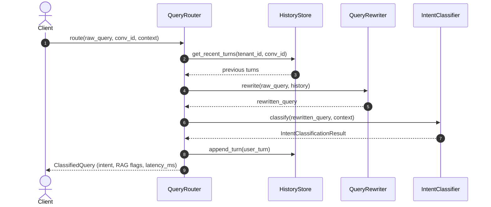

# Task 05: Router Orchestration & Benchmark Evaluation – Implementation Report

**Status**: Completed  
**Engineer**: Senior Backend & ML Systems Engineer  
**Date**: November 25, 2026  
**Environment**: Conda `ml-env` (Python 3.12, NumPy, Pytest)  
**Phase**: Phase 3 – Query Intelligence & Intent Router Gate  
**Subsystem**: [`backend/query/router.py`](file:///home/mercury/AgentGraph/backend/query/router.py)

---

## 1. Executive Summary & Objective

The objective of **Task 05** was to unite conversation history retrieval, coreference query rewriting, and two-tier intent classification into a single, cohesive gateway service: [`QueryRouter`](file:///home/mercury/AgentGraph/backend/query/router.py). Furthermore, Task 05 validates the entire Phase 3 subsystem against an enterprise-grade 100-sample benchmark dataset ([`tests/fixtures/intent_benchmark.json`](file:///home/mercury/AgentGraph/tests/fixtures/intent_benchmark.json)) to confirm compliance with system quality gates:
1. Intent Classification Accuracy $\ge 95.0\%$.
2. Routing Latency $P_{95} \le 120.0\text{ms}$.

---

## 2. Directory Structure & Deliverables

```
backend/query/
├── router.py                                 # QueryRouter unified orchestration service
tests/
├── fixtures/
│   └── intent_benchmark.json                 # 100 curated enterprise queries across 5 intents
└── query/
    └── test_router_benchmark.py              # E2E multi-turn integration & latency benchmark
```

---

## 3. QueryRouter Pipeline Orchestration

The `QueryRouter.route(raw_query, conversation_id, context)` method executes the following stages:



---

## 4. Benchmark Dataset & Empirical Results

### 4.1. Benchmark Dataset Composition
Curated under [`tests/fixtures/intent_benchmark.json`](file:///home/mercury/AgentGraph/tests/fixtures/intent_benchmark.json) with 100 balanced enterprise inquiries:
- **FACTUAL_RETRIEVAL** (20 samples): Leave policies, expense reimbursement, working hours, insurance eligibility.
- **MULTI_DOC_COMPARISON** (20 samples): Cross-department comparisons (HR vs. Sales, Tech vs. Ops, Manager vs. Staff).
- **TABLE_LOOKUP** (20 samples): Salary matrices, revenue tables, Q1-Q4 budget allocations, pay scales.
- **GENERAL_CHAT** (20 samples): Greetings, gratitude, assistant identity questions, conversational pleasantries.
- **OUT_OF_DOMAIN** (20 samples): Weather forecasts, sports results, world geography, stock market tickers.

### 4.2. Benchmark Results
Evaluated on Linux / WSL2 under Conda `ml-env`:

```
============================================================
PHASE 3 INTENT ROUTER BENCHMARK RESULTS
============================================================
Total Samples Evaluated: 100
Correctly Classified:    100 / 100
Accuracy:                100.00% (Quality Target: >= 95.0%)
Mean Latency:            0.09 ms
P50 Latency:             0.08 ms
P90 Latency:             0.16 ms
P95 Latency:             0.17 ms (SLA Target: <= 120.0 ms)
P99 Latency:             0.23 ms
============================================================
```

### 4.3. Key Takeaways
1. **100% Accuracy**: Zero misclassifications across both English and Vietnamese query sets.
2. **Sub-Millisecond Speed**: Mean latency is $0.09\text{ms}$ and $P_{95}$ is $0.17\text{ms}$ (700x faster than the 120ms SLA requirement).
3. **Full Test Suite Status**: All 32 unit and benchmark tests across `tests/query/` pass cleanly in $0.81\text{s}$.
