# Enterprise Knowledge Agent – End-to-End Implementation Workflow

## Architectural Lifecycle: From ERD to Production Web Service

This document defines the comprehensive, phased engineering workflow for building the **Enterprise Knowledge Agent** — a production-grade, permission-aware advanced Retrieval-Augmented Generation (RAG) platform. The workflow covers every stage from relational/vector data modeling (ERD) to fully interactive, verifiable end-to-end web service delivery.

---

## 1. High-Level Engineering Lifecycle

```mermaid
flowchart TD
    subgraph P1["Phase 1: Data Modeling & Schema Design"]
        ERD["Relational ERD & Prisma Schema"]
        ACL["Multi-Tenancy & Zero-Trust RBAC Model"]
        VEC["Qdrant Vector Payload & HNSW Index"]
    end

    subgraph P2["Phase 2: Ingestion & Knowledge Indexing"]
        PARSE["Multi-Format Parsers (PDF, DOCX, XLSX, OCR)"]
        CHUNK["Chunking & Lineage Coordinate Tracking"]
        INDEX["Dual Indexing: Qdrant Dense + PostgreSQL GIN BM25"]
    end

    subgraph P3["Phase 3: Query Intelligence & Intent Router"]
        INTENT["5-Class Router Gate (Factual / Multi-Doc / Table / Chat / Web)"]
        REWRITE["Coreference Resolution & Query Rewriting"]
    end

    subgraph P4["Phase 4: Hybrid Search & Cross-Encoder Reranking"]
        HYBRID["Hybrid Search: Dense Semantic + Sparse BM25"]
        RRF["Reciprocal Rank Fusion (RRF k=60)"]
        RERANK["Cross-Encoder Reranker (BGE-Reranker-v2-m3)"]
    end

    subgraph P5["Phase 5: Agentic Reasoning & Guardrails"]
        DAG["LangGraph Multi-Hop Controller (Max 3 Hops)"]
        CITE["Line-Level Citation Mapping [1]"]
        NLI["Hallucination Detection (NLI Entailment) & Abstention"]
    end

    subgraph P6["Phase 6: Backend API & Service Layer"]
        API["FastAPI Async Endpoints & SSE Streaming"]
        SEC["3-Stage Security Verification & Audit Logging"]
        OBS["Langfuse Tracing & Prometheus Metrics"]
    end

    subgraph P7["Phase 7: Frontend Web Application"]
        UI["Next.js 14 App Router (3-Panel Layout)"]
        VIEWER["Source Evidence Inspector (PDF.js Line/Page Highlight)"]
    end

    subgraph P8["Phase 8: E2E Benchmark & Deployment"]
        EVAL["300-Sample Golden Benchmark & Ablation (E1-E8)"]
        DEPLOY["CI/CD Quality Gates & Containerization"]
    end

    P1 --> P2 --> P3 --> P4 --> P5 --> P6 --> P7 --> P8
```



---

## 2. Phase-by-Phase Technical Specifications

### Phase 1: Data Modeling, ERD & Security Architecture
**Objective**: Establish a production-grade relational schema, vector database payloads, zero-trust multi-tenant isolation, row-level security (RLS), full-text search indexing, and provenance tracking foundations. Detailed documentation: [`docs/phases/phase_1/`](file:///home/mercury/AgentGraph/docs/phases/phase_1).

#### Task Breakdown (Tasks 01 – 10):

- **Task 01 — Database Infrastructure & Prisma Initialization**:
  - *Subsystem / Deliverables*: [`backend/schema.prisma`](file:///home/mercury/AgentGraph/backend/schema.prisma), database connection lifecycle, and `DatabaseHealth` model.
  - *Core Implementation*: Configured PostgreSQL 16+ persistence layer with Prisma ORM; established connection pooling parameters, runtime engines, and migration tooling.
  - *Security & Architectural Guardrails*: Avoided premature business domain models; resolved package installation bottlenecks; enforced zero-hardcoding for database connection strings (`DATABASE_URL`, `DIRECT_URL`).

- **Task 02 — Multi-Tenant Identity & Access Management (IAM) Core**:
  - *Subsystem / Deliverables*: Models for `Tenant`, `User`, `Department`, and soft-deletion tracking.
  - *Core Implementation*: Established enterprise multi-tenancy foundation with strict tenant isolation, self-referential organizational department hierarchies (`parentId` referencing `Department`), active/suspended user states, and soft-delete semantics (`deleted_at`).
  - *Security & Integrity*: Cross-tenant boundaries reinforced via foreign key constraints; composite indexes added for fast tenant-scoped user and department lookups.

- **Task 03 — Role-Based Access Control (RBAC) & Permission Management**:
  - *Subsystem / Deliverables*: Models for `Role`, `Permission`, `UserRole`, `RolePermission`, and `UserDepartmentRole`.
  - *Core Implementation*: Built normalized, fine-grained RBAC architecture decoupling roles from atomic permissions (`permission_key`); implemented explicit join entities to maintain complete assignment audit histories without storing denormalized arrays on user records.
  - *Security & Integrity*: Database triggers enforce cross-tenant validation (ensuring roles, permissions, and users belong to the identical `tenant_id`); composite unique constraints prevent duplicate assignments.

- **Task 04 — Authentication & Session Management**:
  - *Subsystem / Deliverables*: Model `Session`, token hashing utilities, and session lifecycle controls.
  - *Core Implementation*: Multi-tenant user session tracking supporting concurrent multi-device logins; stored cryptographic token hashes (SHA-256) instead of plaintext tokens; tracked native PostgreSQL `INET` column types for client IP addresses (IPv4/IPv6), user-agent metadata, last active timestamps, and explicit session revocation flags.
  - *Security & Integrity*: Enforced database triggers verifying `(session.tenant_id == user.tenant_id)`; session expiration and revocation indexes optimized for high-throughput authentication middleware.

- **Task 05 — Enterprise Audit Logging System**:
  - *Subsystem / Deliverables*: Model `AuditLog` and automated audit triggers.
  - *Core Implementation*: Immutable, append-only audit trail capturing security-sensitive operations (authentication, permission changes, document access, and query executions); tracks acting user, target entity, action verbs, old/new state JSON payloads, IP addresses, and request identifiers.
  - *Security & Integrity*: Historical records preserved unconditionally via `ON DELETE SET NULL` on actor references; database-level immutability rules prevent updates or deletions; configured composite indexes for tenant-scoped, cursor-paginated compliance audits (365-day retention).

- **Task 06 — Document Metadata & Classification Management**:
  - *Subsystem / Deliverables*: Model `Document`, standardized enums `DocumentClassification` and `DocumentIngestionStatus`.
  - *Core Implementation*: Complete document lifecycle persistence tracking file size (`BIGINT`), MIME type, original & normalized file names, storage URI, SHA-256 content hashes, and extensible JSON metadata.
  - *Security & Deduplication*: Implemented classification tiers (`PUBLIC`, `INTERNAL`, `CONFIDENTIAL`, `RESTRICTED`); established tenant-scoped, soft-deletion-aware partial unique index `(tenant_id, content_hash) WHERE deleted_at IS NULL` to prevent duplicate active uploads within a tenant while allowing clean cross-tenant isolation and re-uploads after deletion.

- **Task 07 — Document Versioning & Historical Lineage**:
  - *Subsystem / Deliverables*: Model `DocumentVersion`, revision tracking, and active pointer management.
  - *Core Implementation*: Immutable document version snapshot management with monotonically increasing version counters (`version_number > 0`); unique constraint `UNIQUE (document_id, version_number)`.
  - *Security & Lineage*: Implemented dual identification of current version via direct pointer `Document.currentVersionId` and a partial unique index on `DocumentVersion(document_id) WHERE is_current = TRUE AND deleted_at IS NULL`, guaranteeing exactly one active version per document at the database engine level.

- **Task 08 — Document Chunking & Source Provenance**:
  - *Subsystem / Deliverables*: Model `DocumentChunk`, locator coordinate schemas, and token metrics.
  - *Core Implementation*: Granular text chunk persistence with deterministic sequencing (`chunk_index`), text payload, SHA-256 integrity hash (`content_hash`), and precomputed token metrics (`token_count`); linked to vector stores via `embedding_id` and `vector_storage_id`.
  - *Verifiable Lineage Coordinates*: Preserves physical coordinates across formats: PDF/OCR (`page_number`, `section_heading`, `char_start`, `char_end`), DOCX (`section_heading`, outline path, `char_start`, `char_end`), and XLSX/CSV (`sheet_name`, `row_range`).

- **Task 09 — PostgreSQL Full-Text Search Infrastructure**:
  - *Subsystem / Deliverables*: GIN expression index on `DocumentChunk`, full-text search SQL procedures.
  - *Core Implementation*: PostgreSQL-native lexical search infrastructure supporting BM25 sparse retrieval. Configured Generalized Inverted Index (GIN) using the `'simple'` dictionary:
    ```sql
    CREATE INDEX idx_chunks_fts ON document_chunks USING gin(to_tsvector('simple', content));
    ```
  - *Query Parsing & Ranking*: Supports `plainto_tsquery` and `websearch_to_tsquery` with document-length normalized ranking (`ts_rank_cd`); pre-filters by `tenant_id`, active user roles, and departments before returning candidate passages.

- **Task 10 — Database Security, Performance Optimization & Final Validation**:
  - *Subsystem / Deliverables*: Row-Level Security (RLS) policies, cross-tenant isolation triggers, and query optimization.
  - *Core Implementation*: Enforced PostgreSQL Row-Level Security (RLS) across 12 sensitive tables via 15 RLS policies with connection-pool safe transaction-scoped tenant context (`SET LOCAL app.current_tenant_id`); deployed database triggers preventing cross-tenant foreign key relationships.
  - *Performance & Validation*: Dropped redundant duplicate GIN indexes; added partial indexes for active documents and versions (`idx_documents_tenant_active`); verified all 10 migrations sequentially from clean database with zero errors (`npx prisma validate`).

---

### Phase 2: Heterogeneous Document Ingestion & Indexing Pipeline
**Objective**: Build a modular, asynchronous, atomic ingestion engine capable of extracting unstructured/structured data with line-level locator coordinates, validating provenance, generating dense embeddings, and maintaining cross-storage consistency between PostgreSQL and Qdrant. Detailed documentation: [`docs/phases/phase_2/`](file:///home/mercury/AgentGraph/docs/phases/phase_2).

#### Stage 1: Ingestion Foundation (Tasks 01 – 03)
- **Task 01 — Ingestion Architecture & Shared Interfaces**:
  - *Subsystems*: [`backend/ingestion/`](file:///home/mercury/AgentGraph/backend/ingestion), [`registry.py`](file:///home/mercury/AgentGraph/backend/ingestion/extraction/registry.py), [`exceptions.py`](file:///home/mercury/AgentGraph/backend/ingestion/exceptions.py).
  - *Deliverables*: Established modular Python package structure decoupling business logic from background workers; implemented thread-safe `ExtractorRegistry` (`default_extractor_registry`) and `DocumentExtractor` abstract base class; introduced typed domain exception hierarchy (`IngestionError`, `CorruptDocumentError`, `UnsupportedFormatError`).
- **Task 02 — File Validation & Storage Abstraction**:
  - *Subsystems*: [`backend/ingestion/validation/`](file:///home/mercury/AgentGraph/backend/ingestion/validation), [`backend/ingestion/storage/`](file:///home/mercury/AgentGraph/backend/ingestion/storage).
  - *Deliverables*: Magic byte binary signature validation rejecting spoofed file extensions (PDF `%PDF-`, DOCX/XLSX PK zip headers, CSV delimiters); zero-trust path traversal protection against `..` and null bytes (`\x00`); pluggable `StorageBackend` supporting atomic Local Filesystem storage and S3-compatible Object Storage (MinIO/AWS/Cloudflare R2) partitioned deterministically by `tenants/{tenant_id}/documents/{document_id}/{version_id}/{filename}`.
- **Task 03 — Extraction Result Models & Locator Contracts**:
  - *Subsystems*: [`backend/ingestion/types/elements.py`](file:///home/mercury/AgentGraph/backend/ingestion/types/elements.py), [`coordinates.py`](file:///home/mercury/AgentGraph/backend/ingestion/types/coordinates.py), [`extraction.py`](file:///home/mercury/AgentGraph/backend/ingestion/types/extraction.py).
  - *Deliverables*: Normalized `ExtractedElement` supporting 9 core attributes (`content`, `element_type`, `page_number`, `section_heading`, `sheet_name`, `row_range`, `char_start`, `char_end`, `metadata`); enforced 1-based page indexing ($page \ge 1$), half-open character intervals `[char_start, char_end)`, and `ChunkLocator` containers for verifiable attribution.

#### Stage 2: Format Extractors (Tasks 04 – 07)
- **Task 04 — Native PDF Text Extraction**:
  - *Subsystems*: [`NativePDFExtractor`](file:///home/mercury/AgentGraph/backend/ingestion/extraction/pdf.py#L42-L474) via PyMuPDF 2.1 (`fitz`).
  - *Deliverables*: High-throughput page-by-page digital PDF parser; dynamic font-size clustering for heading hierarchy extraction (H1–H6); native table extraction via `page.find_tables()` converted into Markdown representations; layout-aware multi-column reading order reconstruction.
- **Task 05 — Scanned PDF Detection & OCR Extraction**:
  - *Subsystems*: [`backend/ingestion/extraction/ocr.py`](file:///home/mercury/AgentGraph/backend/ingestion/extraction/ocr.py), [`RapidOCREngine`](file:///home/mercury/AgentGraph/backend/ingestion/extraction/ocr.py#L90-L195), [`TesseractOCREngine`](file:///home/mercury/AgentGraph/backend/ingestion/extraction/ocr.py#L198-L270).
  - *Deliverables*: Digital text density heuristic (< 50 printable characters/page) to accurately identify scanned pages; rendered pages in-memory at configurable DPI (default 300); offline OCR via RapidOCR ONNX Runtime supporting Vietnamese and English; projected OCR pixel bounding boxes back to PDF point coordinates; isolated per-page errors to prevent document-wide aborts.
- **Task 06 — Microsoft Word (DOCX) Extraction**:
  - *Subsystems*: [`DocxExtractor`](file:///home/mercury/AgentGraph/backend/ingestion/extraction/docx.py#L48-L232) via `python-docx`.
  - *Deliverables*: Interleaved document-order traversal of `doc.element.body` (`<w:p>` and `<w:tbl>`) ensuring tables, lists, and headings retain authoring order; multi-tier heading hierarchy detection (Title, Subtitle, Heading 1–6, outline levels); breadcrumb outline stack tracking (`section_path`); table conversion to clean Markdown tables.
- **Task 07 — XLSX & CSV Structured Extraction**:
  - *Subsystems*: [`SpreadsheetExtractor`](file:///home/mercury/AgentGraph/backend/ingestion/extraction/spreadsheet.py) via `openpyxl` & Python `csv`.
  - *Deliverables*: Multi-worksheet extraction preserving sheet names and 1-based physical row coordinates; column-to-value key-value mapping; merged cell value expansion; memory-bounded streaming mode for large spreadsheets; formula evaluation with cached value fallback.

#### Stage 3: Deduplication & Chunking (Tasks 08 – 11)
- **Task 08 — SHA-256 Exact Document Deduplication**:
  - *Subsystems*: [`backend/ingestion/deduplication/`](file:///home/mercury/AgentGraph/backend/ingestion/deduplication).
  - *Deliverables*: Streamed SHA-256 hash calculation before parsing; pre-parsing database checks against `(tenant_id, content_hash) WHERE deleted_at IS NULL`; immediate duplicate rejection or re-activation for soft-deleted documents; prevents redundant compute across parsers, embeddings, and vector stores.
- **Task 09 — Structure-Aware Chunking Engine**:
  - *Subsystems*: [`backend/ingestion/chunking/`](file:///home/mercury/AgentGraph/backend/ingestion/chunking), [`engine.py`](file:///home/mercury/AgentGraph/backend/ingestion/chunking/engine.py).
  - *Deliverables*: Unified chunking engine supporting three strategies:
    1. `FIXED_SLIDING_WINDOW`: Token-based chunking with configurable overlap (default 10%).
    2. `RECURSIVE_STRUCTURAL`: Semantic boundary chunking based on Markdown headings (H1–H3) and paragraph breaks.
    3. `SEMANTIC_TABLE_AWARE`: Tabular chunking preserving table headers, worksheet names, and row indices across chunks.
    Accurate token estimation and bounding via `tiktoken` (cl100k_base).
- **Task 10 — Chunk Provenance & Locator Validation**:
  - *Subsystems*: [`ChunkProvenanceValidator`](file:///home/mercury/AgentGraph/backend/ingestion/validation/provenance.py#L182).
  - *Deliverables*: Dedicated provenance validation service validating non-empty text payloads, physical coordinate bounds, format-specific coordinate invariants (PDF requires 1-based `page_number`; DOCX requires `section_heading`; XLSX requires `sheet_name` and `row_range`), and half-open character intervals; supports bidirectional round-trip mapping between database records, vector payloads, and source files.
- **Task 11 — MinHash LSH Near-Duplicate Chunk Detection**:
  - *Subsystems*: [`MinHashChunkDeduplicator`](file:///home/mercury/AgentGraph/backend/ingestion/deduplication/chunk_deduplicator.py), [`MinHashLshIndex`](file:///home/mercury/AgentGraph/backend/ingestion/deduplication/lsh.py).
  - *Deliverables*: 128-permutation MinHash signature generation with `xxhash`; Locality-Sensitive Hashing (LSH) index with configurable bands and Jaccard similarity threshold ($\ge 0.85$); tenant-isolated near-duplicate chunk detection across document versions to eliminate redundant embeddings and index bloat.

#### Stage 4: Embedding & Vector Indexing (Tasks 12 – 13)
- **Task 12 — BGE-M3 Dense Vector Embedding Service**:
  - *Subsystems*: [`BgeM3EmbeddingService`](file:///home/mercury/AgentGraph/backend/ingestion/embedding/bge_m3.py), [`BgeM3ModelManager`](file:///home/mercury/AgentGraph/backend/ingestion/embedding/bge_m3.py#L65).
  - *Deliverables*: Production-grade dense vector embedding service using `BAAI/bge-m3` generating 1024-dimensional normalized dense vectors; adaptive device allocation (CUDA GPU with PyTorch or CPU fallback); dynamic batch inference, memory management, and warmup routines.
- **Task 13 — Qdrant Vector Indexing & Payload Management**:
  - *Subsystems*: [`QdrantVectorIndexService`](file:///home/mercury/AgentGraph/backend/ingestion/indexing/qdrant.py), collection `enterprise_knowledge_chunks`.
  - *Deliverables*: High-throughput vector indexing service for Qdrant (v1.8+); configured 1024-dim Cosine HNSW (`m = 16`, `ef_construct = 128`, runtime `ef = 64`); structured payload schemas embedding tenant isolation, role/department ACLs, locator coordinates, and text snippets; idempotent batch point upserts with automated collection provisioning.

#### Stage 5: Asynchronous Orchestration, Reliability & Hardening (Tasks 14 – 16)
- **Task 14 — Celery + Redis Asynchronous Workers**:
  - *Subsystems*: [`backend/ingestion/tasks/`](file:///home/mercury/AgentGraph/backend/ingestion/tasks), [`backend/worker.py`](file:///home/mercury/AgentGraph/backend/worker.py).
  - *Deliverables*: Distributed task execution pipeline via Celery and Redis; distributed concurrency lock (`ingestion:lock:{tenant_id}:{document_id}`) with automatic TTL expiry to prevent race conditions; exponential backoff retries for transient vector store or database blips; structured logging and correlation tracking.
- **Task 15 — End-to-End Orchestrator & Cross-Storage Consistency**:
  - *Subsystems*: [`DefaultIngestionOrchestrator`](file:///home/mercury/AgentGraph/backend/ingestion/orchestration/state_machine.py), [`TransactionalOutbox`](file:///home/mercury/AgentGraph/backend/ingestion/orchestration/outbox.py), [`CompensationManager`](file:///home/mercury/AgentGraph/backend/ingestion/orchestration/compensation.py).
  - *Deliverables*: Unified state machine orchestrating file validation, extraction, chunking, validation, embedding, and indexing; Transactional Outbox pattern guaranteeing PostgreSQL relational persistence as single source of truth; Saga compensation rollback executing vector purging upon pipeline errors; background reconciliation worker resolving stale or crashed jobs.
- **Task 16 — End-to-End Testing, Hardening & Benchmarks**:
  - *Subsystems*: [`tests/test_failure_injection.py`](file:///home/mercury/AgentGraph/tests/test_failure_injection.py), [`benchmarks/benchmark_ingestion_pipeline.py`](file:///home/mercury/AgentGraph/benchmarks/benchmark_ingestion_pipeline.py).
  - *Deliverables & Empirical Results*:
    - **Failure Injection Audit**: 10 distinct failure points injected (corrupted binary, OCR crashes, token overflow, DB commit drops, Qdrant disconnects); 100% cleanly trapped with **0 persistent orphan vectors** in Qdrant.
    - **Throughput Benchmark**: Standard text PDF extraction achieved **257.68 – 284.79 Pages/Minute** (5.7x above the $\ge 50$ PPM requirement).
    - **Resource Efficiency**: Peak memory consumption during 100-page document processing reached **49.91 MB** (well below the 250 MB ceiling, 80% safety margin).
    - **Embedding & Vector Speed**: Embedding throughput measured **82,781 tokens/sec** on GPU; Qdrant vector indexing latency measured **0.332 ms/point**.
    - **Test Coverage**: 365 tests passing cleanly across 20 test suites in `tests/`.

---

### Phase 3: Query Intelligence & Intent Router Gate
**Objective**: Build a high-throughput, low-latency first-stage routing gateway that classifies incoming queries, resolves multi-turn conversational context, and directs requests to single-hop hybrid retrieval, multi-hop iterative reasoning, table lookups, direct LLM generation, or external web search.

#### Task Breakdown (Tasks 01 – 05):

- **Task 01 — Query Intelligence Architecture & Shared Data Contracts**:
  - *Subsystem / Deliverables*: `backend/query/types/`, `backend/query/exceptions.py`.
  - *Core Implementation*: Establish the query intelligence package hierarchy (`backend/query/`); define standardized domain enums and Pydantic v2 schemas:
    - `IntentLabel`: `FACTUAL_RETRIEVAL`, `MULTI_DOC_COMPARISON`, `TABLE_LOOKUP`, `GENERAL_CHAT`, `OUT_OF_DOMAIN`.
    - `ClassifiedQuery`: `raw_query`, `rewritten_query`, `intent`, `confidence` ($\in [0.0, 1.0]$), `reasoning`, `conversation_id`, `turn_id`, `latency_ms`.
    - `UserQueryContext`: `tenant_id`, `user_id`, `roles`, `departments`, `locale`.
  - *Typed Exceptions*: Define `QueryRouterError`, `LowConfidenceIntentError`, `RoutingTimeoutError`, and `RewritingError`.
  - *Guardrails*: Enforce strict immutability (`frozen=True`) on classification output schemas; validate that confidence scores fall strictly within $[0.0, 1.0]$.

- **Task 02 — Multi-Turn Conversation History & Session State Management**:
  - *Subsystem / Deliverables*: `backend/query/history/store.py`, `backend/query/history/types.py`.
  - *Core Implementation*: Build a hybrid conversation history provider backing active multi-turn context:
    - Model `ConversationTurn`: `turn_id`, `role` (`user` | `assistant`), `content`, `timestamp`, `intent_label`, `rewritten_query`.
    - Implement `RedisConversationHistoryStore` backed by Redis key `conv:{tenant_id}:{conversation_id}:turns` with rolling window retention (configurable `MAX_HISTORY_TURNS`, default 10) and automatic TTL renewal (`CONVERSATION_TTL_SECONDS`, default 86400s).
    - Provide an in-memory fallback store (`InMemoryConversationHistoryStore`) for local testing or when Redis encounters transient connectivity issues.
  - *Security & Isolation*: Partition Redis keys by `tenant_id` to prevent cross-tenant conversational data leakage.

- **Task 03 — Coreference Resolution & Contextual Query Rewriting**:
  - *Subsystem / Deliverables*: `backend/query/rewriting/rewriter.py`.
  - *Core Implementation*: Translate ambiguous multi-turn user messages containing pronouns (*"nó"*, *"chính sách đó"*, *"họ"*, *"it"*, *"that document"*) and conversational ellipsis into self-contained, standalone search queries:
    - Implement `QueryRewriter` calling the configured LLM with a low-temperature system prompt containing prior turns and the active user query.
    - Fast heuristic bypass: If the current query contains $\ge 12$ words and zero demonstrative pronouns, bypass LLM rewriting to save latency and token costs.
    - Timeout protection: Wrap LLM call with `REWRITER_TIMEOUT_SECONDS` (default 2.0s); on timeout or parsing failure, gracefully fall back to the raw query string and log a structured warning.

- **Task 04 — Two-Tier 5-Class Intent Classification Engine**:
  - *Subsystem / Deliverables*: `backend/query/intent/classifier.py`, `backend/query/intent/heuristics.py`.
  - *Core Implementation*: Build a high-precision, low-latency intent router evaluating queries across the 5 canonical system intents:
    - **Tier 1 (Fast-Path Heuristics)**: Regex and token-pattern matching for immediate zero-latency classification of conversational greetings/acknowledgments (`GENERAL_CHAT` e.g., *"xin chào"*, *"hello"*, *"cảm ơn"*, *"thank you"*) and clear tabular signals (`TABLE_LOOKUP` e.g., *"bảng lương"*, *"sheet"*, *"doanh thu Q3"*). When pattern confidence $\ge 0.98$, return immediately without invoking the LLM ($< 5\text{ms}$).
    - **Tier 2 (Structured LLM Classification)**: For complex or natural queries, invoke the LLM with structured JSON schema output (`{ "intent": str, "confidence": float, "reasoning": str }`). Enforce strict Pydantic parsing.
    - **Routing Rules**:
      - `FACTUAL_RETRIEVAL`: Directs to Single-Hop Hybrid Retrieval (Dense + Sparse BM25 + Reranking).
      - `MULTI_DOC_COMPARISON`: Directs to Multi-Hop LangGraph DAG ($\text{MaxHops}=3$).
      - `TABLE_LOOKUP`: Directs to Table-Aware Retrieval with coordinate/sheet filtering.
      - `GENERAL_CHAT`: Directs to Direct LLM Generation with conversational persona (bypasses vector DB).
      - `OUT_OF_DOMAIN`: Directs to External Web Search Engine with internet disclaimer (bypasses enterprise DB; zero internal tokens leaked).

- **Task 05 — First-Stage Router Orchestration & Latency Benchmark**:
  - *Subsystem / Deliverables*: `backend/query/router.py`, `tests/query/test_router_benchmark.py`.
  - *Core Implementation*: Assemble history loading, rewriting, and intent classification into a unified `QueryRouter.route(raw_query, conversation_id, context)` pipeline:
    - Execute within the strict SLA budget: total routing latency $P_{95} \le 120\text{ms}$.
    - Benchmark against `tests/fixtures/intent_benchmark.json` (100 curated enterprise queries across Vietnamese and English).
    - Assert intent classification accuracy $\ge 95\%$ on the intent dev benchmark.

---

### Phase 4: Permission-Aware Hybrid Search & Cross-Encoder Reranking
**Objective**: Build a dual-engine candidate retrieval service that combines dense semantic search in Qdrant and sparse lexical BM25 in PostgreSQL under strict zero-trust RBAC pre-filtering, fused via Reciprocal Rank Fusion (RRF) and scored by a Cross-Encoder reranker.

#### Task Breakdown (Tasks 01 – 07):

- **Task 01 — Retrieval Architecture & Zero-Trust Security Context**:
  - *Subsystem / Deliverables*: `backend/retrieval/types/`, `backend/retrieval/context.py`.
  - *Core Implementation*: Define the core retrieval abstractions, candidate passage models, and security boundary types:
    - `RetrievalContext`: `tenant_id: UUID`, `user_id: UUID`, `roles: list[str]`, `departments: list[str]`, `classifications: list[str]`.
    - `RetrievedChunk`: `chunk_id`, `document_id`, `content`, `dense_score`, `sparse_score`, `rrf_score`, `rerank_score`, `locator` (`page_number`, `section_heading`, `sheet_name`, `row_range`), `source` (`DENSE` | `SPARSE` | `FUSED`).
    - Define typed domain exceptions: `RetrievalSecurityViolationError`, `RerankerTimeoutError`, `EmptyRetrievalResultWarning`.

- **Task 02 — Dense Semantic Vector Search with Qdrant RBAC Pre-Filtering**:
  - *Subsystem / Deliverables*: `backend/retrieval/dense/qdrant_search.py`.
  - *Core Implementation*: High-speed vector similarity search against Qdrant collection `enterprise_knowledge_chunks`:
    - Inject Stage-1 zero-trust payload filters into the Qdrant query:
      - `must`: `tenant_id == ctx.tenant_id`
      - `should`: Match user's active `roles` in payload `acl.roles` OR user's `departments` in payload `acl.departments` OR `classification == "PUBLIC"`.
    - Query vector: 1024-dimensional normalized dense embedding generated by BGE-M3.
    - Search parameters: HNSW runtime `ef = 64`, candidate limit $K_1 = 40$.
    - Map Qdrant points into `RetrievedChunk` instances with extracted locator coordinates.

- **Task 03 — Sparse Lexical BM25 Search via PostgreSQL GIN Index**:
  - *Subsystem / Deliverables*: `backend/retrieval/sparse/pg_bm25_search.py`.
  - *Core Implementation*: High-precision keyword search against the PostgreSQL GIN expression index on `document_chunks`:
    - Construct parameterized SQL utilizing `websearch_to_tsquery('simple', $1)` with document-length normalized ranking `ts_rank_cd(to_tsvector('simple', content), query, 32)`:
      ```sql
      SELECT id, document_id, content, page_number, section_heading, sheet_name, row_range,
             ts_rank_cd(to_tsvector('simple', content), websearch_to_tsquery('simple', $1), 32) AS rank
      FROM document_chunks
      WHERE tenant_id = $2
        AND (acl_roles && $3 OR acl_departments && $4 OR classification = 'PUBLIC')
        AND to_tsvector('simple', content) @@ websearch_to_tsquery('simple', $1)
      ORDER BY rank DESC
      LIMIT $5;
      ```
    - Retrieve top $K_1 = 40$ sparse lexical candidate passages; map results to `RetrievedChunk` with `source=SPARSE`.

- **Task 04 — Query Embedding Pipeline with Singleton Model Lifecycle**:
  - *Subsystem / Deliverables*: `backend/retrieval/dense/query_embedder.py`.
  - *Core Implementation*: Online dense query embedding service:
    - Reuse the `BgeM3ModelManager` singleton established in Phase 2 (`backend/ingestion/embedding/bge_m3.py`) to prevent redundant memory allocation.
    - Expose `async embed_query(text: str) -> list[float]` producing 1024-dim L2-normalized vectors.
    - Implement torch inference optimizations: `torch.inference_mode()`, fp16 precision on CUDA, dynamic device detection (CUDA $\rightarrow$ CPU).

- **Task 05 — Reciprocal Rank Fusion (RRF) Ranking Engine**:
  - *Subsystem / Deliverables*: `backend/retrieval/fusion/rrf.py`.
  - *Core Implementation*: Implement the spec-compliant Reciprocal Rank Fusion algorithm merging dense and sparse ranked lists:
    $$RRF\_Score(d) = \frac{w_{Dense}}{k + rank_{Dense}(d)} + \frac{w_{Sparse}}{k + rank_{Sparse}(d)}$$
    - Default parameters: smoothing constant $k = 60$, weights $w_{Dense} = 0.7$, $w_{Sparse} = 0.3$.
    - Deduplicate candidate passages by `chunk_id`; sum RRF contributions when a chunk appears in both candidate pools.
    - Sort combined candidates by descending RRF score and retain top $K_1 = 40$ passages for reranking.

- **Task 06 — Cross-Encoder Reranker with Resilient Fallback**:
  - *Subsystem / Deliverables*: `backend/retrieval/reranking/cross_encoder.py`.
  - *Core Implementation*: Deep semantic relevance scoring using `BAAI/bge-reranker-v2-m3`:
    - Formulate query-document sentence pairs `(query, chunk.content)` for top 40 RRF candidates.
    - Execute batched inference; apply sigmoid normalization to map raw logits to normalized relevance scores $\in [0.0, 1.0]$.
    - Filter and select top $K_2 = 5\text{ to }8$ passages meeting relevance threshold ($\ge 0.35$).
    - **Graceful Fallback Mechanism**: If the reranker service times out ($> 1.5\text{s}$) or encounters CUDA OOM, catch the exception, log a warning trace to Langfuse, and smoothly fall back to the top $K_2$ candidates ordered by RRF score.

- **Task 07 — Hybrid Retrieval Orchestrator & Benchmark Evaluation**:
  - *Subsystem / Deliverables*: `backend/retrieval/hybrid_retriever.py`, `tests/retrieval/test_hybrid_benchmark.py`.
  - *Core Implementation*: Unify query embedding, concurrent dense & sparse retrieval (`asyncio.gather`), RRF fusion, and cross-encoder reranking into a single callable service `HybridRetriever.retrieve()`:
    - Validate performance against quality gates: Recall@10 $\ge 85\%$, MRR@10 $\ge 0.75$, end-to-end latency $P_{95} \le 600\text{ms}$.
    - Measure latency breakdown: embedding ($< 30\text{ms}$), parallel search ($< 150\text{ms}$), RRF ($< 5\text{ms}$), reranker ($< 350\text{ms}$).

---

### Phase 5: Multi-Hop Agentic Reasoning & Guardrails
**Objective**: Build a robust, non-looping multi-hop reasoning DAG using LangGraph that decomposes complex multi-document questions, accumulates and deduplicates evidence across iterations, produces verifiable line-level citations `[1]`, and enforces deterministic abstention and NLI hallucination detection.

#### Task Breakdown (Tasks 01 – 07):

- **Task 01 — Reasoning Architecture & LangGraph State Schema**:
  - *Subsystem / Deliverables*: `backend/reasoning/types/`, `backend/reasoning/state.py`.
  - *Core Implementation*: Design the centralized state container for the LangGraph reasoning cycle:
    - `ReasoningState` (TypedDict):
      - `query`: str (original user inquiry)
      - `rewritten_query`: str (contextualized search query)
      - `intent`: IntentLabel
      - `context`: RetrievalContext
      - `sub_queries`: list[str] (decomposed question components)
      - `hop_count`: int (current iteration counter, initialized to 0)
      - `hop_history`: list[dict] (queries, embeddings, and evidence accumulated per hop)
      - `evidence_pool`: list[RetrievedChunk] (deduplicated cumulative evidence)
      - `is_sufficient`: bool (termination condition)
      - `draft_answer`: str | None
      - `citations`: list[CitationMetadata]
      - `nli_verified`: bool
      - `abstention_message`: str | None
    - Define `CitationMetadata`: `citation_index: int`, `chunk_id: UUID`, `document_id: UUID`, `document_title: str`, `page_number: int`, `section_heading: str`, `sheet_name: str | None`, `row_range: str | None`, `relevance_score: float`.

- **Task 02 — Query Decomposition Node for Multi-Document Scenarios**:
  - *Subsystem / Deliverables*: `backend/reasoning/nodes/decomposer.py`.
  - *Core Implementation*: Multi-query decomposition node:
    - For `MULTI_DOC_COMPARISON` queries (e.g., *"So sánh chính sách nghỉ phép của HR và Engineering"*), prompt LLM to break down the query into $\le 3$ independent, focused sub-questions.
    - For single-hop intents (`FACTUAL_RETRIEVAL`, `TABLE_LOOKUP`), pass through the rewritten query as a single-element list without LLM overhead.
    - Ensure sub-queries carry explicit entity names to eliminate dangling coreference during subsequent retrieval hops.

- **Task 03 — Iterative Evidence Accumulation & Deduplication Node**:
  - *Subsystem / Deliverables*: `backend/reasoning/nodes/retriever.py`.
  - *Core Implementation*: Execute hybrid retrieval for the active hop sub-query:
    - Invoke `HybridRetriever.retrieve()` using the authenticated `RetrievalContext`.
    - Accumulate newly retrieved passages into `state["evidence_pool"]`, deduplicating by `chunk_id`.
    - Retain top relevance score if a chunk is retrieved across multiple hops.
    - Record hop query embedding for subsequent cycle-detection analysis; increment `state["hop_count"]`.

- **Task 04 — Evidence Sufficiency Gate & Loop-Termination Guards**:
  - *Subsystem / Deliverables*: `backend/reasoning/nodes/sufficiency.py`.
  - *Core Implementation*: Enforce strict, triple-redundant termination guardrails to prevent infinite retrieval loops and wasted tokens:
    - **Guard 1 (Hard Hop Ceiling)**: If `hop_count >= 3` ($\text{MaxHops}$ cap), immediately set `is_sufficient = True`.
    - **Guard 2 (Cosine Loop Detection)**: Calculate cosine similarity between the current hop query embedding and all previous hop query embeddings:
      $$\text{sim}(q_t, q_i) = \frac{q_t \cdot q_i}{\|q_t\| \|q_i\|}$$
      If $\max_{i < t} \text{sim}(q_t, q_i) > 0.95$, terminate the trajectory immediately to avoid circular retrieval.
    - **Guard 3 (LLM Sufficiency Evaluator)**: If guards 1 and 2 do not trigger, prompt LLM with accumulated evidence snippets and active sub-queries to evaluate if information is sufficient (`{ "is_sufficient": bool, "missing_information": str | None }`).
    - If all sub-questions are answered, terminate retrieval early; otherwise route to next hop.

- **Task 05 — Grounded Answer Synthesis & Line-Level Inline Citation Mapping**:
  - *Subsystem / Deliverables*: `backend/reasoning/nodes/synthesizer.py`.
  - *Core Implementation*: Generate verifiable, grounded responses with inline citation markers:
    - Format accumulated evidence chunks into an indexed reference block: `[1] (Tài liệu A, Trang X, Mục Y): <trích dẫn>`.
    - Prompt LLM with strict instructions: formulate answers strictly based on referenced evidence; annotate every factual assertion with inline numerical citations `[1]`, `[2]`; abstain cleanly if facts are absent.
    - Post-process LLM response: extract all `[N]` citation tokens via regex; construct structured `CitationMetadata` mapping each marker directly to source chunk ID, document name, page, and section coordinates.
    - **Deterministic Abstention**: If evidence is absent, conflicting, or blocked by RBAC, output a standardized abstention response detailing what specific document or policy could not be found.

- **Task 06 — Natural Language Inference (NLI) Hallucination Verifier**:
  - *Subsystem / Deliverables*: `backend/reasoning/guards/nli_verifier.py`.
  - *Core Implementation*: Post-generation hallucination detection gate:
    - Segment synthesized answer into individual factual claim sentences.
    - For each claim sentence, execute NLI cross-encoder inference (`BAAI/bge-reranker-v2-m3` or dedicated NLI model) against the cited source chunk passage.
    - Classify claim relationship as `ENTAILMENT`, `NEUTRAL`, or `CONTRADICTION`.
    - Guardrail trigger: If any claim produces `CONTRADICTION` with probability $\ge 0.80$, reject the answer, replace with a safe abstention response, and emit a `rag_hallucination_refusal_total` metric increment.
    - Compute overall `faithfulness_score` = entailed claims / total claims. Assert faithfulness $\ge 0.90$.

- **Task 07 — LangGraph Multi-Hop DAG Controller & End-to-End Validation**:
  - *Subsystem / Deliverables*: `backend/reasoning/graph.py`, `tests/reasoning/test_graph_e2e.py`.
  - *Core Implementation*: Compile the complete LangGraph DAG state machine:
    - Nodes: `decomposer`, `retriever`, `sufficiency_evaluator`, `synthesizer`, `nli_verifier`.
    - Conditional Edges:
      - `sufficiency_evaluator`: routes to `synthesizer` if `is_sufficient == True`; routes to `retriever` if `is_sufficient == False` and `hop_count < 3`.
      - `nli_verifier`: routes to `END` on pass; routes to abstention fallback on contradiction.
    - Validate with 50 end-to-end multi-hop test queries; verify zero infinite loops, 100% citation resolvability, and clean abstention on unanswerable inputs.

---

### Phase 6: Backend API, Security Middleware & Telemetry
**Objective**: Package query intelligence, hybrid retrieval, and reasoning workflows within a high-throughput, asynchronous FastAPI web service supporting real-time Server-Sent Events (SSE) streaming, three-stage zero-trust RBAC enforcement, immutable audit logging, and comprehensive observability.

#### Task Breakdown (Tasks 01 – 07):

- **Task 01 — FastAPI Application Bootstrap & Dynamic Configuration**:
  - *Subsystem / Deliverables*: `backend/api/app.py`, `backend/api/config.py`.
  - *Core Implementation*: Production-grade FastAPI service initialization:
    - Implement `Settings` using `pydantic-settings` strictly resolving all configuration from `.env` (database URLs, Qdrant host/port/key, Redis URL, S3 credentials, LLM API keys, Langfuse keys, Prometheus port). Zero hardcoded defaults.
    - Establish async lifespan manager (`@asynccontextmanager`) managing connection pool lifecycle for PostgreSQL (`asyncpg`), Qdrant client, Redis cache, and warm ML model singletons.
    - Configure CORS middleware, gzip compression, request ID injection (`X-Request-ID`), and global exception handlers mapping domain errors (`IngestionError`, `RetrievalSecurityViolationError`, `RoutingTimeoutError`) to standard RFC 7807 problem details.

- **Task 02 — Multi-Tenant JWT Authentication & RBAC Middleware**:
  - *Subsystem / Deliverables*: `backend/api/auth/jwt_handler.py`, `backend/api/auth/dependencies.py`, `backend/api/auth/rbac.py`.
  - *Core Implementation*: Enterprise authentication and authorization middleware:
    - Validate RS256 / HS256 JWT bearer tokens; verify signature, expiration (`exp`), issuer (`iss`), and extract `tenant_id`, `user_id`.
    - FastAPI dependency `get_current_user`: loads authenticated user profile, resolved roles (`acl.roles`), and assigned departments (`acl.departments`) from PostgreSQL with Redis session caching (TTL 60s).
    - Declarative permission guard `require_permission(permission_key: str)` enforcing fine-grained RBAC on sensitive endpoints (e.g., `documents:upload`, `audit:read`).

- **Task 03 — Real-Time Chat Streaming via Server-Sent Events (SSE)**:
  - *Subsystem / Deliverables*: `backend/api/routes/chat.py`.
  - *Core Implementation*: Streaming conversational endpoint `POST /api/v1/chat/stream`:
    - Accept `ChatRequest`: `message`, `conversation_id`, `stream=True`.
    - Return `EventSourceResponse` (via `sse-starlette`) streaming typed JSON events:
      - `event: intent`: `{ "label": "FACTUAL_RETRIEVAL", "confidence": 0.98 }`
      - `event: token`: `{ "delta": "Theo " }`
      - `event: citation`: `{ "marker": "[1]", "document_title": "Quy_dinh_2024.pdf", "page": 4, "section": "3.1" }`
      - `event: complete`: `{ "latency_ms": 1120, "faithfulness": 0.96 }`
      - `event: error`: `{ "code": "ROUTING_TIMEOUT", "message": "..." }`
    - Graceful client disconnect handling: terminate LLM generation and reasoning loops on client abort.

- **Task 04 — Document Management & Ingestion API Endpoints**:
  - *Subsystem / Deliverables*: `backend/api/routes/ingestion.py`.
  - *Core Implementation*: Document upload and status tracking endpoints:
    - `POST /api/v1/documents/upload`: Multipart file upload validating magic bytes, enforcing tenant file-size limits, saving to S3/local storage, and dispatching Celery ingestion task. Returns `202 Accepted` with `document_id` and `task_id`.
    - `GET /api/v1/documents/{document_id}/status`: Query ingestion progress (parsing, chunking, embedding, indexing, completed, failed) with error diagnostics.
    - `GET /api/v1/documents`: Cursor-paginated document catalog filtered by tenant and authorized departments.
    - `DELETE /api/v1/documents/{document_id}`: Soft-delete document, revoke active version pointer, and trigger vector removal compensation saga.

- **Task 05 — Stage-3 Post-Retrieval Verification & Immutable Audit Logging**:
  - *Subsystem / Deliverables*: `backend/api/security/post_retrieval_verifier.py`, `backend/api/audit/logger.py`.
  - *Core Implementation*: Complete the zero-trust security lifecycle:
    - **Stage-3 Verification**: Before retrieved passages enter LLM prompt context, query live PostgreSQL permissions to verify that the requesting user's department/role assignments have not been revoked since vector payload indexing. Drop any unauthorized passages.
    - **Immutable Audit Logger**: Record every query execution to the `audit_logs` table:
      - Fields: `tenant_id`, `user_id`, `conversation_id`, `query_hash` (SHA-256), `intent_label`, `chunks_retrieved_count`, `access_decision` (`GRANTED`, `PARTIALLY_GRANTED`, `DENIED`), `client_ip`, `user_agent`, `latency_ms`.
      - Enforce append-only retention (365-day compliance policy).

- **Task 06 — Observability: Langfuse Distributed Tracing & Prometheus Metrics**:
  - *Subsystem / Deliverables*: `backend/api/telemetry/langfuse.py`, `backend/api/telemetry/prometheus.py`.
  - *Core Implementation*: Comprehensive telemetry instrumentation:
    - **Langfuse Tracing**: Wrap query router, hybrid retriever, LangGraph nodes, and LLM calls into nested Langfuse traces; track prompt versions, input/output tokens, step latencies, and user feedback tags.
    - **Prometheus Metrics**: Expose `/metrics` endpoint publishing:
      - `rag_query_latency_seconds` (Histogram partitioned by intent and status)
      - `rag_token_usage_total` (Counter partitioned by model and token type)
      - `rag_retrieval_chunks_total` (Histogram of retrieved candidates)
      - `rag_hallucination_refusal_total` (Counter of NLI contradiction triggers)
      - `rag_active_requests` (Gauge tracking concurrent in-flight streams).

- **Task 07 — High-Throughput Load Testing & Performance SLA Validation**:
  - *Subsystem / Deliverables*: `tests/api/test_e2e_pipeline.py`, `benchmarks/load_test/`.
  - *Core Implementation*: End-to-end integration and load testing:
    - Validate 100% endpoint test coverage for authentication barriers and RBAC authorization matrices.
    - Execute simulated concurrent user load test (50 concurrent SSE streaming clients for 5 minutes).
    - Verify Single-Hop Retrieval Latency $P_{95} \le 1.5\text{s}$ and zero memory leaks in Celery or FastAPI processes.

---

### Phase 7: Frontend Web Application & Evidence Inspector
**Objective**: Build a responsive, accessible, production-grade 3-panel enterprise web application using Next.js 14 App Router, TypeScript, and modern CSS, featuring real-time conversational streaming, clickable citation badges `[1]`, and an interactive Source Evidence Inspector with synchronized PDF.js line/page highlighting.

#### Task Breakdown (Tasks 01 – 08):

- **Task 01 — Next.js 14 App Router Bootstrap & Enterprise Design System**:
  - *Subsystem / Deliverables*: `frontend/app/globals.css`, `frontend/app/layout.tsx`, `frontend/lib/constants.ts`.
  - *Core Implementation*: Establish frontend architecture and design tokens:
    - Initialize Next.js 14 with App Router, TypeScript strict mode, and CSS Modules / Vanilla CSS.
    - Define cohesive design token system in `globals.css`: dark/light theme CSS variables, modern typography (Inter / Outfit via Google Fonts), sleek HSL palettes, subtle glassmorphism, fluid elevation shadows, and standard transition curves.
    - Dynamic environment configuration: resolve backend API base URL from `process.env.NEXT_PUBLIC_API_BASE_URL` with zero hardcoded URLs.

- **Task 02 — Multi-Tenant Authentication & Secure Cookie Session Management**:
  - *Subsystem / Deliverables*: `frontend/app/(auth)/login/`, `frontend/middleware.ts`, `frontend/hooks/useAuth.ts`.
  - *Core Implementation*: Secure enterprise login and session handling:
    - Modern login interface supporting tenant slug, email, and password.
    - Store JWT access tokens in `httpOnly`, `Secure`, `SameSite=Lax` cookies managed via Next.js Route Handlers (`app/api/auth/session/route.ts`). Avoid insecure `localStorage` token storage.
    - Implement Next.js edge middleware (`middleware.ts`) enforcing authenticated route protection and redirecting unauthenticated sessions to `/login`.

- **Task 03 — Responsive Three-Panel App Shell & Fluid Resizer**:
  - *Subsystem / Deliverables*: `frontend/components/layout/AppShell.tsx`, `frontend/components/layout/PanelResizer.tsx`.
  - *Core Implementation*: Build the primary 3-panel workstation layout:
    - **Left Panel (280px default)**: Workspace navigation and department document catalog.
    - **Center Panel (Flexible)**: Verifiable conversation console and streaming message feed.
    - **Right Panel (420px default, collapsible)**: Source Evidence Inspector.
    - Fluid drag-and-drop panel resizer (`PanelResizer`) with pointer-lock math and localStorage persistence of user layout preferences.
    - Responsive adaptations: collapse side panels into accessible overlay drawers on mobile/tablet viewports (< 1024px).

- **Task 04 — Left Panel: Department Document Catalog & Ingestion Zone**:
  - *Subsystem / Deliverables*: `frontend/components/catalog/DocumentTree.tsx`, `frontend/components/catalog/FileUploadZone.tsx`.
  - *Core Implementation*: Document catalog management interface:
    - Hierarchical document tree grouped by department (HR, Finance, Engineering, Legal) with expand/collapse state.
    - Document metadata badges: classification tiers (`PUBLIC`, `INTERNAL`, `CONFIDENTIAL`, `RESTRICTED`), file size, and upload timestamps.
    - Drag-and-drop file upload zone supporting multi-format ingestion (PDF, DOCX, XLSX, CSV).
    - Real-time ingestion progress indicator polling status (`useDocumentStatus` hook) displaying parsing $\rightarrow$ chunking $\rightarrow$ indexing transitions.

- **Task 05 — Center Panel: Real-Time SSE Conversation Console & Citation Badges**:
  - *Subsystem / Deliverables*: `frontend/components/chat/MessageList.tsx`, `frontend/components/chat/AssistantMessage.tsx`, `frontend/components/chat/CitationBadge.tsx`, `frontend/components/chat/ChatInput.tsx`.
  - *Core Implementation*: Verifiable chat console with streaming token rendering:
    - Custom SSE hook consuming `POST /api/v1/chat/stream` via `fetch` and `eventsource-parser` with cancellation (`AbortController`).
    - Assistant message renderer: parse markdown, code blocks, and convert inline citation markers `[1]`, `[2]` into interactive, clickable `<CitationBadge>` elements.
    - Intent indicator pill: display real-time query classification badge (`🔍 Factual`, `⚖️ Multi-Doc Comparison`, `📊 Table Lookup`, `🌐 Web Search`).
    - Multiline input box supporting `Enter` to submit, `Shift+Enter` for newline, character count, and stop-generation button.

- **Task 06 — Right Panel: Source Evidence Inspector (PDF.js Text Overlay & Table Viewer)**:
  - *Subsystem / Deliverables*: `frontend/components/evidence/EvidenceInspector.tsx`, `frontend/components/evidence/PdfViewer.tsx`, `frontend/components/evidence/TableViewer.tsx`.
  - *Core Implementation*: Deep citation verification document viewer:
    - Synchronized document inspector activated instantly upon clicking any `<CitationBadge>`:
      - **PDF Inspector**: Integrated PDF.js / `react-pdf` viewer. Fetch document binary with session credentials, immediately jump to target `page_number`, and render a semi-transparent golden highlight overlay over the cited paragraph coordinates (`char_start`, `char_end`).
      - **Table Inspector**: Render structured tabular chunks in an interactive data grid; scroll to and highlight target `row_range` and `sheet_name`.
    - Citation inspector jump latency: $< 100\text{ms}$ navigation response time.

- **Task 07 — Global Command Palette (`⌘K`) & Keyboard Navigation**:
  - *Subsystem / Deliverables*: `frontend/components/palette/CommandPalette.tsx`, `frontend/hooks/useCommandPalette.ts`.
  - *Core Implementation*: Keyboard-driven power-user navigation:
    - Global shortcut `⌘K` / `Ctrl+K` opens fuzzy-search modal.
    - Search across all accessible enterprise documents, recent chat conversations, and department folders.
    - Full keyboard navigation: `↑` / `↓` arrow keys to cycle results, `Enter` to select and load into Evidence Inspector, `Esc` to close modal.

- **Task 08 — Accessibility, Micro-Interactions & Lighthouse Performance Auditing**:
  - *Subsystem / Deliverables*: `frontend/`, Lighthouse CI configuration.
  - *Core Implementation*: Polish, performance tuning, and accessibility validation:
    - Code-split heavy dependencies (`react-pdf`, command palette) using `next/dynamic` with skeleton loading states.
    - Enforce WCAG 2.1 AA accessibility standards: ARIA attributes on panels, accessible button labels, keyboard focus rings, and high-contrast color ratios.
    - Execute automated Lighthouse audit asserting Performance $\ge 90$, Accessibility $\ge 95$, and Best Practices $\ge 90$.

---

### Phase 8: End-to-End Benchmark, Validation & Production Deployment
**Objective**: Quantitatively benchmark retrieval and generation quality against the 300-sample gold dataset, execute ablation studies (E1 to E8), enforce automated CI/CD evaluation gates, and package the complete multi-service architecture for production deployment.

#### Task Breakdown (Tasks 01 – 07):

- **Task 01 — 300-Sample Golden Benchmark Construction & Partitioning**:
  - *Subsystem / Deliverables*: `benchmarks/data/golden_benchmark.json`, `benchmarks/data/dev_set.json`, `benchmarks/data/test_set.json`, `benchmarks/validate_dataset.py`.
  - *Core Implementation*: Curate and validate the enterprise gold evaluation suite:
    - 300 meticulously annotated QA samples partitioned across the 7 required categories:
      1. Simple Factual (25% — 75 samples)
      2. Semantic Retrieval (15% — 45 samples)
      3. Multi-Document Reasoning (20% — 60 samples)
      4. Multi-Hop Questions (15% — 45 samples)
      5. Numerical / Table QA (10% — 30 samples)
      6. Unanswerable Questions (10% — 30 samples)
      7. Permission-Sensitive Questions (5% — 15 samples)
    - Stratified 50/50 split into `dev_set.json` (150 samples for tuning) and `test_set.json` (150 blind samples locked exclusively for final evaluation).
    - Validation script: verify that ground-truth chunk IDs exist in database and schema invariants hold.

- **Task 02 — Automated Retrieval Evaluation Harness**:
  - *Subsystem / Deliverables*: `benchmarks/eval_retrieval.py`.
  - *Core Implementation*: Automated retrieval metric calculation:
    - Execute retrieval on the benchmark dataset against `HybridRetriever`.
    - Compute standard IR evaluation metrics:
      - $\text{Recall}@K = \frac{|\text{Retrieved}_K \cap \text{Relevant}|}{|\text{Relevant}|}$ for $K \in \{5, 10\}$
      - $\text{MRR}@10 = \frac{1}{|Q|} \sum_{i=1}^{|Q|} \frac{1}{\text{rank}_i}$
      - $\text{nDCG}@10 = \frac{\text{DCG}@10}{\text{IDCG}@10}$
    - Output per-category breakdown JSON; assert Recall@10 $\ge 85\%$ and MRR@10 $\ge 0.75$.

- **Task 03 — End-to-End Generation & Groundedness Evaluation**:
  - *Subsystem / Deliverables*: `benchmarks/eval_generation.py`.
  - *Core Implementation*: Automated LLM generation quality metrics:
    - Evaluate full RAG responses against ground truth:
      - **Faithfulness**: NLI-based ratio of verified entailed claims to total claims ($\ge 0.90$).
      - **Citation Accuracy**: Ratio of citations correctly mapping to ground-truth passages ($\ge 0.95$).
      - **Answer Relevancy**: Semantic embedding similarity between generated response and golden reference ($\ge 0.85$).
      - **Deterministic Abstention Rate**: 100% correct abstention on unanswerable and permission-blocked queries.

- **Task 04 — Ablation Studies Execution Framework (E1 to E8)**:
  - *Subsystem / Deliverables*: `benchmarks/ablation/runner.py`, `docs/phases/phase_8/ablation_report.md`.
  - *Core Implementation*: Quantify architectural impact via 8 controlled experiments:
    - **E1**: Dense-Only Retrieval (Qdrant alone).
    - **E2**: Sparse-Only Retrieval (PostgreSQL GIN alone).
    - **E3**: Hybrid RRF without Cross-Encoder Reranking.
    - **E4**: Full Hybrid RRF + Cross-Encoder Reranking (Production baseline).
    - **E5**: Single-Hop Retrieval on Multi-Document queries (no LangGraph).
    - **E6**: Full Multi-Hop LangGraph DAG ($\text{MaxHops}=3$).
    - **E7**: Generation without NLI Hallucination Guard.
    - **E8**: Generation with NLI Hallucination Guard.
    - Compile empirical comparison tables and metric differentials into the formal ablation report.

- **Task 05 — Continuous Integration Quality Gates**:
  - *Subsystem / Deliverables*: `.github/workflows/pr_smoke_benchmark.yml`, `.github/workflows/nightly_benchmark.yml`.
  - *Core Implementation*: Automated regression prevention:
    - **PR Smoke Benchmark**: Run stratified 30-sample dev subset on every PR; runtime cap $\le 3\text{ minutes}$. Block merge if Recall@10 drops $> 2\%$ or Faithfulness $< 0.90$.
    - **Nightly Benchmark**: Run full 150-sample dev benchmark against staging; publish metrics dashboard and alert Slack/Teams on regression.

- **Task 06 — Production Containerization & Multi-Service Orchestration**:
  - *Subsystem / Deliverables*: `Dockerfile`, `Dockerfile.worker`, `frontend/Dockerfile`, `docker-compose.yml`, `deploy/health_check.sh`.
  - *Core Implementation*: Complete production deployment packaging:
    - Multi-stage Dockerfile for FastAPI backend with CUDA PyTorch runtime.
    - Multi-stage Dockerfile for Celery background workers.
    - Multi-stage Dockerfile for Next.js frontend with standalone output mode.
    - Production `docker-compose.yml` declaring all dependent services: PostgreSQL 16 (with pgvector), Qdrant v1.8+, Redis 7, MinIO object storage, Prometheus, Grafana.
    - Automated health check script verifying readiness across all service endpoints.

- **Task 07 — Final Validation on Held-Out Test Split & Release Tagging**:
  - *Subsystem / Deliverables*: `docs/phases/phase_8/final_validation_report.md`, Git release tag `v1.0.0-rc`.
  - *Core Implementation*: The definitive production readiness gate:
    - Execute full benchmark harness once against the untouched 150-sample `test_set.json`.
    - Verify that all production SLA targets pass simultaneously:
      - Faithfulness $\ge 0.90$
      - Citation Accuracy $\ge 0.95$
      - Answer Relevancy $\ge 0.85$
      - Single-hop $P_{95}$ latency $\le 1.5\text{s}$
      - 0 loop occurrences, 0 cross-tenant permission leaks.
    - Publish signed `final_validation_report.md` and create official release tag.

---

## 3. Workflow Deliverables & Technology Stack Matrix

| Phase | Phase Focus | Key Deliverables | Core Technologies |
| :--- | :--- | :--- | :--- |
| **Phase 1** | Data Modeling & Security | [`schema.prisma`](file:///home/mercury/AgentGraph/backend/schema.prisma), Qdrant Collection, DB Migrations | PostgreSQL 16+, pgvector, Prisma, Qdrant |
| **Phase 2** | Ingestion & Lineage | Parsers, OCR Pipeline, Structure-Aware Chunker | Python 3.11, PyMuPDF, RapidOCR, Celery, Redis |
| **Phase 3** | Query Intelligence | 5-Class Intent Router, Query Rewriter | FastAPI, BGE Embeddings, LLM Prompt Router |
| **Phase 4** | Hybrid Search & Reranking | Dual Search Engine, RRF Algorithm, Cross-Encoder | Qdrant HNSW, PostgreSQL GIN, BGE-Reranker-v2-m3 |
| **Phase 5** | Agentic Reasoning | LangGraph Multi-Hop DAG, Citation & NLI Guard | LangGraph, Cross-Encoder NLI, Pydantic v2 |
| **Phase 6** | Backend API & Telemetry | FastAPI Async Gateway, SSE Streaming, Audit Logs | FastAPI, SSE-Starlette, Langfuse, Prometheus |
| **Phase 7** | Frontend Web Application | 3-Panel Console, PDF.js Evidence Viewer | Next.js 14 App Router, TypeScript, CSS Modules |
| **Phase 8** | Benchmark & Production | Automated Benchmark Harness, Docker Compose, Helm | Pytest, Golden Benchmark Suite, Docker, K8s |

---

## 4. Operational Best Practices & Strict Guidelines

1. **Environment Initialization**:
   - Always activate the dedicated machine learning environment:
     ```bash
     conda activate ml-env
     ```
2. **Zero Hardcoding**:
   - Never embed static API keys, local paths (`/home/...`, `/tmp/...`), or hardcoded tenant IDs (`tenant_enterprise_vn`).
   - Resolve all configurations via Pydantic Settings (`pydantic-settings`) in Python and `process.env` in TypeScript.
3. **Database Migrations**:
   - Format and validate the Prisma schema before any migration:
     ```bash
     cd backend && npx prisma format && npx prisma validate
     ```
4. **Evaluation Integrity**:
   - Never use the blind 50% Test split of the Golden Benchmark for prompt engineering or hyperparameter tuning. Reserve the Test split exclusively for final regression gates.
