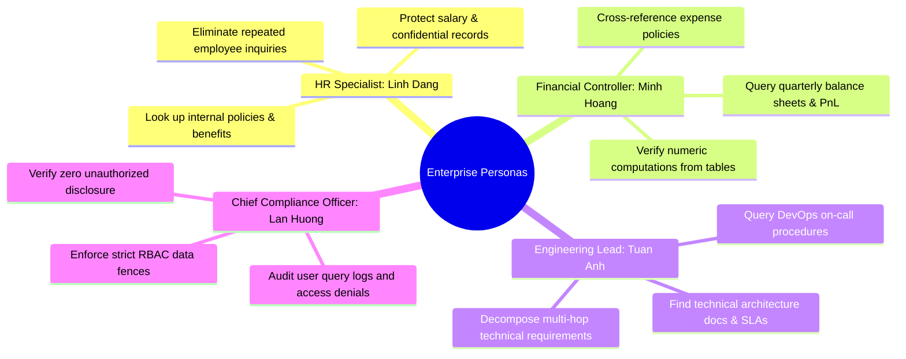

# Non-Technical & Business Requirements Document

## Project: Enterprise Knowledge Agent – Permission-Aware Advanced RAG Platform
**Document Version:** 2.0.0  
**Target Audience:** Product Managers, Enterprise Stakeholders, UX Designers, Security Auditors, Compliance Officers  
**Status:** Approved  

---

## Table of Contents
1. [Business Context, Vision & Value Proposition](#1-business-context-vision--value-proposition)
2. [Target Personas & Enterprise User Scenarios](#2-target-personas--enterprise-user-scenarios)
3. [The 30 Non-Technical & Operational Requirements (NFR-01 to NFR-30)](#3-the-30-non-technical--operational-requirements-nfr-01-to-nfr-30)
   - [3.1. Functional Usability (NFR-01 – NFR-06)](#31-functional-usability)
   - [3.2. Performance & Reliability (NFR-07 – NFR-12)](#32-performance--reliability)
   - [3.3. Security & Privacy (NFR-13 – NFR-18)](#33-security--privacy)
   - [3.4. Scalability & Maintainability (NFR-19 – NFR-24)](#34-scalability--maintainability)
   - [3.5. Business & Operational Requirements (NFR-25 – NFR-30)](#35-business--operational-requirements)
4. [Enterprise User Experience & Interaction Standards](#4-enterprise-user-experience--interaction-standards)
5. [Data Privacy, Governance & Ethical AI Guardrails](#5-data-privacy-governance--ethical-ai-guardrails)
6. [Operational Readiness, KPIs & Acceptance Criteria](#6-operational-readiness-kpis--acceptance-criteria)

---

## 1. Business Context, Vision & Value Proposition

### 1.1. The Enterprise Knowledge Challenge
Modern enterprises generate massive volumes of unstructured knowledge across decentralized repositories—PDF manuals, policy handbooks, financial spreadsheets, technical specifications, and legal contracts. Traditional keyword search tools (e.g., standard intranet search) suffer from:
- **Low Recall & Semantic Inflexibility:** Inability to understand synonymy, intent, or context.
- **High Hallucination Risk in Generic AI:** Public LLMs lack corporate knowledge grounding and fabricate facts.
- **Critical Security Blindspots:** Off-the-shelf RAG tools ignore organizational access control, leaking confidential HR or executive data to unauthorized employees.
- **Opaque Answers Without Proof:** Answers without verifiable line-level citations cannot be trusted for mission-critical business decisions.

### 1.2. Strategic Product Vision
**Enterprise Knowledge Agent** delivers a private, permission-aware conversational intelligence layer across corporate data. It guarantees:
- **Absolute Grounding:** Answers are 100% verifiable with direct deep-links to source pages, headings, and spreadsheet cells.
- **Zero-Trust Access Isolation:** Role-Based Access Control (RBAC) and department-level policies are enforced at retrieval time.
- **Complex Analytical Reasoning:** Solves multi-document and multi-hop queries that require synthesizing facts across department boundaries.
- **Continuous Quality Governance:** Automated metrics evaluate faithfulness, relevancy, and hallucination risk in real-time.
- **Open-Domain Internet Search Fallback:** For employee inquiries outside internal enterprise documentation, the agent leverages live web search to answer questions while strictly separating web sources from internal confidential documents.

---

## 2. Target Personas & Enterprise User Scenarios



### Detailed Persona Matrix:

| Persona & Role | Key Workflow Objectives | Critical Pain Points & Fears | System Value Realization |
| :--- | :--- | :--- | :--- |
| **Linh Dang**<br>Senior HR Specialist | Rapidly answer staff inquiries regarding leave, insurance, and onboarding procedures. | Fear of leaking executive compensation data; tired of answering identical handbook questions daily. | Automatic retrieval of public HR rules; strict RBAC fences block sensitive salary documents from regular staff queries. |
| **Minh Hoang**<br>Financial Analyst | Compare quarterly expenses across departments; audit invoices against procurement contracts. | Excel spreadsheets have complex tabular layouts; generic AI hallucinates financial metrics. | Table-aware chunking preserves sheet/row coordinates; cross-checking extracts exact numeric data with cell citations. |
| **Tuan Anh**<br>Lead DevOps Engineer | Quickly retrieve incident runbooks, architecture diagrams, and on-call escalation policies. | Information is scattered across 50+ PDF manuals; needs multi-hop synthesis across systems. | Multi-hop agentic RAG plans iterative search across Engineering and Infrastructure documentation. |
| **Lan Huong**<br>Chief Compliance Officer | Verify company compliance with internal regulations, GDPR, and data localization laws. | Fear of enterprise data being used to train third-party public models; lack of audit trail. | Complete audit logging of all queries; zero data retention for external model training; zero-trust access control. |

---

## 3. The 30 Non-Technical & Operational Requirements (NFR-01 to NFR-30)

### 3.1. Functional Usability

| ID | Requirement Name | Description & Enterprise Expectation |
| :--- | :--- | :--- |
| **NFR-01** | **User-friendly UI** | The conversational and document management interface must be intuitive, requiring zero technical or prompt engineering expertise from non-technical staff. |
| **NFR-02** | **Document Management** | Administrators and department leads can upload, categorize, inspect, replace, and delete documents through a clean visual web portal. |
| **NFR-03** | **Conversational Interface** | Support conversational queries in natural English and Vietnamese, supporting multi-turn dialogue with automated coreference resolution across 5 distinct intent tasks. |
| **NFR-03b**| **Internet Web Search** | When user requests fall outside internal enterprise documents (`OUT_OF_DOMAIN`), the agent is authorized to retrieve real-time information via secure web search engines, strictly preventing internal enterprise context leaks. |
| **NFR-04** | **Source Transparency** | Every generated answer must include interactive citation badges: internal badges `[1]`, `[2]` linking directly to document coordinates, or external badges `[Web 1]` with URLs and an explicit out-of-domain disclaimer. |
| **NFR-05** | **Feedback System** | Provide one-click user feedback mechanisms (Thumbs Up / Down) with structured error tags (e.g., "Outdated info", "Incorrect citation", "Incomplete"). |
| **NFR-06** | **Conversation History** | Automatically archive, title, and index chat sessions for historical review, searchable by date and subject matter. |

### 3.2. Performance & Reliability

> *Note: These performance targets represent baseline design SLAs for standard production enterprise deployment.*

| ID | Requirement Name | Target Metric / SLA | Measurement Condition |
| :--- | :--- | :--- | :--- |
| **NFR-07** | **Document Upload** | Support file sizes up to **50 MB** per document | Covers 99% of corporate PDF reports, handbooks, and large XLSX workbooks. |
| **NFR-08** | **Retrieval Latency** | $P_{95} \le \mathbf{1.5\text{ seconds}}$ | Hybrid Search (Dense + BM25) + Reranking over a collection of 500,000 chunks. |
| **NFR-09** | **Answer Latency** | $P_{95} \le \mathbf{10.0\text{ seconds}}$ | Single-hop RAG queries using streaming generation (Time-to-First-Token $\le 1.8\text{s}$). |
| **NFR-10** | **System Availability** | **99.5% Monthly Uptime** | Maximum unplanned downtime $\le 3.6$ hours per calendar month; multi-AZ redundancy. |
| **NFR-11** | **Concurrent Users** | Support $\ge \mathbf{50\text{ active concurrent sessions}}$ | Sustained query load without queue timeouts or memory exhaustion. |
| **NFR-12** | **Data Integrity** | **Zero Data Corruption / Loss** | Ingestion failures must be atomic; interrupted uploads auto-rollback cleanly. |

### 3.3. Security & Privacy

| ID | Requirement Name | Description & Enterprise Expectation |
| :--- | :--- | :--- |
| **NFR-13** | **Data Confidentiality** | Corporate documents and extracted text must remain strictly confidential within the enterprise tenant boundary; zero egress to unauthorized external APIs. |
| **NFR-14** | **Access Isolation** | Absolute mathematical guarantee that a user cannot retrieve or be informed about information from documents outside their authorized role and department. |
| **NFR-15** | **Data Encryption** | All data must be encrypted using industry standards: TLS 1.3 in-transit and AES-256 at-rest (for PostgreSQL, Qdrant vectors, and S3 objects). |
| **NFR-16** | **Auditability** | Maintain immutable audit logs tracking user identity, role, timestamp, prompt text, returned chunk IDs, and access grant/denial decisions for 365 days. |
| **NFR-17** | **Data Retention** | Support configurable data retention and automated purging policies; comply with "Right to be Forgotten" by deleting documents and associated vectors. |
| **NFR-18** | **Compliance** | Built to satisfy ISO 27001, SOC 2 Type II, and GDPR standards regarding data sovereignty, access governance, and privacy. |

### 3.4. Scalability & Maintainability

| ID | Requirement Name | Description & Enterprise Expectation |
| :--- | :--- | :--- |
| **NFR-19** | **Scalability** | Horizontally scalable architecture capable of scaling from 10,000 to 5,000,000 chunks and supporting multi-department expansion without redesign. |
| **NFR-20** | **Modularity** | Ingestion, embedding, hybrid retrieval, agentic reasoning, and generation modules are decoupled via clear programmatic interfaces and REST/gRPC contracts. |
| **NFR-21** | **Model Agnostic** | The platform can interchange LLMs (OpenAI, Anthropic, local vLLM) and embedding models without refactoring retrieval logic or database schema. |
| **NFR-22** | **Maintainability** | Clean codebase adhering to PEP 8 / TypeScript ESLint standards, $\ge 80\%$ automated unit test coverage, and comprehensive API documentation. |
| **NFR-23** | **Extensibility** | Pluggable architecture allowing seamless addition of new file parsers (e.g., Markdown, PPTX, HTML) and retrieval strategies (e.g., ColBERT). |
| **NFR-24** | **Observability** | Centralized telemetry monitoring query traces, component latencies, token consumption, and hallucination alerts via OpenTelemetry/Langfuse. |

### 3.5. Business & Operational Requirements

| ID | Requirement Name | Description & Enterprise Expectation |
| :--- | :--- | :--- |
| **NFR-25** | **Multi-Tenancy** | Support logical and physical isolation across multiple corporate subsidiaries, business units, or enterprise client tenants. |
| **NFR-26** | **Workspace Management** | Department leads can configure localized workspaces, ingest department-specific document collections, and invite authorized staff. |
| **NFR-27** | **Admin Dashboard** | Central administrative portal to manage users, assign RBAC permissions, monitor ingest queues, and view system health metrics. |
| **NFR-28** | **Usage Analytics** | Detailed dashboards tracking query frequency, peak usage hours, top-asked topics, unanswerable questions, and user adoption rates. |
| **NFR-29** | **Cost Efficiency** | Optimize token usage via smart chunk selection, query caching in Redis, and prompt minification to minimize commercial model API expenses. |
| **NFR-30** | **Human Feedback** | Curated workflow allowing domain experts (e.g., HR Managers, Legal Counsel) to review flagged answers and promote vetted ground-truth responses. |

---

## 4. Enterprise User Experience & Interaction Standards

### 4.1. Three-Panel Responsive Workstation Layout

```
+---------------------------------------------------------------------------------------------------------+
|  Enterprise Knowledge Agent           [Search Documents / Actions ⌘K]              [Dashboard] [Linh D.]|
+--------------------------+-------------------------------------------------+----------------------------+
| WORKSPACE & DEPARTMENTS  | VERIFIABLE CONVERSATION CONSOLE                 | CITATION & EVIDENCE VIEWER |
|                          |                                                 |                            |
| 📁 Human Resources       | 👤 Linh Dang:                                   | 📄 HR_Policy_2026.pdf      |
|   ├── 📄 HR_Policy.pdf   | "Nhân viên mới được hưởng bao nhiêu ngày phép?" |                            |
|   └── 📊 Benefits.xlsx   |                                                 | [Page 12 · Section 3.2]    |
|                          | 🤖 Knowledge Agent:                             |                            |
| 📁 Engineering (Shared)  | "Theo chính sách nhân sự công ty, nhân viên     | "3.2 Annual Leave Policy:  |
|   ├── 📄 Guidelines.docx | chính thức được hưởng 12 ngày phép năm [1]. Đối | Regular employees receive  |
|   └── 📝 OnCall_SLA.pdf  | với nhân viên mới gia nhập trong năm, số ngày   | 12 days paid annual leave. |
|                          | phép được tính theo tỷ lệ số tháng làm việc [2]."| For new employees joining  |
|                          |                                                 | mid-year, leave is accrued |
|                          | [1] HR_Policy_2026.pdf (p.12, Sec 3.2)          | pro-rata per month..."     |
|                          | [2] Onboarding_FAQ_2026.docx (Sec 1.4)          |                            |
|                          |                                                 | [Download Original PDF]    |
|                          | [👍 Helpful] [👎 Report Issue]                  | [Open in Split View]       |
+--------------------------+-------------------------------------------------+----------------------------+
| Tenant: Enterprise_VN    | Latency: 1.42s | Tokens: 384                    | RBAC: HR_SPECIALIST (Valid)|
+---------------------------------------------------------------------------------------------------------+
```

### 4.2. Usability & Interaction Principles
1. **Zero Guesswork / Explicit Provenance:** When an answer is provided, clicking citation badge `[1]` instantly opens the right panel with the exact source document previewed at the highlighted page and paragraph.
2. **Graceful Failure & Honest Abstention:** If a question cannot be answered from available documents, the system explicitly states what is missing rather than generating generic, ungrounded filler.
3. **Inclusive Accessibility:** Full keyboard navigation support (shortcuts `⌘K` for search, `Enter` to submit, `Esc` to close modal), high-contrast theme compliant with WCAG 2.1 AA standards.

---

## 5. Data Privacy, Governance & Ethical AI Guardrails

1. **Zero External Model Training Guarantee:**
   Customer contracts must state explicitly: *Enterprise documents, queries, and vector representations will never be stored or used by third-party model providers for foundation model training or telemetry harvesting.*
2. **Strict Right to Erasure (GDPR Art. 17):**
   When a document is marked for deletion:
   - The original binary file in S3 is purged.
   - Associated relational metadata in PostgreSQL is deleted.
   - All corresponding vector points in Qdrant are removed by payload filter (`document_id`).
   - Cached embedding representations in Redis are invalidated.
3. **Tamper-Evident Audit Logging:**
   Audit logs are appended to an immutable database partition. Even system administrators cannot alter historical access and query log records.

---

## 6. Operational Readiness, KPIs & Acceptance Criteria

### 6.1. Product Key Performance Indicators (KPIs)
- **User Answer Trust Rate:** $\ge 92\%$ of verified employee users rate provided answers as accurate and helpful.
- **Support Ticket Deflection:** $\ge 50\%$ reduction in tier-1 routine internal HR and IT support inquiries within 90 days of deployment.
- **Zero RBAC Breach Incidents:** $0$ verified security incidents where an unauthorized user retrieved confidential cross-department data.

### 6.2. Acceptance Sign-off Matrix
Prior to production sign-off, the deployment must pass validation across all 30 NFRs and achieve green status on the benchmark suite outlined in the [Evaluation & Benchmark Document](file:///home/mercury/AgentGraph/docs/specifications/evaluation_and_benchmark.md).
