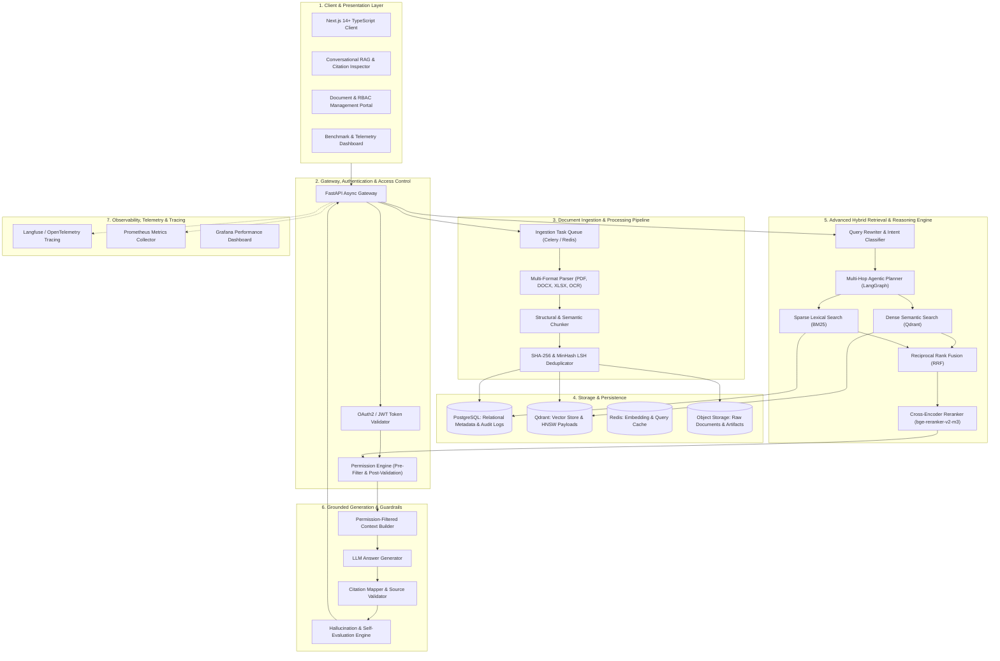
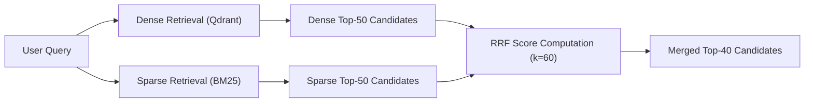
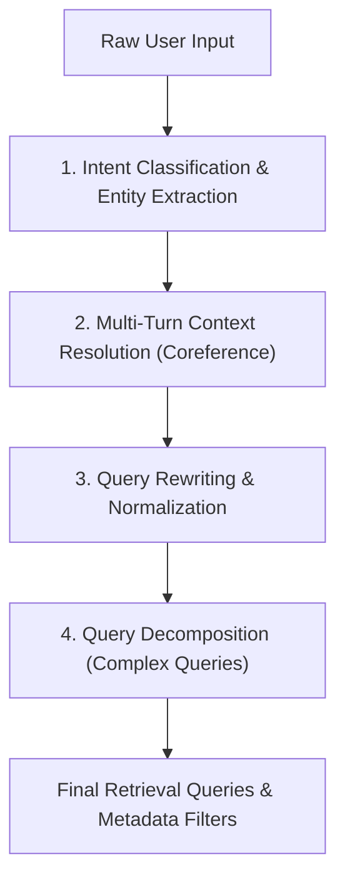
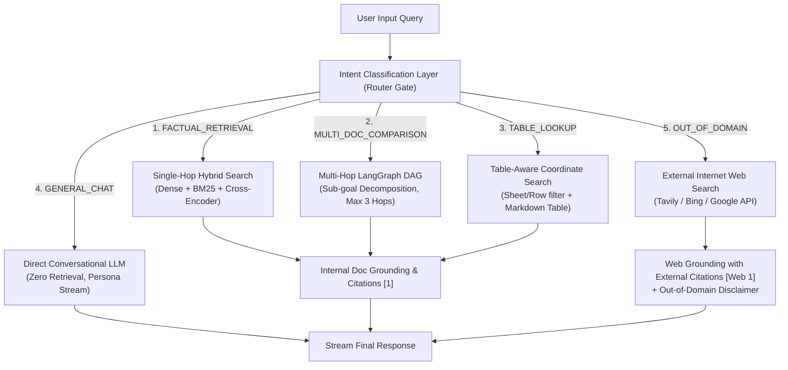
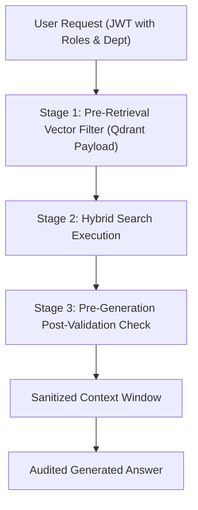

# Technical Requirements Document (TRD)

## Project: Enterprise Knowledge Agent – Permission-Aware Advanced RAG Platform
**Document Version:** 2.0.0  
**Target Environment:** Production Enterprise Infrastructure  
**Status:** Architecture Approved  

---

## Table of Contents
1. [System Architecture & High-Level Design](#1-system-architecture--high-level-design)
2. [Module 1: Document Ingestion & Processing](#2-module-1-document-ingestion--processing)
3. [Module 2: Embedding & Vector Database](#3-module-2-embedding--vector-database)
4. [Module 3: Hybrid Search & Rank Fusion](#4-module-3-hybrid-search--rank-fusion)
5. [Module 4: Query Understanding & Query Rewriting](#5-module-4-query-understanding--query-rewriting)
6. [Module 5: Cross-Encoder Reranking](#6-module-5-cross-encoder-reranking)
7. [Module 6: Multi-Hop Retrieval & Agentic RAG](#7-module-6-multi-hop-retrieval--agentic-rag)
8. [Module 7: Grounded Answer Generation & Verifiable Citation](#8-module-7-grounded-answer-generation--verifiable-citation)
9. [Module 8: Permission-Aware Retrieval & Enterprise Security](#9-module-8-permission-aware-retrieval--enterprise-security)
10. [Module 9: Hallucination Detection & Self-Evaluation](#10-module-9-hallucination-detection--self-evaluation)
11. [Module 10: Backend, Infrastructure & Observability](#11-module-10-backend-infrastructure--observability)
12. [API Specifications & Data Contracts](#12-api-specifications--data-contracts)

---

## 1. System Architecture & High-Level Design

The Enterprise Knowledge Agent is engineered as a decoupled, microservice-friendly platform that guarantees **end-to-end data provenance**, **strict permission isolation**, and **quantifiable generation accuracy**.



---

## 2. Module 1: Document Ingestion & Processing

### 2.1. Core Capabilities & Supported Formats
The ingestion pipeline processes unstructured and semi-structured corporate files, transforming them into chunked, attributed vectors while maintaining absolute lineage back to the source file.

| Document Format | Ingestion Engine / Library | Technical Extraction Specification |
| :--- | :--- | :--- |
| **PDF (Native)** | `pypdf`, `pdfplumber`, `PyMuPDF` | Extract raw text, document catalog, page boundaries, font size hierarchy (H1, H2, H3), and embedded tables. |
| **PDF (Scanned/Images)** | `Tesseract OCR`, `RapidOCR` | Detect image-only pages, apply image binarization and skew-correction, execute OCR with bounding box coordinates per line. |
| **DOCX** | `python-docx` | Parse OpenXML DOM: hierarchical headings (`Heading 1-6`), bullet lists, standard paragraphs, table cells, and footnotes. |
| **XLSX / CSV** | `openpyxl`, `pandas` | Extract individual sheets, headers, row/column indices, cell formulas vs. calculated values, and convert tabular data into markdown/JSON semantic records. |

### 2.2. Metadata Extraction Schema
Every ingested document produces a parent record in PostgreSQL with strict metadata attribution:
```json
{
  "document_id": "doc_9b1deb4d-3b7d-4bad-9bdd-2b0d7b3dcb6d",
  "filename": "HR_Policy_2026.pdf",
  "file_hash_sha256": "e3b0c44298fc1c149afbf4c8996fb92427ae41e4649b934ca495991b7852b855",
  "file_size_bytes": 4194304,
  "mime_type": "application/pdf",
  "author": "People Operations Directorate",
  "department": "Human Resources",
  "classification_level": "RESTRICTED",
  "allowed_roles": ["HR", "HR_ADMIN", "EXECUTIVE"],
  "allowed_users": [],
  "allowed_departments": ["Human Resources", "Executive Committee"],
  "created_at": "2026-01-15T08:30:00Z",
  "updated_at": "2026-02-01T10:15:00Z",
  "total_pages": 48,
  "chunk_count": 182
}
```

### 2.3. Chunking Strategies
The system implements three distinct chunking algorithms, configured per document type:
1. **Fixed-Size Chunking with Sliding Window:**
   - Window size: 512 tokens. Overlap: 64 tokens (~12.5%). Used for dense, continuous narrative texts.
2. **Recursive Structural Chunking:**
   - Hierarchy separators: `["\n\n# ", "\n\n## ", "\n\n### ", "\n\n", "\n", ". "]`.
   - Maintains document outline integrity, ensuring headers remain prepended to child sections.
3. **Semantic / Table-Aware Chunking:**
   - For XLSX and DOCX tables: Rows are serialized as standalone markdown tables or key-value tuples prepended with the sheet name and column schema.
   - Threshold-based embedding difference: Splits text when semantic cosine similarity between adjacent sentences drops below a parameterized threshold ($\tau = 0.75$).

### 2.4. Traceability & Lineage Guarantee
Every chunk must store precise locator coordinates in Qdrant payload:
```json
{
  "chunk_id": "chk_c01a88b2-54a2-4a7b-a1e4-3983e2001a11",
  "document_id": "doc_9b1deb4d-3b7d-4bad-9bdd-2b0d7b3dcb6d",
  "chunk_index": 8,
  "source_location": {
    "page_number": 12,
    "section_heading": "3.2 Annual Leave Allowances",
    "sheet_name": null,
    "row_range": null,
    "character_start": 14200,
    "character_end": 15820
  },
  "content": "According to the corporate HR policy, regular employees are entitled to 12 days of annual paid leave...",
  "acl": {
    "departments": ["Human Resources", "Executive Committee"],
    "roles": ["HR", "HR_ADMIN", "EXECUTIVE"],
    "tenant_id": "tenant_enterprise_vn"
  }
}
```

### 2.5. Deduplication & Incremental Ingestion
- **Document Level Deduplication:** Compares SHA-256 file hashes before parsing. Identical files are instantly referenced without re-embedding.
- **Content Level Deduplication:** MinHash with Locality-Sensitive Hashing (LSH) detects near-duplicate chunks across different document revisions (Jaccard similarity $> 0.92$).
- **Incremental Updates:** Document replacement triggers soft deletion and targeted vector deletion via Qdrant's `delete_points(filter)` without rebuilding the collection.

---

## 3. Module 2: Embedding & Vector Database

### 3.1. Embedding Engine Specifications
- **Model Agnostic Abstraction:** An internal `EmbeddingProvider` interface decouples vector operations from vendor-specific libraries.
- **Supported High-Performance Multilingual Models:**
  - `BAAI/bge-m3`: 1024 dimensions, native multilingual support (100+ languages), 8192 token context window.
  - `intfloat/multilingual-e5-large`: 1024 dimensions, high cross-lingual retrieval accuracy.
  - `Qwen/Qwen3-Embedding`: Modern multilingual embedding with state-of-the-art token efficiency.
- **Batch Processing:** Dynamic batching with worker queue, batch size 64-128 vectors with GPU acceleration (CUDA / TensorRT).
- **Embedding Cache:** Redis cache keyed by `sha256(model_version + ":" + text_content)`. Cache TTL: 30 days.

### 3.2. Qdrant Vector Database Configuration
- **Collection Setup:**
  - Distance Metric: `Cosine`.
  - Vectors: 1024 dimensions (or model-native dimensions).
- **HNSW Index Parameters:**
  - `m = 16`: Number of bi-directional links per node.
  - `ef_construct = 128`: Exploration depth during index construction.
  - `ef = 64`: Query exploration depth for sub-millisecond retrieval.
- **Payload Indexing:** Immediate payload schema indexes on:
  - `acl.departments` (keyword)
  - `acl.roles` (keyword)
  - `acl.tenant_id` (keyword)
  - `document_id` (keyword)
  - `source_location.page_number` (integer)

---

## 4. Module 3: Hybrid Search & Rank Fusion

### 4.1. Dual-Path Retrieval Mechanism
To eliminate semantic blindspots and exact keyword misses, the engine runs parallel retrieval branches:
1. **Dense Retrieval (Semantic Similarity):**
   - Query embedded through the active `EmbeddingProvider`.
   - Qdrant nearest neighbor search with HNSW index and RBAC pre-filters.
2. **Sparse Retrieval (Exact Keyword / BM25):**
   - Tokenized keyword search executed against PostgreSQL Full-Text Search (or integrated Qdrant sparse vectors).
   - Accurately captures SKU codes, project acronyms, contract numbers, employee IDs, and technical terms.

### 4.2. Reciprocal Rank Fusion (RRF) Formulation
Candidate lists from dense retrieval ($D$) and sparse retrieval ($S$) are merged using the RRF algorithm:

$$RRF\_Score(d) = \sum_{m \in \{Dense, Sparse\}} \frac{w_m}{k + rank_m(d)}$$

Where:
- $k = 60$ (constant factor smoothing rank bias).
- $rank_m(d)$ is the 1-based ordinal rank of document $d$ in retrieval method $m$.
- $w_{Dense} \in [0.0, 1.0]$ and $w_{Sparse} \in [0.0, 1.0]$ are configurable branch weights (default: $w_{Dense}=0.7$, $w_{Sparse}=0.3$).



---

## 5. Module 4: Query Understanding & Query Rewriting

Before hitting retrieval indexes, the incoming user question passes through the Query Processing Pipeline to resolve ambiguity, expand domain terminology, and extract structured filters.



### 5.1. Pipeline Steps
1. **Query Normalization:** Strip extraneous whitespace, standardize punctuation, normalize Vietnamese diacritics and unicode fonts.
2. **Intent Classification & Task Routing:** Classify input into one of 5 distinct task categories (`FACTUAL_RETRIEVAL`, `MULTI_DOC_COMPARISON`, `TABLE_LOOKUP`, `GENERAL_CHAT`, or `OUT_OF_DOMAIN`) to dictate retrieval depth and data sources.
3. **Entity Extraction:** Detect departments (e.g., "Engineering", "Finance"), document types ("Chính sách", "Hợp đồng"), dates, and IDs. Extracted entities are translated into structured metadata filters.
4. **Context-Aware Coreference Resolution:** In multi-turn chat, resolve pronouns ("Chính sách đó áp dụng cho ai?" $\to$ "Chính sách nghỉ phép của nhân viên mới áp dụng cho đối tượng nào?").
5. **Query Expansion & Rewriting:** Produce multiple query formulations (synonyms, domain expansions) without injecting hallucinated constraints.
6. **Query Decomposition:** Complex queries are decomposed into atomic, independent sub-questions for multi-hop execution.

### 5.2. Five Core Intent Routing Gates (Task Taxonomy)



| Task / Intent | Query Scope & Definition | Internal RAG Required? | Execution Engine & Data Source | Citation & Grounding Standard |
| :--- | :--- | :--- | :--- | :--- |
| **1. `FACTUAL_RETRIEVAL`** | Specific factual policy, regulation, rule, or employee benefit in internal docs. | **YES** | Single-hop Hybrid Search (Dense `bge-m3` + Sparse BM25 + Reranker `bge-reranker-v2-m3`). | Internal citations `[1]` with document, page, heading. |
| **2. `MULTI_DOC_COMPARISON`** | Questions comparing, analyzing, or synthesizing across multiple files or departments. | **YES** | Multi-hop Iterative LangGraph DAG (Max 3 hops, loop prevention, evidence accumulator). | Multi-source line-level citations `[1]`, `[2]`. |
| **3. `TABLE_LOOKUP`** | Numeric matrices, salary brackets, financial balance sheets, structured tables. | **YES** | Table-aware coordinate retrieval (filtering on `sheet_name`, `row_range`, structured chunks). | Cell / Row-level citations with markdown table rendering. |
| **4. `GENERAL_CHAT`** | Polite greetings, acknowledgments, casual conversational pleasantries. | **NO** | Direct LLM streaming generation with conversational persona (bypasses vector DB). | No citations required. |
| **5. `OUT_OF_DOMAIN`** | Questions outside corporate scope, internal handbooks, or workplace docs (e.g., weather, public news, world facts). | **NO (Internal Docs)**<br>**YES (External Web)** | **External Internet Web Search Engine** (Tavily, Bing Search, or Serper API). Bypasses internal database to retrieve live internet information. | External citations `[Web 1]` with source URLs + explicit disclaimer distinguishing internet data from internal corporate records. |

### 5.3. External Internet Web Search Specifications (For Out-of-Domain Tasks)
When a user query is identified as outside enterprise documentation (`OUT_OF_DOMAIN`):
1. **Zero Internal Data Egress:** The external web search query is synthesized strictly from the user's public topic. **No tenant identifiers, internal documents, or user credentials may ever be leaked** into the external search query or payload.
2. **Search Providers:** Configurable via environment variables (`WEB_SEARCH_PROVIDER`: `tavily`, `bing`, `serper`, or `google_search`).
3. **Evidence Synthesis & Disclaimers:**
   - Web search results (Top 3-5 snippets) are ingested into a temporary context window.
   - LLM synthesizes an informative answer citing external hyperlinks: `[Web 1: Domain/Title](url)`.
   - The response **MUST include a standardized disclaimer badge**:
     > 🌐 *Lưu ý: Câu trả lời này được tổng hợp từ nguồn tra cứu Internet công khai do nội dung nằm ngoài phạm vi tài liệu nội bộ của doanh nghiệp.*

---

## 6. Module 5: Cross-Encoder Reranking

### 6.1. Reranking Architecture
While vector search provides high recall, bi-encoders cannot perform deep cross-attention between query and passage tokens. The top $K_1 = 40$ candidates from RRF are fed into a state-of-the-art cross-encoder.

- **Primary Models:** `BAAI/bge-reranker-v2-m3` or `jinaai/jina-reranker-v2-base-multilingual`.
- **Inference Budget:** Max latency $\le 300\text{ms}$ on GPU / $\le 800\text{ms}$ on 8-core CPU.
- **Top-$K_2$ Output:** Reranker outputs the top $K_2 = 5 \text{ to } 8$ highest-scoring chunks with normalized relevance scores $\in [0.0, 1.0]$.
- **Graceful Fallback:** If the reranker service encounters a timeout or OOM, the system falls back directly to the RRF ranked order and issues an observability warning to Langfuse.

---

## 7. Module 6: Multi-Hop Retrieval & Agentic RAG

### 7.1. Complex Reasoning Workflow
When answering complex questions requiring disparate facts across multiple files, the system uses an iterative Agentic RAG graph powered by LangGraph.

```mermaid
sequenceDiagram
    autonumber
    actor User as User
    participant Agent as Agentic Controller
    participant QueryEngine as Query Processor
    participant Retrieval as Hybrid Retrieval & Reranker
    participant Aggregator as Evidence Aggregator
    participant LLM as Generator & Verifier

    User->>Agent: "What allowances are Engineering staff entitled to, and how do they differ from Sales?"
    Agent->>QueryEngine: Decompose query into sub-goals
    QueryEngine-->>Agent: Sub-goal 1: Engineering allowances; Sub-goal 2: Sales allowances
    
    rect rgb(245, 248, 255)
        Note over Agent,Retrieval: Hop 1: Retrieve Engineering Policy
        Agent->>Retrieval: Search "Engineering staff allowance policy"
        Retrieval-->>Agent: Top chunks from HR_Engineering_Manual.pdf
        Agent->>Aggregator: Store Evidence E1
    end

    rect rgb(255, 248, 245)
        Note over Agent,Retrieval: Hop 2: Retrieve Sales Commission & Policy
        Agent->>Retrieval: Search "Sales staff allowance compensation"
        Retrieval-->>Agent: Top chunks from Sales_Comp_Plan_2026.docx
        Agent->>Aggregator: Store Evidence E2
    end

    Agent->>Agent: Check Termination Criteria: Is evidence sufficient? (Yes)
    Agent->>LLM: Synthesize comparative response using E1 + E2
    LLM-->>User: Comparative analysis with inline citations [1], [2]
```

### 7.2. Loop Prevention & Guardrails
- **Max Iterations Limit:** Hard cap of $\text{MaxHops} = 3$ iterations.
- **Query Loop Detection:** Exact match or cosine similarity $> 0.95$ with previous queries in the trajectory terminates the loop.
- **Evidence Sufficiency Evaluator:** An explicit verification step evaluates whether accumulated evidence answers all components of the original query. If unreachable within 3 hops, the agent yields with partial evidence and an explicit abstention note.

---

## 8. Module 7: Grounded Answer Generation & Verifiable Citation

### 8.1. Citation Mapping Standards
Every claim generated by the LLM must be strictly backed by retrieved evidence, formatted with discrete citation markers matching the source chunk.

#### Formal Output Format:
```markdown
Theo quy định về chế độ làm việc của công ty, nhân viên chính thức thuộc khối Kỹ thuật được hưởng phụ cấp dự án on-call là 3.000.000 VNĐ/tháng [1]. Trong khi đó, nhân viên bộ phận Kinh doanh không nhận phụ cấp on-call mà được hưởng phụ cấp di chuyển công tác 2.500.000 VNĐ/tháng kèm theo hoa hồng theo chỉ tiêu doanh số [2].

---
### Nguồn tham khảo:
- [1] **HR_Engineering_Manual_2026.pdf** · Trang 18 · Mục 4.1 (On-call Allowance) · Chunk #14
- [2] **Sales_Comp_Plan_2026.docx** · Phần 2 (Chế độ phụ cấp) · Bảng 1 · Chunk #09
```

### 8.2. Abstention Protocol
When retrieved context is insufficient or conflicting:
- The model **must refuse to speculate**.
- System output: *"Based on the internal documents available under your permissions, there is no official policy regarding [Query Subject]. Please contact [Department Owner] for further clarification."*

---

## 9. Module 8: Permission-Aware Retrieval & Enterprise Security

### 9.1. Zero-Trust Access Model
Corporate RAG systems cannot afford data leaks where unauthorized employees view salary tables or executive memos. Security is enforced at **three independent levels**:



### 9.2. Role-Based & Department Access Matrix
| Enterprise Role | HR Policies | Financial Records | Engineering Docs | Executive Memos |
| :--- | :--- | :--- | :--- | :--- |
| **HR Specialist** | Read / Write | No Access | Read Only | No Access |
| **Finance Analyst**| No Access | Read / Write | No Access | No Access |
| **Software Engineer** | Read Only | No Access | Read / Write | No Access |
| **Executive / Admin**| Full Access | Full Access | Full Access | Full Access |

### 9.3. Technical Implementation
1. **Pre-Retrieval Filtering in Qdrant:**
   Every query to Qdrant contains an obligatory filter block matching user claims:
   ```json
   {
     "filter": {
       "must": [
         {"key": "acl.tenant_id", "match": {"value": "tenant_enterprise_vn"}},
         {
           "should": [
             {"key": "acl.roles", "match": {"any": ["ENGINEERING", "GENERAL_STAFF"]}},
             {"key": "acl.departments", "match": {"value": "Engineering"}},
             {"key": "acl.users", "match": {"value": "usr_tuananh_482"}}
           ]
         }
       ]
     }
   }
   ```
2. **Post-Retrieval Verification:**
   Before chunks enter the LLM context window, an independent security validator inspects every chunk ID against PostgreSQL active permission tables. Any chunk failing validation is purged and logged as an unauthorized retrieval attempt.
3. **Immutable Audit Logs:**
   Every retrieval request records: `timestamp`, `user_id`, `query_text`, `returned_chunk_ids`, `access_decision` (`GRANTED` / `DENIED`), and `client_ip`.

---

## 10. Module 9: Hallucination Detection & Self-Evaluation

To ensure enterprise-grade reliability, the system runs an automated post-generation verification barrier before delivering the answer to the user.

### 10.1. Evaluation Dimensions & Metrics
| Metric | Formal Definition | Target SLA |
| :--- | :--- | :--- |
| **Faithfulness** | Ratio of statements in the answer that can be logically inferred from retrieved context. | $\ge 0.90$ |
| **Answer Relevancy** | Semantic similarity and intent alignment between user question and final answer. | $\ge 0.85$ |
| **Context Precision** | Proportion of retrieved chunks that are genuinely relevant to answering the question. | $\ge 0.80$ |
| **Context Recall** | Extent to which all facts needed to answer the question were successfully retrieved. | $\ge 0.85$ |
| **Citation Accuracy** | Verification that inline markers `[x]` point to text containing the exact cited claim. | $\ge 0.95$ |
| **Answer Correctness** | Factual accuracy measured against curated enterprise ground-truth datasets. | $\ge 0.80$ |

### 10.2. Multi-Tier Verification Mechanism
1. **Claim Extraction:** The answer is split into individual factual assertions.
2. **NLI Verification (Natural Language Inference):** Each claim is evaluated against cited chunks using a cross-encoder NLI model classifying: `ENTAILMENT`, `NEUTRAL`, or `CONTRADICTION`.
3. **Automated Self-Correction:**
   - If a claim receives `CONTRADICTION`, the response is immediately sent for regeneration with explicit instructions to remove the ungrounded claim.
   - If regeneration fails twice, the system outputs an abstention message rather than risking hallucination.

---

## 11. Module 10: Backend, Infrastructure & Observability

### 11.1. Core Tech Stack Specifications
- **Application Backend:** Python 3.11+, FastAPI (high-throughput async endpoints, Pydantic v2 data models).
- **Frontend Application:** Next.js 14+ (App Router), TypeScript, Tailwind CSS, Monaco Editor / PDF Viewer.
- **Relational Storage:** PostgreSQL 16+ (Metadata, user accounts, sessions, audit trails, and document catalogs).
- **Vector Database:** Qdrant v1.8+ (High-performance HNSW index, distributed payload filtering).
- **Asynchronous Task Queue:** Celery with Redis broker (handles document OCR, heavy parsing, batch embedding).
- **Authentication & Secrets:** JWT (RS256 signed), OAuth2 (SSO Google / Microsoft Azure AD).
- **Containerization & Deployment:** Docker, Docker Compose, Kubernetes manifests, Helm charts for AWS EKS / GCP GKE.

### 11.2. Observability & Tracing Architecture
- **Langfuse Integration:** End-to-end trace capture for every pipeline step: query rewriting $\to$ dense/sparse search $\to$ RRF scores $\to$ reranker output $\to$ LLM generation tokens $\to$ latency breakdown.
- **Prometheus Metrics:**
  - `rag_query_latency_seconds` (Histogram by step)
  - `rag_token_usage_total` (Counter: prompt vs completion)
  - `rag_hallucination_refusal_total` (Counter)
  - `rag_rbac_denial_total` (Counter)
- **Grafana Dashboard:** Visual panels for query volume, P50/P95/P99 latencies, cache hit rates, and LLM spending.

---

## 12. API Specifications & Data Contracts

### 12.1. Conversational Query Endpoint
`POST /api/v1/chat/query`

#### Request Payload:
```json
{
  "session_id": "ses_7f2b1d3e-4a6c-4e8a-8d1e-9c2b3a4f5e6d",
  "query": "Chính sách phụ cấp kỹ thuật cho nhân viên Engineering mới như thế nào?",
  "temperature": 0.1,
  "enable_multi_hop": true,
  "top_k": 5
}
```

#### Response Payload:
```json
{
  "query_id": "qry_8a9b0c1d-2e3f-4a5b-6c7d-8e9f0a1b2c3d",
  "answer": "Theo Chính sách Kỹ thuật 2026, nhân viên Engineering mới được hưởng phụ cấp thiết bị làm việc 5.000.000 VNĐ trong tháng đầu tiên và phụ cấp on-call sau khi hoàn thành thời gian thử việc [1].",
  "citations": [
    {
      "marker": 1,
      "document_id": "doc_9b1deb4d-3b7d-4bad-9bdd-2b0d7b3dcb6d",
      "document_name": "Engineering_Onboarding_Policy_2026.pdf",
      "page_number": 8,
      "section": "2.4 Technical Allowances",
      "chunk_id": "chk_c01a88b2-54a2-4a7b-a1e4-3983e2001a11",
      "relevance_score": 0.942
    }
  ],
  "retrieval_stats": {
    "dense_candidates": 50,
    "sparse_candidates": 50,
    "reranked_top_k": 5,
    "hops_taken": 1,
    "latency_breakdown_ms": {
      "query_rewrite": 120,
      "hybrid_search": 85,
      "rerank": 180,
      "generation": 1250,
      "verification": 150,
      "total": 1785
    }
  },
  "hallucination_check": {
    "is_grounded": true,
    "faithfulness_score": 0.96
  }
}
```
